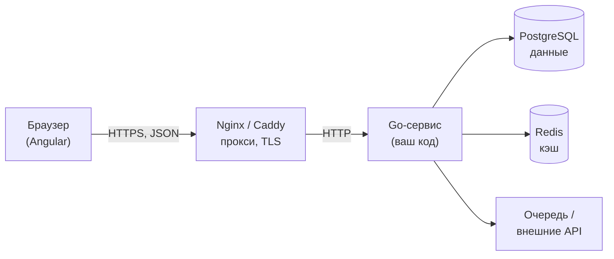
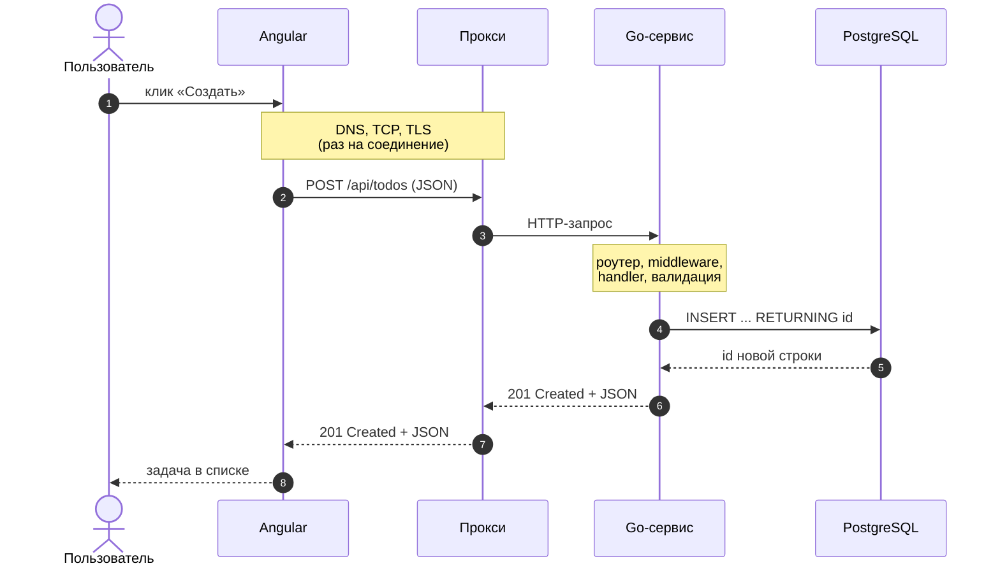

# Глава 0. Как устроен бэкенд и что нужно поставить

**Цели главы:** понять, что именно делает бэкенд и чем это отличается от фронтенда; поставить инструменты; научиться «разговаривать» с сервером руками через `curl`.

⏱ ~1 неделя · предыдущая: [README](README.md) · следующая: [Глава 1](01-osnovy-go.md)

---

## 0.1. Что делает бэкенд

Вы, как Angular-разработчик, знаете путь «до края»: компонент вызывает `HttpClient.get('/api/todos')`, и дальше что-то отвечает JSON. Теперь вы будете этим «что-то».



**Жизненный цикл одного запроса** (запомните этот список — вся книга про его части):

1. Браузер резолвит DNS-имя в IP-адрес.
2. Устанавливается TCP-соединение, поверх него — TLS (HTTPS).
3. Браузер отправляет **HTTP-запрос**: метод, путь, заголовки, тело.
4. Reverse proxy (Nginx/Caddy) принимает его и передаёт вашему процессу.
5. Go-сервер **маршрутизирует** запрос на нужный обработчик.
6. **Middleware**: логирование, проверка авторизации, лимиты.
7. **Обработчик** разбирает вход, **валидирует** его, вызывает бизнес-логику.
8. Бизнес-логика ходит в **БД** (иногда в кэш или другие сервисы).
9. Формируется HTTP-ответ: статус, заголовки, тело (JSON).
10. Ответ идёт обратно по той же цепочке.

Тот же путь по времени — для запроса «создать задачу»:



<!-- viz:RequestLifecycle -->

**За что отвечает бэкенд:**

| Зона ответственности | Пример |
|---|---|
| Бизнес-логика | «Нельзя оформить заказ, если товара нет на складе» |
| Хранение данных | Таблицы, транзакции, бэкапы, миграции схем |
| Авторизация и безопасность | «Пользователь видит только свои заказы» |
| Валидация | Клиенту верить нельзя: проверки на фронте — только UX |
| Интеграции | Платёжка, почта, сторонние API |
| Фоновые задачи | Отправка писем, отчёты, очистка данных |
| Надёжность и скорость | Таймауты, ретраи, кэши, масштабирование |

## 0.2. Смена мышления: фронтенд → бэкенд

| На фронтенде | На бэкенде |
|---|---|
| Один пользователь на одну вкладку | Тысячи одновременных пользователей на одном процессе → **конкурентность** и гонки данных |
| Состояние живёт в памяти вкладки | Состояние живёт в **БД**; процесс можно убить в любой момент — данные должны остаться |
| Баг — сломанная страница, F5 исправит | Баг — потерянные данные, двойное списание денег, утечка паролей |
| Сломалось у одного юзера | Сломалось у всех сразу, и вас будят ночью |
| DevTools, Redux DevTools | Логи, метрики, трейсы (глава 15) |
| Данные приходят «правильные» | **Любой вход — враждебный**, пока не доказано обратное |
| Сеть иногда лагает | Сбои — норма: таймауты, ретраи, частичные отказы |
| Деплой = выложить статику | Деплой = обновить работающий сервис, не потеряв запросы и не сломав схему БД |

Три фразы, которые стоит выучить сразу:

- **«Никогда не доверяй клиенту.»** Кнопка заблокирована в Angular? Хакер всё равно пришлёт запрос через `curl`.
- **«Данные важнее кода.»** Код можно откатить, потерянные данные — нет.
- **«Всё, что может сломаться, сломается.»** Проектируйте так, чтобы сбой одной части не уронил остальное.

## 0.3. Почему именно Go

**Плюсы:**

- **Простой язык.** Всего 25 ключевых слов; спецификацию можно прочесть за вечер. Код чужих проектов читается легко — стиль один на всех (`gofmt`).
- **Статическая типизация + быстрая компиляция.** Ошибки ловятся до запуска, сборка занимает секунды.
- **Один бинарник.** `go build` даёт самодостаточный файл без рантайма — идеален для Docker (образ в 10–20 МБ).
- **Конкурентность из коробки.** Горутины и каналы встроены в язык; сервер на 10 000 одновременных соединений — рядовая задача.
- **Богатая стандартная библиотека.** `net/http`, `encoding/json`, `database/sql`, `crypto`, `testing` — продакшен-качество без зависимостей.
- **Экосистема облачной инфраструктуры.** Docker, Kubernetes, Terraform, Prometheus, etcd, CockroachDB написаны на Go. Нужен спрос на рынке — Go-бэкенд востребован.

**Минусы (честно):**

- Обработка ошибок многословна: `if err != nil { return err }` будет везде.
- Нет исключений, наследования, перегрузки, «магии» — сначала непривычно, потом это становится плюсом.
- Дженерики появились поздно (1.18) и намеренно ограничены.
- Нет такого количества «батареек», как у Java/Spring или Node/NestJS: многое собираете из маленьких библиотек сами.

## 0.4. Установка инструментов

### Go

1. Скачайте установщик с [go.dev/dl](https://go.dev/dl) (Windows: `.msi`; macOS: `.pkg`; Linux: tar.gz).
2. Откройте **новый** терминал и проверьте:

```bash
go version
go env GOPATH GOROOT
```

### Редактор

- **VS Code** + расширение **Go** (от команды Go): поставит `gopls` (language server), включит автоформатирование при сохранении (`"editor.formatOnSave": true`) и запуск тестов кнопками.
- Альтернатива: **GoLand** (JetBrains, платный, очень сильный рефакторинг).

### Остальное

| Инструмент | Зачем | Проверка |
|---|---|---|
| **Git** | версии кода | `git --version` |
| **Docker Desktop** | контейнеры (глава 9) | `docker run hello-world` |
| **psql** или **DBeaver** / pgAdmin | работа с PostgreSQL (глава 7) | `psql --version` |
| **curl** | HTTP из терминала | `curl --version` (в Windows — `curl.exe`) |
| **Bruno** / Postman / httpie | GUI для запросов | по желанию |
| **WSL2** (Windows) | настоящий Linux — серверы живут там | `wsl --install` |

> 💡 **Windows-заметка.** Детектор гонок `go test -race` требует cgo, а значит C-компилятор (gcc). Проще всего: запускать тесты в Linux — через WSL2 или через Docker (команда будет в главе 5). Остальное в учебнике работает на Windows «как есть».

## 0.5. Первая программа и команды Go

Создайте папку и модуль:

```bash
mkdir hello && cd hello
go mod init example.com/hello
```

Файл `main.go`:

```go
package main

import "fmt"

func main() {
	fmt.Println("Привет, бэкенд!")
}
```

Запуск и сборка:

```bash
go run .            # скомпилировать во временную папку и запустить
go build -o hello . # собрать бинарник (hello или hello.exe)
./hello
```

Команды, которыми вы будете пользоваться каждый день:

| Команда | Что делает | Аналог в вашем мире |
|---|---|---|
| `go run .` | компилирует и запускает | `ng serve` (без hot reload) |
| `go build ./...` | компилирует всё, проверяя ошибки | `tsc --noEmit` / `ng build` |
| `go test ./...` | запускает тесты всех пакетов | `ng test` |
| `go fmt ./...` / `gofmt -w .` | форматирует код | Prettier |
| `go vet ./...` | ищет подозрительный код | ESLint (часть правил) |
| `go mod tidy` | синхронизирует `go.mod` с импортами | `npm prune` + `npm install` |
| `go get pkg@version` | добавляет зависимость | `npm install pkg` |
| `go doc fmt.Printf` | документация из терминала | — |

## 0.6. Терминал: минимум для выживания

Серверы управляются из командной строки. Выучите эти команды (на Windows в Git Bash/WSL они работают так же):

| Команда | Смысл |
|---|---|
| `pwd`, `cd`, `ls -la` | где я, перейти, что тут лежит |
| `cat file`, `less file`, `head`, `tail -f log` | смотреть файлы; `tail -f` — «следить» за логом |
| `grep -rn "text" .` | искать текст в файлах |
| `cmd1 \| cmd2` | **pipe**: вывод одной команды — на вход другой |
| `cmd > out.txt`, `cmd >> out.txt` | перенаправить вывод в файл (перезапись / дозапись) |
| `echo $?` | код выхода последней команды (`0` — успех) |
| `export NAME=value`, `env` | переменные окружения (основной способ настройки сервисов) |
| `ps aux`, `kill PID`, `Ctrl+C` | процессы и их остановка |
| `curl`, `ss -tlnp` (Linux) | HTTP-запросы; какие порты кто слушает |

## 0.7. HTTP руками

Откройте терминал и выполните:

```bash
curl -v https://jsonplaceholder.typicode.com/todos/1
```

Флаг `-v` покажет всё: строки с `>` — то, что отправили вы, с `<` — что ответил сервер.

**Анатомия запроса:**

```
GET /todos/1 HTTP/1.1                     ← метод, путь, версия
Host: jsonplaceholder.typicode.com        ← заголовки
Accept: */*
                                           ← пустая строка, потом (необязательное) тело
```

**Анатомия ответа:**

```
HTTP/1.1 200 OK                           ← статус
Content-Type: application/json            ← заголовки
Cache-Control: max-age=43200

{ "userId": 1, "id": 1, "title": "...", "completed": false }   ← тело
```

**Методы** (запомните смысл и идемпотентность):

| Метод | Смысл | Идемпотентен? | Тело запроса |
|---|---|---|---|
| `GET` | прочитать | да | нет |
| `POST` | создать / выполнить действие | **нет** | да |
| `PUT` | заменить ресурс целиком | да | да |
| `PATCH` | частично изменить | обычно нет | да |
| `DELETE` | удалить | да | нет |

> **Идемпотентность** — повторный вызов даёт тот же результат, что и один. Это критично при ретраях: если ответ потерялся, клиент повторит запрос. Повторный `DELETE` не вредит, повторный `POST /payments` — списывает деньги дважды.

**Коды статусов:**

| Группа | Примеры | Значение |
|---|---|---|
| 2xx | `200 OK`, `201 Created`, `204 No Content` | успех |
| 3xx | `301`, `302`, `304 Not Modified` | редирект / кэш |
| 4xx | `400` плохой запрос, `401` не аутентифицирован, `403` запрещено, `404` не найдено, `409` конфликт, `422` не прошла валидация, `429` слишком часто | **ошибка клиента** |
| 5xx | `500` внутренняя ошибка, `502`/`503`/`504` | **ошибка сервера** |

Отправка данных:

```bash
curl -X POST https://jsonplaceholder.typicode.com/todos \
  -H "Content-Type: application/json" \
  -d '{"title":"выучить Go","completed":false,"userId":1}'
```

---

## Задачи

1. 🟢 **Установка.** Установите всё из таблицы 0.4. Выполните `go version`, `docker run hello-world`, `git --version`. Запишите версии в `notes.md`.
2. 🟢 **Hello.** Сделайте программу из 0.5; соберите бинарник и посмотрите его размер. Запустите **на другой ОС** (например, соберите для Linux: `GOOS=linux GOARCH=amd64 go build -o hello-linux .` — кросс-компиляция в одну команду!).
3. 🟢 **curl-разбор.** Выполните `curl -v` на 3 разных публичных API. Для каждого выпишите: метод, статус, 3 заголовка ответа и что каждый означает (`Content-Type`, `Cache-Control`, `Server`, `Date`, …).
4. 🟢 **Статусы.** Запросите `https://httpstat.us/404`-подобные страницы или несуществующий путь на любом сайте; затем `curl -i https://example.com` и `curl -I https://example.com` (только заголовки). Чем отличаются `-i` и `-I`?
5. 🟡 **Диаграмма.** На бумаге или в Mermaid/draw.io нарисуйте sequence-диаграмму: пользователь нажал «Создать задачу» в Angular → … → запись в БД → ответ → обновление UI. Включите: `HttpClient`, interceptor, браузер, DNS, TLS, балансировщик, Go-обработчик, БД. Для каждого шага подпишите, **что может пойти не так**.
6. 🟡 **Терминал.** Скачайте большой текстовый файл (например, `curl -O https://www.gutenberg.org/cache/epub/1342/pg1342.txt`) и средствами `grep`, `wc`, `sort`, `uniq`, `head` найдите 10 самых частых слов (конвейер из `tr`, `sort`, `uniq -c`, `sort -rn`, `head`). Запомните этот результат: в главе 2 вы сделаете то же на Go.
7. 🟡 **Идемпотентность.** Объясните письменно, почему «Оплатить заказ» нельзя делать обычным `POST` без защиты от повторов, и придумайте решение (подсказка: ключ идемпотентности — вернёмся в главах 6 и 17).

## Самопроверка

- Перечислите 10 шагов жизненного цикла запроса по памяти.
- Чем `401` отличается от `403`? `400` от `422`? `502` от `504`?
- Почему валидация на фронте недостаточна?
- Что такое идемпотентность и какие методы HTTP идемпотентны?
- Что делает `go mod tidy`? Чем `go run` отличается от `go build`?
- Назовите три причины, по которым бэкенд-баг опаснее фронтенд-бага.

➡️ Дальше: [Глава 1. Основы Go](01-osnovy-go.md)
