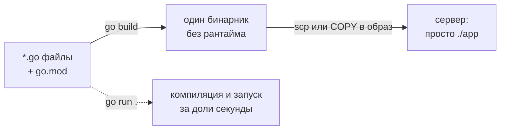

# Глава 1. Основы Go

**Цели главы:** писать простые программы на Go: переменные, типы, функции, ветвления, циклы; понимать **нулевые значения**, возврат нескольких значений и базовую работу с ошибками.

⏱ ~1 неделя · предыдущая: [Глава 0](00-podgotovka.md) · следующая: [Глава 2](02-sostavnye-tipy.md)
Параллельно пройдите [A Tour of Go](https://go.dev/tour) (разделы Basics, Flow control).

---

## 1.1. Структура программы

От исходников до программы на сервере (сравните с `ng build` и Node):



```go
package main // исполняемая программа всегда в package main

import (
	"fmt"  // стандартные пакеты
	"os"
)

func main() { // точка входа: без аргументов и без возвращаемого значения
	fmt.Println("hello")
	if len(os.Args) > 1 {
		fmt.Println("аргумент:", os.Args[1])
	}
}
```

Правила, к которым надо привыкнуть:

- **Неиспользуемые переменные и импорты — ошибка компиляции.** Не предупреждение, а ошибка. Сначала бесит, потом спасает.
- **Фигурная скобка `{` — на той же строке**, что и `func`/`if`/`for`. Иначе — ошибка (автоматическая вставка `;`).
- **Точки с запятой не пишем.**
- **Форматирование делает `gofmt`.** Отступы — табы. Споров о стиле нет.
- **Экспорт по регистру.** `Println` (с большой буквы) — публичное, `println` — приватное в пределах пакета. Ни `public`, ни `export`.

## 1.2. Переменные и константы

```go
package main

import "fmt"

func main() {
	var a int = 10      // полная форма
	var b = 20          // тип выведен: int
	c := 30             // короткое объявление — только внутри функций
	var d, e = "go", true
	var (               // блок объявлений
		x float64
		y string
	)

	const Pi = 3.14159  // константа
	fmt.Println(a, b, c, d, e, x, y == "", Pi)

	c = 31   // присваивание
	c, f := 1, 2 // := допустимо, если ХОТЯ БЫ ОДНА переменная слева новая
	_ = f        // _ — «выбросить значение»
}
```

> ⚠️ **Подводный камень: затенение (shadowing).** `:=` во вложенном блоке создаёт **новую** переменную, а не присваивает внешней:
>
> ```go
> err := doA()
> if cond {
> 	result, err := doB() // это НОВАЯ err — внешняя не изменится!
> 	_, _ = result, err
> }
> ```

### Нулевые значения (zero values)

В Go **нет `undefined`**. Любая переменная при объявлении получает нулевое значение своего типа:

| Тип | Нулевое значение |
|---|---|
| `int`, `float64`, … | `0` |
| `bool` | `false` |
| `string` | `""` (не `null`!) |
| указатель, `slice`, `map`, `chan`, `func`, `interface` | `nil` |
| структура | все поля — нулевые |

Это фундаментальная идея языка: «сделай нулевое значение полезным». Например, `var mu sync.Mutex` и `var buf bytes.Buffer` готовы к работе без конструкторов.

## 1.3. Типы

| Группа | Типы |
|---|---|
| Логический | `bool` |
| Целые | `int`, `int8`, `int16`, `int32`, `int64`; `uint`, `uint8`…`uint64`; `uintptr` |
| Дробные | `float32`, `float64` |
| Комплексные | `complex64`, `complex128` (редко) |
| Строки | `string` (неизменяемая последовательность **байт**, обычно UTF-8) |
| Псевдонимы | `byte` = `uint8`, `rune` = `int32` (кодовая точка Unicode) |

Ключевые отличия от TypeScript:

- **`int` — это целое, а не `number`.** Деление целых — целочисленное: `7 / 2 == 3`.
- **Нет неявных преобразований.** `var f float64 = i` не скомпилируется; нужно `float64(i)`.
- **Переполнение не бросает ошибку** — «заворачивается»: `var x uint8 = 255; x++` → `0`.
- **Для денег никогда не используйте `float64`.** Храните копейки в `int64` или используйте `decimal`-библиотеку / `numeric` в БД (глава 7).

```go
var i int = 7
var f float64 = float64(i) / 2 // 3.5
big := 300
var u uint8 = uint8(big)       // 44 — тихое усечение! (uint8(300) от константы не скомпилируется, а от переменной — молча обрежет)
n, err := strconv.Atoi("42")   // строка → int (с ошибкой)
s := strconv.Itoa(42)          // int → строка (НЕ string(42): это символ с кодом 42!)
```

### Константы и `iota`

```go
type Weekday int

const (
	Sunday Weekday = iota // 0
	Monday                // 1
	Tuesday               // 2
)

const (
	_  = iota             // пропустить 0
	KB = 1 << (10 * iota) // 1 << 10
	MB                    // 1 << 20
	GB                    // 1 << 30
)
```

`iota` — счётчик внутри блока `const`. Так в Go делают «enum» (подробнее в главе 3).

## 1.4. Функции

```go
func add(a, b int) int {            // параметры одного типа можно группировать
	return a + b
}

func divide(a, b float64) (float64, error) { // несколько возвращаемых значений
	if b == 0 {
		return 0, errors.New("деление на ноль")
	}
	return a / b, nil
}

func sum(nums ...int) int {         // вариативная функция
	total := 0
	for _, n := range nums {
		total += n
	}
	return total
}
// вызов: sum(1, 2, 3)  или  sum(slice...)
```

### Возврат нескольких значений и ошибки

Ключевая идиома Go: **ошибка — это обычное последнее возвращаемое значение**.

```go
result, err := divide(10, 0)
if err != nil {
	fmt.Println("ошибка:", err)
	return
}
fmt.Println(result)
```

Нет `try/catch`, нет `throw`. Сначала это кажется многословным; в обмен вы всегда **видите**, где операция может не удасться.

### Именованные возвращаемые значения

```go
func minMax(nums []int) (lo, hi int) { // lo и hi — уже объявленные переменные
	lo, hi = nums[0], nums[0]
	for _, n := range nums {
		lo, hi = min(lo, n), max(hi, n) // min/max — встроенные с Go 1.21
	}
	return // «голый» return вернёт lo, hi — используйте только в коротких функциях
}
```

### Функции — значения первого класса, замыкания

```go
func counter() func() int {
	n := 0
	return func() int { // замыкание захватывает n
		n++
		return n
	}
}

func main() {
	next := counter()
	fmt.Println(next(), next(), next()) // 1 2 3
}
```

Как `() => ...` в TS — только синтаксис `func(...) ... { ... }`. Стрелочных функций нет.

## 1.5. Управляющие конструкции

### `if` (с инициализацией)

```go
if n, err := strconv.Atoi(s); err != nil {
	return err
} else if n < 0 {
	return errors.New("отрицательное")
} else {
	fmt.Println(n) // n и err видны во всех ветках
}
```

Скобок вокруг условия нет, фигурные — обязательны.

### `for` — единственный цикл

```go
for i := 0; i < 3; i++ { }  // классический
for cond { }                // как while
for { }                     // бесконечный (выход — break/return)

for i := range 3 { }        // Go 1.22+: i = 0, 1, 2

nums := []int{10, 20, 30}
for i, v := range nums { }  // индекс и значение
for _, v := range nums { }  // только значение
for i := range nums { }     // только индекс

for k, v := range m { }     // мапа: ПОРЯДОК СЛУЧАЕН
for i, r := range "Привет" { } // строка: i — индекс байта, r — руна
```

`break`, `continue` и метки (`outer:`) работают как обычно.

### `switch`

```go
switch day {
case "sat", "sun":    // несколько значений через запятую
	fmt.Println("выходной")
case "mon":
	fmt.Println("ох")
	// fallthrough — только если ЯВНО нужно провалиться дальше (редко)
default:
	fmt.Println("будний")
}

// switch без выражения — аккуратная замена цепочки if/else:
switch {
case score >= 90:
	grade = "A"
case score >= 75:
	grade = "B"
default:
	grade = "C"
}
```

В отличие от JS, `break` не нужен: проваливания между `case` **нет** по умолчанию.

### `defer` (первое знакомство)

```go
f, err := os.Open("data.txt")
if err != nil {
	return err
}
defer f.Close() // выполнится при выходе из функции, как finally
```

Подробно — в главе 3.

## 1.6. Работа с вводом/выводом

```go
fmt.Println("a", 1, true)          // через пробел + перевод строки
fmt.Printf("%s: %d лет\n", "Аня", 30)
s := fmt.Sprintf("%05.1f", 3.14159) // в строку: 003.1
```

Самые полезные «глаголы» (verbs):

| Verb | Значение | Пример для `p := Point{1, 2}` |
|---|---|---|
| `%v` | значение по умолчанию | `{1 2}` |
| `%+v` | с именами полей | `{X:1 Y:2}` |
| `%#v` | как Go-код | `main.Point{X:1, Y:2}` |
| `%T` | тип | `main.Point` |
| `%d`, `%s`, `%q`, `%f`, `%x` | число, строка, строка в кавычках, дробное, hex | |
| `%p` | указатель | |

Чтение строки из stdin:

```go
scanner := bufio.NewScanner(os.Stdin)
for scanner.Scan() {
	line := scanner.Text()
	fmt.Println("вы ввели:", line)
}
```

## 1.7. TypeScript ↔ Go: быстрое сравнение

| TypeScript | Go |
|---|---|
| `let x = 5` | `x := 5` |
| `const PI = 3.14` | `const PI = 3.14` |
| `number` | `int`, `int64`, `float64` (выбираете явно) |
| `string` (UTF-16) | `string` (UTF-8 байты) |
| `boolean` | `bool` |
| `null`, `undefined` | `nil` (только для ссылочных типов) + нулевые значения |
| `function f(a: number): number` | `func f(a int) int` |
| `(a, b) => a + b` | `func(a, b int) int { return a + b }` |
| `throw new Error("x")` | `return errors.New("x")` |
| `for (const x of arr)` | `for _, x := range arr` |
| `arr.length` | `len(arr)` |
| `` `Привет, ${name}` `` | `fmt.Sprintf("Привет, %s", name)` |
| `console.log` | `fmt.Println` |

Полная шпаргалка — [cheatsheet.md](cheatsheet.md).

## 1.8. Типичные ошибки новичков

1. `:=` вне функции — нельзя (используйте `var`).
2. Деление `int / int` — целочисленное. Нужна дробь — преобразуйте.
3. Тень переменной `err` во вложенном блоке.
4. `string(65)` → `"A"`, а не `"65"`. Используйте `strconv.Itoa`.
5. Забыли обработать `err` — компилятор **не** заставит (но `go vet` и линтеры подскажут). Привыкайте делать это всегда.
6. Ожидание, что `for ... range` по мапе упорядочен.

---

## Задачи

> Для 📦-задач: код в `tasks/ch01/...`, запуск `go test ./tasks/ch01/...`.

1. 📦🟢 **FizzBuzz** — [`tasks/ch01/fizzbuzz`](tasks/ch01/fizzbuzz/fizzbuzz.go). Верните `[]string` из `n` элементов по классическим правилам.
2. 📦🟢 **Stats** — [`tasks/ch01/stats`](tasks/ch01/stats/stats.go). Верните минимум, максимум и среднее; на пустом вводе — ошибку `ErrEmpty`.
3. 🟢 **Конвертер температур.** CLI: `go run . 36.6 C` → `97.88 F`; `go run . 100 F` → `37.78 C`. Читайте `os.Args`, парсите через `strconv.ParseFloat`, обрабатывайте неверный ввод с понятным сообщением и **кодом выхода `1`** (`os.Exit(1)`).
4. 🟡 **Угадайка.** Программа загадывает число 1–100 (`math/rand/v2`: `rand.IntN(100)+1`), читает догадки из stdin (`bufio.Scanner`), отвечает «больше/меньше», считает попытки, завершается при вводе `quit` или угадывании. Нечисловой ввод не должен ронять программу.
5. 🟡 **Калькулятор.** Читает строки вида `12 + 5` (число, оператор `+ - * /`, число), печатает результат. Деление на ноль и неизвестный оператор — ошибки, а не паника. Разбейте код на функции `parse(line) (a float64, op string, b float64, err error)` и `calc(a, op, b) (float64, error)`.
6. 🟡 **Простые числа.** Функция `primes(n int) []int` по решету Эратосфена. (Пока слайсы — просто «список»: `make([]bool, n+1)`, `append`.) Распечатайте простые до 100, посчитайте, сколько их до 1 000 000, и измерьте время (`time.Now()` / `time.Since`).
7. 🔴 **Переполнение.** Напишите программу, которая показывает: `uint8(250)+10`, `int32(2147483647)+1`, `math.MaxInt64+1` (на переменных, не константах). Объясните результаты и придумайте, как безопасно сложить два `int64` с обнаружением переполнения.

## Самопроверка

- Чем `var x int` отличается от `x := 0`? Где можно использовать `:=`?
- Что такое нулевое значение? Чему равны `""`-строка, `nil`-слайс, `false`?
- Как функция в Go возвращает ошибку? Чем это лучше/хуже исключений?
- Почему `7 / 2` даёт `3`? Как получить `3.5`?
- Как работает `for ... range` по строке `"Привет"` и что такое `rune`?
- Что делает `iota`?
- Что такое затенение переменной и как оно может привести к багу?

➡️ Дальше: [Глава 2. Составные типы](02-sostavnye-tipy.md)
