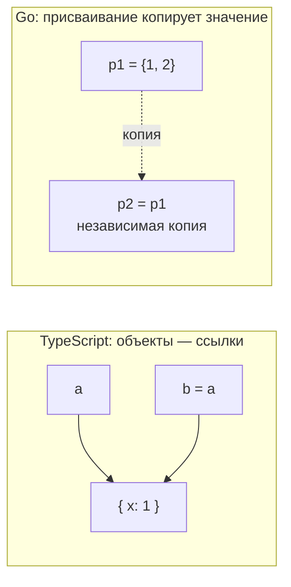
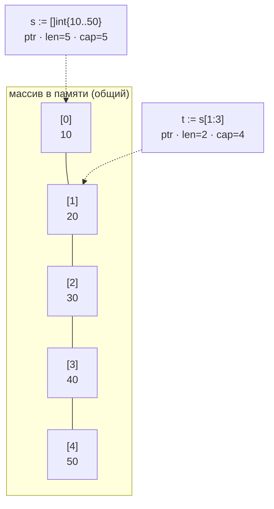

# Глава 2. Составные типы: слайсы, мапы, строки, структуры, указатели

**Цели главы:** уверенно работать с коллекциями и структурами; понимать, **когда данные копируются, а когда нет**; не наступать на классические грабли со слайсами.

⏱ ~1 неделя · предыдущая: [Глава 1](01-osnovy-go.md) · следующая: [Глава 3](03-metody-interfejsy-oshibki.md)

---

## 2.0. Главная разница с TypeScript



В JS/TS объекты и массивы — **ссылочные типы**: `const b = a` не копирует, обе переменные указывают на один объект.

В Go **всё — значение**, если вы явно не взяли указатель. Присваивание и передача в функцию **копируют** значение:

```go
type Point struct{ X, Y int }

p1 := Point{1, 2}
p2 := p1      // копия! изменение p2 не затронет p1
p2.X = 100
fmt.Println(p1, p2) // {1 2} {100 2}
```

Исключения — типы, внутри которых уже спрятан указатель: **слайс, мапа, канал, функция, интерфейс**. Их «заголовок» копируется, но указывает на общие данные. Именно из-за этого слайсы — главный источник удивления.

## 2.1. Массивы и слайсы

### Массив — фиксированная длина, часть типа

```go
var a [3]int            // [0 0 0]; тип [3]int
b := [...]string{"x", "y"} // длина выводится: [2]string
// [3]int и [4]int — РАЗНЫЕ типы. Массивы копируются целиком. На практике используют слайсы.
```

### Слайс — «окно» над массивом

Слайс — это маленькая структура из трёх полей: **указатель** на массив, **длина** (`len`), **ёмкость** (`cap`).



```go
s := []int{1, 2, 3}          // литерал
t := make([]int, 3)          // len=3, cap=3: [0 0 0]
u := make([]int, 0, 100)     // len=0, cap=100 — «резервируем» место
var n []int                  // nil-слайс: len=0, cap=0; append к нему работает!

s = append(s, 4, 5)          // ВСЕГДА присваивайте результат append
s = append(s, t...)          // добавить другой слайс
copy(dst, src)               // копирует min(len(dst), len(src)) элементов
fmt.Println(len(s), cap(s))
```

### Классическая ловушка: общий массив

```go
package main

import "fmt"

func main() {
	a := []int{1, 2, 3}
	b := a[:2]         // len 2, cap 3 — делит память с a
	b = append(b, 99)  // влезает в cap → ПЕРЕЗАПИСЫВАЕТ a[2]!
	fmt.Println(a, b)  // [1 2 99] [1 2 99]

	b = append(b, 100) // cap превышена → выделен НОВЫЙ массив, b «отвязался» от a
	b[0] = -1
	fmt.Println(a, b)  // [1 2 99] [-1 2 99 100]
}
```

Выводы:
- Подслайс `s[i:j]` **делит память** с оригиналом.
- `append` либо пишет в тот же массив (если есть место), либо создаёт новый — **заранее не угадать**, поэтому не полагайтесь ни на то, ни на другое. Нужна независимая копия — делайте её явно: `slices.Clone(s)` или `append([]int(nil), s...)`.
- При росте ёмкость увеличивается: для небольших слайсов примерно вдвое, дальше медленнее (~1,25×). Если знаете размер заранее — `make([]T, 0, n)` избавит от лишних аллокаций.

<!-- viz:SliceViz -->

### Пакет `slices` (Go 1.21+) — забудьте про ручные циклы

```go
import "slices"

slices.Contains(s, 3)              // bool
slices.Index(s, 3)                 // индекс или -1
slices.Sort(s)                     // по возрастанию (для упорядочиваемых типов)
slices.SortFunc(users, func(a, b User) int { return cmp.Compare(a.Age, b.Age) })
slices.Reverse(s)
slices.Max(s); slices.Min(s)
slices.Equal(a, b)
slices.Clone(s)
slices.Insert(s, 1, 42)            // вставка по индексу
slices.Delete(s, 1, 3)             // удалить [1:3)
slices.BinarySearch(sorted, 42)    // (индекс, найдено)
```

### `nil`-слайс против пустого

```go
var a []int        // nil
b := []int{}       // пустой, но не nil
len(a) == len(b)   // оба 0; for range и append работают одинаково
// НО в JSON: a → null, b → []   ← частая причина багов на стыке с Angular!
```

## 2.2. Мапы

```go
ages := map[string]int{"Аня": 30, "Борис": 25}
m := make(map[string][]string) // пустая; ключ — string, значение — слайс

ages["Вера"] = 28              // записать
v := ages["Аня"]               // прочитать (если ключа нет — НУЛЕВОЕ значение, не ошибка)
v, ok := ages["Глеб"]          // «comma ok»: ok == false, если ключа нет
delete(ages, "Борис")          // удалить (нет ключа — ничего не происходит)
len(ages)
clear(ages)                    // очистить (Go 1.21+)

for name, age := range ages { } // ПОРЯДОК СЛУЧАЕН и меняется от запуска к запуску
```

Важные факты:

- **Ключ** должен быть сравним (`==`): числа, строки, структуры из сравнимых полей, массивы. Слайсы, мапы, функции — нельзя.
- `var m map[string]int` — **nil-мапа**: читать можно, **писать — паника**. Всегда `make` или литерал.
- Множество — это `map[T]struct{}` (пустая структура занимает 0 байт) или `map[T]bool`.
- **Мапа не потокобезопасна.** Параллельная запись → `fatal error: concurrent map writes` (глава 5).
- Нужен упорядоченный обход? Отсортируйте ключи:

```go
import ("maps"; "slices")

for _, k := range slices.Sorted(maps.Keys(ages)) { // Go 1.23+
	fmt.Println(k, ages[k])
}
```

- Счётчик слов без проверки на наличие — благодаря нулевым значениям: `freq[w]++`.
- Мапа из мап/слайсов: `groups[k] = append(groups[k], v)` — работает, потому что для отсутствующего ключа вернётся `nil`-слайс.

## 2.3. Строки, байты, руны

`string` в Go — **неизменяемая последовательность байт** (по соглашению — UTF-8).

```go
s := "Привет"
fmt.Println(len(s))                    // 12 — БАЙТЫ (кириллица — по 2 байта)
fmt.Println(utf8.RuneCountInString(s)) // 6 — символы (руны)

for i, r := range s { fmt.Println(i, string(r)) } // 0 П, 2 р, 4 и ... — i — смещение в байтах!
fmt.Println(s[0])                      // 208 — байт, а не символ
fmt.Println([]rune(s)[0], string([]rune(s)[0])) // 1055 П

b := []byte(s)   // копирует байты — можно менять
r := []rune(s)   // копирует руны
s2 := string(r)  // обратно
```

| Тип | Что это | Когда |
|---|---|---|
| `byte` (`uint8`) | один байт | бинарные данные, ASCII |
| `rune` (`int32`) | кодовая точка Unicode | работа с «символами» |
| `string` | иммутабельные байты | почти всегда |

**Конкатенация в цикле — O(n²)**, потому что строки неизменяемы. Используйте `strings.Builder`:

```go
var sb strings.Builder
for i := 0; i < 1000; i++ {
	fmt.Fprintf(&sb, "%d,", i)
}
result := sb.String()
```

Пакет `strings` — ваш инструмент №1:

```go
strings.Contains("hello", "ell")        // true
strings.HasPrefix(s, "http")            // HasSuffix
strings.Split("a,b,c", ",")             // ["a" "b" "c"]
strings.Join([]string{"a","b"}, "-")    // "a-b"
strings.Fields("  a  b \n c ")          // ["a" "b" "c"] — по любым пробелам
strings.TrimSpace(s); strings.Trim(s, ".!")
strings.ToUpper(s); strings.ToLower(s)
strings.ReplaceAll(s, "old", "new")
strings.EqualFold("Go", "GO")           // сравнение без учёта регистра
before, after, found := strings.Cut("key=value", "=") // разделить по первому вхождению
```

Преобразования с числами — пакет `strconv` (`Atoi`, `Itoa`, `ParseFloat`, `ParseBool`, `FormatInt`, `Quote`).

## 2.4. Структуры

```go
type User struct {
	ID        int
	Name      string
	Email     string
	IsAdmin   bool
	CreatedAt time.Time
}

u := User{ID: 1, Name: "Аня"}         // литерал с именами полей (всегда предпочитайте)
var zero User                          // все поля нулевые
u.Email = "anna@example.com"
p := &u                                // указатель на структуру
p.Name = "Анна"                        // автоматическое разыменование: (*p).Name
```

Структуры сравниваются через `==`, если все поля сравнимы. Анонимные структуры удобны для разовых данных и таблиц тестов:

```go
cfg := struct {
	Host string
	Port int
}{"localhost", 8080}
```

### Теги полей — метаданные для библиотек

```go
type User struct {
	ID        int       `json:"id"`
	Name      string    `json:"name"`
	Email     string    `json:"email,omitempty"` // не выводить, если пусто
	Password  string    `json:"-"`               // никогда не попадает в JSON!
	CreatedAt time.Time `json:"created_at"`
}
```

Это аналог декораторов Angular/class-transformer: `encoding/json` читает теги через рефлексию. Те же теги используют библиотеки БД (`db:"..."`) и валидации (`validate:"required"`).

### Встраивание (embedding) — композиция вместо наследования

```go
type Timestamps struct {
	CreatedAt, UpdatedAt time.Time
}

type Post struct {
	Timestamps        // встроено: поля «поднимаются» наружу
	ID    int
	Title string
}

p := Post{ID: 1, Title: "Hi"}
p.CreatedAt = time.Now() // обращаемся напрямую, хотя поле живёт в Timestamps
```

Это **не** наследование: нет полиморфизма по типам, `Post` — не «подтип» `Timestamps`. Просто удобный способ переиспользовать поля и методы (методы — в главе 3).

## 2.5. Указатели

```go
x := 10
p := &x        // p имеет тип *int — адрес x
fmt.Println(*p) // 10 — разыменование
*p = 20        // меняем x через указатель
fmt.Println(x)  // 20

var np *int    // nil
// fmt.Println(*np) → panic: nil pointer dereference
```

Никакой арифметики указателей (как в C) нет — они безопасны, кроме `nil`.

**Когда использовать указатель:**

| Ситуация | Пример |
|---|---|
| Функция/метод должна **изменить** переданное значение | `func (u *User) Rename(n string)` |
| Структура **большая**, копировать дорого | передаём `*Config` |
| Нужно выразить **«значения может не быть»** | `*string` в PATCH-запросе: `nil` — поле не прислали, `""` — прислали пустое |
| Тип содержит `sync.Mutex` и т. п. (копировать **нельзя**) | `*Server` |

Во всех остальных случаях — передавайте значения: проще, меньше аллокаций, меньше `nil`-паник.

```go
type Counter struct{ n int }

func incByValue(c Counter)    { c.n++ } // меняет копию
func incByPointer(c *Counter) { c.n++ } // меняет оригинал

c := Counter{}
incByValue(c); incByValue(c)
incByPointer(&c)
fmt.Println(c.n) // 1
```

### Ловушки с `range` и указателями

```go
users := []User{{Name: "a"}, {Name: "b"}}

for _, u := range users {
	u.Name = "X" // меняет КОПИЮ — users не изменится!
}
for i := range users {
	users[i].Name = "X" // так правильно
}
for i := range users {
	u := &users[i] // указатель на реальный элемент
	u.Name = "Y"
}
```

С Go 1.22 переменные цикла создаются **заново на каждой итерации**, поэтому старый баг «все горутины/замыкания видят последнее значение» исчез. Но в старом коде и в чужих проектах (`go 1.21` в `go.mod`) он ещё живёт — знайте о нём.

### `new` и литералы

```go
p := new(int)             // *int, указывает на 0
u := &User{Name: "Аня"}   // чаще всего пишут так
```

Не беспокойтесь о «куче» и «стеке»: компилятор сам решает (escape analysis). Вернуть указатель на локальную переменную — абсолютно нормально.

---

## 2.6. Полный пример: счётчик слов (`wordcount`)

Тот самый конвейер из `grep | sort | uniq` главы 0, но на Go:

```go
package main

import (
	"bufio"
	"fmt"
	"os"
	"slices"
	"strings"
	"unicode"
)

type entry struct {
	Word  string
	Count int
}

func main() {
	freq := make(map[string]int)

	sc := bufio.NewScanner(os.Stdin) // читает построчно (лимит строки по умолчанию — 64 КБ)
	for sc.Scan() {
		words := strings.FieldsFunc(sc.Text(), func(r rune) bool { return !unicode.IsLetter(r) })
		for _, w := range words {
			freq[strings.ToLower(w)]++ // нулевое значение int — 0, проверка на наличие не нужна
		}
	}
	if err := sc.Err(); err != nil {
		fmt.Fprintln(os.Stderr, "ошибка чтения:", err)
		os.Exit(1)
	}

	list := make([]entry, 0, len(freq))
	for w, c := range freq {
		list = append(list, entry{w, c})
	}
	slices.SortFunc(list, func(a, b entry) int {
		if a.Count != b.Count {
			return b.Count - a.Count // по убыванию частоты
		}
		return strings.Compare(a.Word, b.Word) // при равенстве — по алфавиту
	})

	for _, e := range list[:min(10, len(list))] {
		fmt.Printf("%6d  %s\n", e.Count, e.Word)
	}
}
```

Запуск: `go run . < pg1342.txt` (файл из задачи 6 главы 0).

---

## Задачи

1. 📦🟢 **WordFreq** — [`tasks/ch02/wordfreq`](tasks/ch02/wordfreq/wordfreq.go). Частоты слов в тексте.
2. 📦🟢 **Dedup** — [`tasks/ch02/dedup`](tasks/ch02/dedup/dedup.go). Удаление повторов с сохранением порядка, без побочных эффектов на вход.
3. 📦🟡 **Строки** — [`tasks/ch02/textutil`](tasks/ch02/textutil/textutil.go). `ReverseRunes` и `IsPalindrome` (Unicode-корректно).
4. 📦🟡 **TopN** — [`tasks/ch02/topn`](tasks/ch02/topn/topn.go). Топ-N ключей мапы с детерминированным порядком.
5. 🟢 **wordcount CLI.** Наберите программу из 2.6 руками, запустите на `pg1342.txt`. Сравните результат с shell-конвейером из главы 0. Затем замените в ней своими `WordFreq`/`TopN` (скопируйте реализации в `main`-пакет).
6. 🟡 **Эксперимент с `cap`.** Напишите программу: в цикле `append`-те числа в слайс до 10 000 элементов и **печатайте строку только когда `cap` изменилась**. Зафиксируйте последовательность ёмкостей. Затем повторите с `make([]int, 0, 10000)`. Объясните разницу и сколько аллокаций сэкономили.
   *Ориентир (реальный запуск на Go 1.27):* `4 8 16 32 64 128 256 512 848 1280 1792 2560 3408 5120 …` — до 256 удвоение, дальше ≈ ×1,25 с выравниванием по классам размеров аллокатора. Первая ёмкость зависит от версии Go и от того, «убегает» ли слайс в кучу (escape analysis, глава 15): у вас может получиться `1`, а не `4` — закономерность важнее чисел. (На сайте книги с моделью роста можно поиграть в интерактивном визуализаторе слайсов.)
7. 🟡 **Ловушка подслайса.** Сделайте так, чтобы подслайс, полученный из большого слайса, **не удерживал** в памяти весь исходный массив. (Подсказка: `slices.Clone`.) Объясните на бумаге, почему «вырезать маленький кусочек из огромного файла и хранить» — утечка памяти.
8. 🟡 **Группировка.** Дана `[]User{ID, Name, City}`. Верните `map[string][]User` — пользователи по городам; затем выведите города по алфавиту и пользователей внутри по имени.
9. 🟡 **JSON-null.** Напишите программу, сериализующую структуру с полями `[]string` (nil и пустой), `*string` (nil, `""` и `"x"`), поле с `omitempty` и поле с `json:"-"` через `json.MarshalIndent`. Запишите, что получилось, и объясните, какие значения различит Angular-клиент.
10. 🔴 **Матрицы.** Реализуйте `Transpose([][]int) [][]int` и `Multiply(a, b [][]int) ([][]int, error)` (ошибка при несовместимых размерах). Убедитесь, что результат не делит память с входом.

## Самопроверка

- Что копируется при `b := a`, если `a` — структура? Слайс? Мапа?
- Из чего состоит слайс? Что такое `len` и `cap`? Что произойдёт после `b := a[:2]; b = append(b, 99)`?
- Почему запись в `nil`-мапу — паника, а `append` к `nil`-слайсу — нет?
- Чем `len("Привет")` отличается от числа символов? Как корректно перебрать символы?
- Когда нужен указатель, а когда достаточно значения? Зачем `*string` в полях PATCH?
- Почему изменение переменной цикла `for _, u := range users` не меняет `users`?
- Как сделать упорядоченный вывод мапы?

➡️ Дальше: [Глава 3. Методы, интерфейсы, ошибки](03-metody-interfejsy-oshibki.md)
