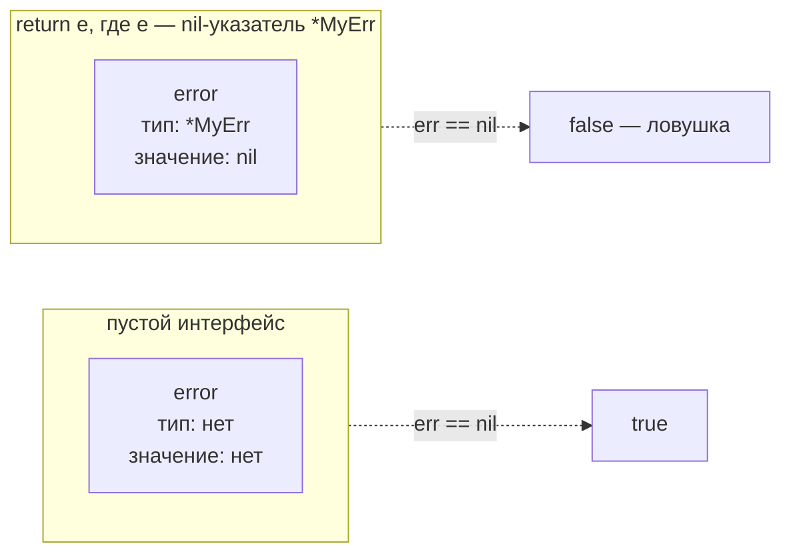
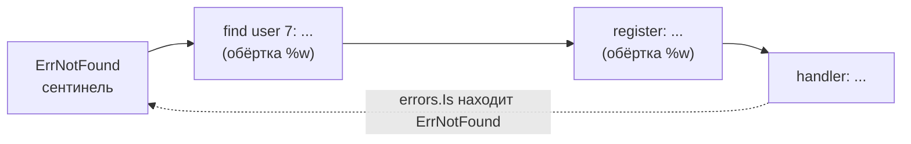

# Глава 3. Методы, интерфейсы, ошибки, `defer`

**Цели главы:** понимать, как Go обходится без классов и исключений; проектировать через небольшие интерфейсы; правильно создавать, оборачивать и проверять ошибки.

⏱ ~1 неделя · предыдущая: [Глава 2](02-sostavnye-tipy.md) · следующая: [Глава 4](04-moduli-testy-generiki.md)

---

## 3.1. Методы

Метод — функция с **получателем** (receiver), привязанная к типу. Тип может быть любым **своим** типом, не только структурой:

```go
type Rect struct{ W, H float64 }

func (r Rect) Area() float64 { return r.W * r.H } // получатель-значение: работает с копией

func (r *Rect) Scale(k float64) { // получатель-указатель: меняет оригинал
	r.W *= k
	r.H *= k
}

type Celsius float64
func (c Celsius) Fahrenheit() float64 { return float64(c)*9/5 + 32 }
```

```go
r := Rect{3, 4}
r.Scale(2)           // Go сам превратил в (&r).Scale(2)
fmt.Println(r.Area()) // 48
```

**Какой получатель выбрать:**

| Выбирайте указатель `*T`, если | Выбирайте значение `T`, если |
|---|---|
| метод изменяет получателя | тип маленький и неизменяемый (`time.Time`, `Point`) |
| структура большая | метод только читает |
| в структуре есть `sync.Mutex` или подобное (копировать нельзя) | тип — число/строка/слайс (`Celsius`) |

**Правило хорошего тона:** у одного типа все методы — с одним видом получателя. Если сомневаетесь — указатель.

Нюанс: `m["k"].Scale(2)` — ошибка компиляции для мапы значений: элемент мапы не «адресуем». Либо `r := m["k"]; r.Scale(2); m["k"] = r`, либо храните в мапе указатели.

## 3.2. Интерфейсы

Интерфейс — **набор методов**. Тип реализует интерфейс **автоматически**, если у него есть все эти методы. Ни `implements`, ни регистрации.

```go
type Shape interface {
	Area() float64
	Perimeter() float64
}

type Circle struct{ R float64 }
func (c Circle) Area() float64      { return math.Pi * c.R * c.R }
func (c Circle) Perimeter() float64 { return 2 * math.Pi * c.R }

func PrintArea(s Shape) { fmt.Printf("%.2f\n", s.Area()) }

PrintArea(Circle{2}) // Circle неявно удовлетворяет Shape
```

> 🔁 **Сравнение с TypeScript.** В TS интерфейсы тоже структурные, но описывают **форму данных** и исчезают после компиляции. В Go интерфейс описывает **поведение**, живёт в рантайме и является полноценным значением: хранит пару «(конкретный тип, значение)».

### Идиомы интерфейсов в Go

1. **Маленькие интерфейсы.** Лучшие — из 1–2 методов. Знаменитые: `io.Reader` (`Read`), `io.Writer` (`Write`), `fmt.Stringer` (`String`), `error` (`Error`), `http.Handler` (`ServeHTTP`).
2. **«Принимай интерфейсы, возвращай структуры».** Параметры функций — интерфейсы (гибко), результаты — конкретные типы (удобно).
3. **Интерфейс объявляет потребитель, а не поставщик.** Пакет, который *использует* зависимость, описывает минимальный интерфейс с нужными ему методами. Поэтому в Go нет «библиотек интерфейсов».
4. **Не создавайте интерфейс «на всякий случай».** Пока нет двух реализаций или потребности в подмене в тестах — достаточно структуры.

### Аналог DI из Angular

```go
// Пакет service — потребитель. Описывает, что ему нужно, и только это:
type UserStore interface {
	GetUser(ctx context.Context, id int) (User, error)
}

type Greeter struct{ store UserStore }

func NewGreeter(s UserStore) *Greeter { return &Greeter{store: s} } // «инъекция» через конструктор

func (g *Greeter) Greet(ctx context.Context, id int) (string, error) {
	u, err := g.store.GetUser(ctx, id)
	if err != nil {
		return "", fmt.Errorf("greet: %w", err)
	}
	return "Привет, " + u.Name, nil
}
```

В `main()` вы передаёте реализацию на Postgres, в тестах — пару строк «заглушки»-фейка. Контейнера и декораторов не нужно — это просто функция с параметром (подробнее — в главе 11).

### Пустой интерфейс и приведение типов

`any` (псевдоним `interface{}`) — «значение любого типа». Аналог `unknown`/`any` в TS; используйте скупо.

```go
var x any = "привет"

s, ok := x.(string)   // type assertion с проверкой
if ok { fmt.Println(len(s)) }
n := x.(int)          // без ok — паника, если не int!

switch v := x.(type) { // type switch
case int:
	fmt.Println("int", v+1)
case string:
	fmt.Println("string", strings.ToUpper(v))
case nil:
	fmt.Println("nil")
default:
	fmt.Printf("другое: %T\n", v)
}
```

### Ловушка: интерфейс с `nil`-указателем внутри — не `nil`



```go
package main

import "fmt"

type MyErr struct{}

func (*MyErr) Error() string { return "my error" }

func mayFail(fail bool) error {
	var e *MyErr // nil-указатель типа *MyErr
	if fail {
		e = &MyErr{}
	}
	return e // ← интерфейс (тип=*MyErr, значение=nil) — это НЕ nil!
}

func main() {
	err := mayFail(false)
	fmt.Println(err == nil) // false !!!  Ожидали true
}
```

Интерфейс равен `nil` только когда **и тип, и значение** пусты. Правило: **функция, возвращающая `error`, должна возвращать литерал `nil`**, а не типизированную переменную-указатель.

## 3.3. Ошибки

`error` — это встроенный интерфейс из одного метода:

```go
type error interface {
	Error() string
}
```

### Создание

```go
errors.New("not found")                    // простая ошибка
fmt.Errorf("user %d: not found", id)       // форматированная
fmt.Errorf("load config: %w", err)         // ОБЁРТКА: добавляет контекст и сохраняет исходную ошибку
```

### Сентинельные ошибки и `errors.Is`

```go
var ErrNotFound = errors.New("not found") // пакетная переменная, обычно с префиксом Err

func find(id int) (User, error) {
	return User{}, fmt.Errorf("find user %d: %w", id, ErrNotFound)
}

_, err := find(7)
if errors.Is(err, ErrNotFound) { // проходит по всей цепочке обёрток
	fmt.Println("нет такого пользователя")
}
// err == ErrNotFound — НЕ сработает, ошибка обёрнута!
```

### Свои типы ошибок и `errors.As`

Когда нужны **данные** об ошибке, а не просто факт:

```go
type ValidationError struct {
	Field string
	Msg   string
}

func (e *ValidationError) Error() string { return e.Field + ": " + e.Msg }

func validate(u User) error {
	if u.Email == "" {
		return &ValidationError{Field: "email", Msg: "required"}
	}
	return nil
}

err := fmt.Errorf("register: %w", validate(User{}))

var ve *ValidationError
if errors.As(err, &ve) { // найти в цепочке ошибку этого типа и достать
	fmt.Println("поле:", ve.Field)
}
```

Пример цепочки: `handler: register: validate: email: required` — каждый слой добавляет свой контекст через `%w`, а проверка (`Is`/`As`) работает сквозь все слои.

### Несколько ошибок сразу

Цепочка оборачивания: каждый слой добавляет контекст, а `errors.Is` проходит её насквозь.



```go
err := errors.Join(errA, errB) // Go 1.20+; errors.Is видит обе
```

Удобно для валидации формы: собрать **все** ошибки полей, а не первую.

### Правила обращения с ошибками

1. **Проверяйте всегда.** `_ = f()` ради игнорирования — осознанное решение с комментарием.
2. **Добавляйте контекст при пробросе:** `fmt.Errorf("create order: %w", err)`. Сообщения — со строчной буквы, без точки: они склеиваются в цепочку.
3. **Обрабатывайте ошибку один раз:** либо верните её наверх, либо залогируйте и завершите обработку. «Залогировал и вернул» даёт дубли в логах.
4. **Не делайте `panic` для обычных ошибок.** Паника — для невозможных состояний и ошибок программиста.
5. **Не показывайте клиенту внутренности.** Внутренняя ошибка БД → клиенту `500 internal error`, подробности — в лог (глава 6, 11).
6. **Сентинель или тип?** Нужен только факт (`ErrNotFound`) — сентинель; нужны данные (поле, код) — тип.

## 3.4. `defer`

`defer` откладывает вызов функции до **выхода из текущей функции** (в любом случае: `return`, паника).

```go
func process(path string) error {
	f, err := os.Open(path)
	if err != nil {
		return err
	}
	defer f.Close() // выполнится при выходе, где бы мы ни вышли

	// ... работа с f ...
	return nil
}
```

Идиомы: `defer mu.Unlock()`, `defer rows.Close()`, `defer cancel()`, `defer tx.Rollback()`.

Три правила, которые стоит запомнить:

```go
func main() {
	for i := 0; i < 3; i++ {
		defer fmt.Println("defer", i) // порядок LIFO: напечатает 2, 1, 0
	}

	x := 10
	defer fmt.Println("x =", x) // аргументы вычисляются СРАЗУ, в момент defer: напечатает 10
	x = 20
}
```

1. **LIFO**: последний отложенный вызов выполняется первым.
2. **Аргументы вычисляются сразу**, а не при выполнении.
3. **`defer` в цикле** откладывает вызов до конца *функции*, а не итерации — при обработке тысяч файлов получите утечку дескрипторов. Выносите тело цикла в отдельную функцию.

`defer` может менять **именованные** возвращаемые значения:

```go
func writeFile(path string, data []byte) (err error) {
	f, err := os.Create(path)
	if err != nil {
		return err
	}
	defer func() {
		if cerr := f.Close(); cerr != nil && err == nil {
			err = cerr // не потеряем ошибку закрытия
		}
	}()
	_, err = f.Write(data)
	return err
}
```

## 3.5. `panic` и `recover`

`panic` — аварийная остановка: выполняются отложенные вызовы, и программа падает со стек-трейсом. Происходит при: разыменовании `nil`, выходе за границы слайса, делении целых на ноль, записи в `nil`-мапу, отправке в закрытый канал, неудачном `x.(T)` без `ok`.

`recover()` перехватывает панику — **только внутри отложенной функции**:

```go
func safeDiv(a, b int) (res int, err error) {
	defer func() {
		if r := recover(); r != nil {
			err = fmt.Errorf("recovered: %v", r)
		}
	}()
	return a / b, nil // при b == 0 — паника «integer divide by zero»
}
```

Где `recover` оправдан: на **границе** — верхний уровень горутины или HTTP-middleware (чтобы одна кривая запрос не убила весь сервер). Не используйте паники как замену исключениям.

## 3.6. Полезные интерфейсы стандартной библиотеки

```go
type Stringer interface{ String() string }                 // fmt: как печатать значение
type Reader   interface{ Read(p []byte) (n int, err error) }
type Writer   interface{ Write(p []byte) (n int, err error) }
```

На `io.Reader`/`io.Writer` построено всё: файлы, сетевые соединения, HTTP-тела, gzip, буферы, `os.Stdout`. Их можно **композировать**, как декораторы:

```go
package main

import (
	"io"
	"os"
	"strings"
)

type upperReader struct{ r io.Reader }

func (u upperReader) Read(p []byte) (int, error) {
	n, err := u.r.Read(p)
	for i := 0; i < n; i++ {
		if p[i] >= 'a' && p[i] <= 'z' {
			p[i] -= 'a' - 'A'
		}
	}
	return n, err
}

func main() {
	src := strings.NewReader("hello, reader\n")
	io.Copy(os.Stdout, upperReader{src}) // HELLO, READER
}
```

Тот же приём — основа **middleware** в HTTP (глава 6): обёртка вокруг обработчика, реализующая тот же интерфейс.

---

## Задачи

1. 📦🟢 **Фигуры** — [`tasks/ch03/shapes`](tasks/ch03/shapes/shapes.go). `Shape`, `Rect`, `Circle`, `TotalArea`, `Largest`.
2. 📦🟡 **ParseAge** — [`tasks/ch03/parseage`](tasks/ch03/parseage/parseage.go). Сентинельные ошибки + оборачивание контекстом.
3. 📦🟡 **Level** — [`tasks/ch03/level`](tasks/ch03/level/level.go). «Enum» на `iota`, `fmt.Stringer`, парсинг с ошибкой.
4. 🟡 **ROT13-ридер.** Реализуйте `rot13Reader{r io.Reader}`, который шифрует поток ROT13 (A↔N, a↔n, остальное без изменений). Проверка: `"Lbh penpxrq gur pbqr!"` → `"You cracked the code!"`. Напишите `_test.go` с table-driven тестом.
5. 🟡 **CountingWriter.** Тип, оборачивающий `io.Writer` и считающий записанные байты (`Count() int64`). Подключите: `io.Copy(cw, strings.NewReader(...))` и `fmt.Fprintf(cw, ...)`.
6. 🟡 **Цепочка ошибок.** Тип `NotFoundError{Entity string; ID int}`. Создайте 3 функции-слоя (`repo → service → handler`), каждая оборачивает ошибку через `%w`. В `main` покажите: `errors.Is` с сентинелем, `errors.As` с вашим типом, и распечатайте всю цепочку циклом `errors.Unwrap`.
7. 🟡 **Баг `nil`-интерфейса.** Воспроизведите программу из 3.2, объясните вывод и исправьте функцию тремя способами (вернуть `nil` явно, не использовать промежуточную типизированную переменную, и т. д.).
8. 🟡 **Паника на границе.** Напишите функцию `RunSafely(fn func()) (err error)`, которая превращает панику внутри `fn` в `error` с сохранением сообщения. Проверьте на делении на ноль, обращении к `nil`-мапе и `x.(string)` на `int`.
9. 🔴 **Валидация формы.** Структура `Signup{Email, Password, Age}`. Метод `Validate() error` собирает **все** нарушения через `errors.Join` (email без `@`, пароль короче 8, возраст вне 18..120). Кастомные ошибки с полем и кодом; напишите функцию, которая из joined-ошибки достаёт `[]ValidationError` (подсказка: `interface{ Unwrap() []error }`) — именно такой ответ ждёт Angular-форма.
10. 🔴 **Хранилище на интерфейсе.** Интерфейс `Store { Get(key string) (string, error); Put(key, val string) error }` + две реализации: `MemoryStore` (мапа + мьютекс-пока-заглушка) и `FileStore` (JSON-файл). Сервис `Notes` зависит от `Store`. Покройте `Notes` тестом с `MemoryStore`, затем прогоните **тот же набор тестов** на обеих реализациях (вынесите тесты в функцию `func testStore(t *testing.T, s Store)`). Это называется *contract test*.

## Самопроверка

- Чем получатель-значение отличается от получателя-указателя? Когда что?
- Как тип «становится» реализацией интерфейса? Чем это отличается от `implements` в TS?
- Что значит «интерфейс объявляет потребитель»? Как это помогает в тестах?
- Почему `err == ErrNotFound` может не сработать, а `errors.Is` сработает?
- Когда нужен `errors.As`, а когда достаточно `errors.Is`?
- В каком порядке выполняются несколько `defer`? Когда вычисляются их аргументы?
- Почему `return e` с `e` типа `*MyErr(nil)` даёт ненулевой `error`?
- Где уместно `recover()`?

➡️ Дальше: [Глава 4. Модули, тесты, дженерики](04-moduli-testy-generiki.md)
