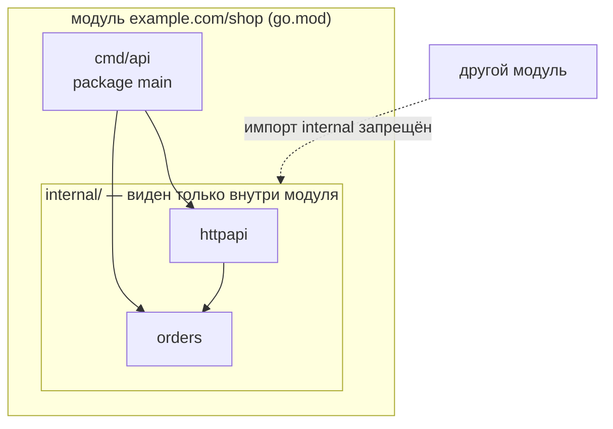

# Глава 4. Модули, пакеты, тестирование, дженерики, стандартная библиотека

**Цели главы:** организовывать код в пакеты и модули; писать идиоматичные тесты (table-driven, бенчмарки, фаззинг); использовать дженерики там, где они нужны; знать, что лежит в стандартной библиотеке.

⏱ ~1 неделя · предыдущая: [Глава 3](03-metody-interfejsy-oshibki.md) · следующая: [Глава 5](05-konkurentnost.md)

---

## 4.1. Пакеты и модули



| Понятие | Что это | Аналог в вашем мире |
|---|---|---|
| **Пакет** | все `.go`-файлы **одной папки** с одинаковой строкой `package x` | Angular-модуль / папка с barrel-файлом |
| **Модуль** | дерево пакетов с общим файлом `go.mod` в корне | npm-пакет (`package.json`) |
| **Импорт** | `import "example.com/shop/internal/orders"` — путь к **папке** | `import ... from '...'` |

```
shop/
├── go.mod                    ← module example.com/shop / go 1.22
├── go.sum                    ← контрольные суммы зависимостей (коммитить!)
├── cmd/
│   └── api/
│       └── main.go           ← package main — точка входа
└── internal/                 ← код ТОЛЬКО для этого модуля
    ├── orders/
    │   ├── orders.go         ← package orders
    │   └── orders_test.go
    └── httpapi/
        └── handler.go
```

**Правила:**

- Имя пакета — короткое, строчное, без подчёркиваний: `orders`, `httpapi`, не `order_utils`. Обращаются как `orders.Create(...)`, поэтому имя должно читаться в месте вызова: `http.Client`, а не `http.HTTPClient`.
- **Экспорт — по регистру** первой буквы идентификатора: `Create` виден снаружи, `create` — только внутри пакета.
- **Папка `internal/`** — компилятор запрещает импортировать её из других модулей. Складывайте туда всё, что не является публичным API.
- **Циклические импорты запрещены.** Если `a` импортирует `b`, то `b` не может импортировать `a`. Это принуждает к осмысленным зависимостям (и объясняет, зачем интерфейсы описывают на стороне потребителя).
- `cmd/<имя>/main.go` — для исполняемых программ. Внутри `main` — минимум логики: собрать зависимости и запустить.
- Избегайте пакетов `utils`, `common`, `helpers`, `models` — это свалка. Называйте пакет по тому, **что он делает**.
- Функция `init()` выполняется при импорте пакета — используйте как можно реже (скрытое поведение).

### `go.mod` и зависимости

```
module example.com/shop

go 1.22

require (
	github.com/go-chi/chi/v5 v5.x.y
	github.com/jackc/pgx/v5 v5.x.y
)
```

```bash
go mod init example.com/shop       # создать модуль (имя — обычно путь репозитория)
go get github.com/go-chi/chi/v5    # добавить зависимость
go get github.com/go-chi/chi/v5@v5.1.0 # конкретная версия
go get -u ./...                    # обновить зависимости
go mod tidy                        # убрать лишнее, добавить недостающее — запускайте часто
go list -m all                     # все зависимости
go mod why github.com/x/y          # почему этот пакет вообще в проекте
```

- Версии — **semver**: `v1.2.3`. Для `v2+` путь модуля получает суффикс `/v2` (так `chi/v5`).
- Зависимости скачиваются в общий кэш (`~/go/pkg/mod`), **папки `node_modules` нет**.
- `go.sum` — как `package-lock.json`: защита от подмены. Коммитьте.
- Принцип *minimal version selection*: Go берёт **минимальную** версию, удовлетворяющую всем требованиям — сборки воспроизводимы.

### Инструменты качества

```bash
gofmt -w .          # или go fmt ./...
go vet ./...        # подозрительные конструкции (неправильные Printf, копирование мьютекса, ...)
golangci-lint run   # агрегатор линтеров (staticcheck, errcheck, ...) — ставьте отдельно
```

В CI (глава 16) эти три команды + `go test ./...` — минимальный гейт.

## 4.2. Тестирование

Тестирование встроено в язык: никаких Jest/Karma/конфигов.

- Файл `xxx_test.go` рядом с кодом.
- Функция `func TestXxx(t *testing.T)`.
- Запуск: `go test ./...`.

```go
// calc.go
package calc

func Add(a, b int) int { return a + b }
```

```go
// calc_test.go
package calc

import "testing"

func TestAdd(t *testing.T) {
	got := Add(2, 3)
	want := 5
	if got != want {
		t.Errorf("Add(2, 3) = %d, want %d", got, want)
	}
}
```

Нет `expect(...).toBe(...)` — вы пишете обычный `if`. Сообщение формата **«что вызвали → что получили → что хотели»** обязательно: оно единственное, что вы увидите при падении.

| Метод | Поведение |
|---|---|
| `t.Errorf` / `t.Error` | отметить тест как упавший, **продолжить** |
| `t.Fatalf` / `t.Fatal` | отметить упавшим и **остановить** этот тест (используйте, если дальше смысла нет) |
| `t.Helper()` | в начале вспомогательной функции — ошибка будет указывать на вызывающую строку |
| `t.Cleanup(func())` | выполнить после теста (как `afterEach`) |
| `t.TempDir()` | временная папка, удалится сама |
| `t.Setenv(k, v)` | переменная окружения на время теста |
| `t.Skip()` | пропустить |
| `t.Parallel()` | запускать параллельно с другими |

### Table-driven тесты — главный паттерн

```go
func TestParseAge(t *testing.T) {
	tests := []struct {
		name    string
		in      string
		want    int
		wantErr bool
	}{
		{"обычный", "42", 42, false},
		{"пробелы", " 7 ", 7, false},
		{"не число", "abc", 0, true},
		{"отрицательный", "-1", 0, true},
	}
	for _, tt := range tests {
		t.Run(tt.name, func(t *testing.T) { // подтест: запускается отдельно
			got, err := ParseAge(tt.in)
			if (err != nil) != tt.wantErr {
				t.Fatalf("ParseAge(%q) error = %v, wantErr %v", tt.in, err, tt.wantErr)
			}
			if got != tt.want {
				t.Errorf("ParseAge(%q) = %d, want %d", tt.in, got, tt.want)
			}
		})
	}
}
```

Добавить случай — одна строка в таблице. Каждый случай виден отдельно в выводе (`--- FAIL: TestParseAge/не_число`).

### Команды

```bash
go test ./...                       # все пакеты
go test -v ./internal/orders        # подробно, один пакет
go test -run 'TestParseAge/пробелы' # по регулярному выражению имени
go test -count=1 ./...              # не использовать кэш результатов
go test -cover ./...                # покрытие
go test -coverprofile=c.out ./... && go tool cover -html=c.out   # HTML-отчёт покрытия
go test -race ./...                 # детектор гонок (глава 5)
go test -short ./...                # пропускать долгие (по if testing.Short())
```

> Go кэширует результаты тестов: если код и входы не менялись — вы увидите `(cached)`. Для проверки нестабильных тестов используйте `-count=1` или `-count=100`.

### Библиотеки для проверок (необязательно)

Стандартного `if` достаточно. Популярные помощники:
- [`testify`](https://github.com/stretchr/testify) — `assert.Equal`, `require.NoError`;
- [`go-cmp`](https://github.com/google/go-cmp) — читаемый diff сложных структур: `cmp.Diff(want, got)`.

В этом учебнике используем только стандартную библиотеку — чтобы вы понимали, что внутри.

### Бенчмарки

```go
func BenchmarkConcatPlus(b *testing.B) {
	for i := 0; i < b.N; i++ { // Go подбирает b.N, пока замер не станет стабильным
		s := ""
		for j := 0; j < 100; j++ {
			s += "x"
		}
	}
}
```

```bash
go test -bench=. -benchmem   # ns/op, B/op, allocs/op
```

(В Go 1.24+ можно писать `for b.Loop() { ... }`.) Сравнивайте варианты по **аллокациям** (`allocs/op`) — часто они важнее наносекунд.

### Фаззинг

Тест генерирует случайные входы и ищет такие, на которых нарушается ваше **свойство**:

```go
func FuzzReverse(f *testing.F) {
	f.Add("hello") // seed-корпус
	f.Fuzz(func(t *testing.T, s string) {
		if !utf8.ValidString(s) {
			t.Skip()
		}
		if got := ReverseRunes(ReverseRunes(s)); got != s {
			t.Errorf("двойной reverse(%q) = %q", s, got)
		}
	})
}
```

```bash
go test -fuzz=FuzzReverse -fuzztime=10s
```

Найденные падающие входы сохраняются в `testdata/fuzz/` и дальше запускаются как обычные тесты.

### Примеры как документация

```go
func ExampleAdd() {
	fmt.Println(Add(1, 2))
	// Output: 3
}
```

Запускается как тест и попадает в `go doc` / pkg.go.dev.

### Как писать хорошие тесты

- Тестируйте **поведение**, а не реализацию.
- **Arrange → Act → Assert**, один смысл на тест.
- Тест не должен зависеть от порядка, времени и сети. Время — инжектируйте (`now func() time.Time`), а не `time.Sleep`.
- Внешний тест-пакет `package orders_test` проверяет **публичный** API так, как его видит пользователь.

## 4.3. Дженерики (Go 1.18+)

Параметры типа позволяют писать функции и типы для разных типов без `any` и приведений.

```go
// T и U — параметры типа; any — ограничение («что угодно»)
func Map[T, U any](s []T, f func(T) U) []U {
	out := make([]U, 0, len(s))
	for _, v := range s {
		out = append(out, f(v))
	}
	return out
}

squares := Map([]int{1, 2, 3}, func(n int) int { return n * n })     // типы выводятся сами
labels  := Map([]int{1, 2, 3}, func(n int) string { return fmt.Sprint(n) })
```

### Ограничения (constraints)

```go
import "cmp"

// cmp.Ordered — все типы, поддерживающие <, >, <=, >=
func Max[T cmp.Ordered](a, b T) T {
	if a > b {
		return a
	}
	return b
}

// Свой набор: ~int означает «любой тип, чей базовый тип — int» (включая type UserID int)
type Number interface {
	~int | ~int64 | ~float64
}

func Sum[T Number](xs []T) T {
	var total T
	for _, x := range xs {
		total += x
	}
	return total
}
```

| Ограничение | Смысл |
|---|---|
| `any` | любой тип |
| `comparable` | поддерживает `==` (нужно для ключей мапы) |
| `cmp.Ordered` | числа и строки (упорядочиваемые) |
| `interface{ ~int \| ~string }` | объединение типов |
| `fmt.Stringer` | любой интерфейс — нужные методы |

### Обобщённые типы

```go
type Stack[T any] struct {
	items []T
}

func (s *Stack[T]) Push(v T) { s.items = append(s.items, v) }

func (s *Stack[T]) Pop() (T, bool) {
	var zero T
	if len(s.items) == 0 {
		return zero, false
	}
	v := s.items[len(s.items)-1]
	s.items = s.items[:len(s.items)-1]
	return v, true
}

var st Stack[string]
st.Push("a")
```

> У методов **нет собственных** параметров типа — только у типа целиком.

### Итераторы (Go 1.23+)

`for range` умеет обходить функции — так устроены `slices.Values`, `maps.Keys`:

```go
package main

import (
	"fmt"
	"iter"
)

func Countdown(n int) iter.Seq[int] {
	return func(yield func(int) bool) {
		for i := n; i > 0; i-- {
			if !yield(i) { // потребитель сделал break
				return
			}
		}
	}
}

func main() {
	for v := range Countdown(3) {
		fmt.Print(v, " ") // 3 2 1
	}
}
```

### Когда дженерики НЕ нужны

Сообщество единодушно: **не начинайте с дженериков**. Сначала напишите конкретный код; обобщайте, когда видите, что копируете одну и ту же функцию для разных типов. Если хватает интерфейса с методом — используйте интерфейс. В бэкенд-коде дженерики чаще всего живут в утилитах (коллекции, кэши, пулы, `Result`-обёртки), а не в бизнес-логике.

> 🔁 **Сравнение с TS.** Дженерики Go проще: нет условных типов, mapped types, вывода по структуре. Это ограничение — сознательная цена за читаемость и быструю компиляцию.

## 4.4. Тур по стандартной библиотеке

Прежде чем тянуть зависимость — загляните сюда:

| Пакет | Для чего |
|---|---|
| `fmt`, `log/slog` | форматирование; структурные логи (глава 15) |
| `strings`, `strconv`, `bytes`, `unicode`, `regexp`, `text/template` | строки, числа, регулярки, шаблоны |
| `slices`, `maps`, `cmp`, `sort`, `container/list`, `container/heap` | коллекции и сортировка |
| `os`, `io`, `bufio`, `io/fs`, `path/filepath`, `embed` | файлы, потоки, встраивание файлов в бинарник |
| `time` | время (см. ниже) |
| `encoding/json`, `encoding/csv`, `encoding/xml`, `encoding/base64` | кодирование |
| `net/http`, `net/url`, `net/http/httptest` | HTTP-сервер, клиент, тесты (глава 6) |
| `database/sql` | абстракция над БД (глава 8) |
| `context`, `sync`, `sync/atomic`, `errors` | конкурентность и ошибки (главы 3, 5) |
| `crypto/*`, `math/rand/v2`, `crypto/rand` | криптография (для секретов — только `crypto/rand`!) |
| `testing`, `testing/fstest`, `net/http/httptest` | тесты |
| `flag`, `os/signal` | аргументы командной строки, сигналы ОС |

### `time` — отдельная боль

```go
d := 1500 * time.Millisecond           // time.Duration — тип, а не число
time.Sleep(2 * time.Second)

now := time.Now().UTC()                // на сервере всегда храните и считайте в UTC
elapsed := time.Since(start)
t, err := time.Parse(time.RFC3339, "2026-03-01T12:00:00Z")
fmt.Println(t.Format("2006-01-02 15:04"))
```

Формат задаётся **эталонной датой** `Mon Jan 2 15:04:05 MST 2006` (то есть `01/02 03:04:05PM '06 -0700` — числа 1, 2, 3, 4, 5, 6, 7 по порядку). Привыкнуть придётся: `"YYYY-MM-DD"` **не работает**, нужно `"2006-01-02"`.

Правила: время хранится в UTC (`timestamptz` в БД), в часовой пояс переводится только на границе показа; для сравнения используйте `t.Before`, `t.After`, `t.Equal` (не `==`); в тестах инжектируйте часы.

---

## Задачи

1. 📦🟢 **Дженерик-функции** — [`tasks/ch04/generics`](tasks/ch04/generics/generics.go). `Map`, `Filter`, `Reduce`, `Keys`.
2. 📦🟡 **Stack[T]** — [`tasks/ch04/stack`](tasks/ch04/stack/stack.go). Нулевое значение должно быть рабочим.
3. 📦🔴 **LRU-кэш** — [`tasks/ch04/lru`](tasks/ch04/lru/lru.go). `container/list` + мапа, `Get`/`Put` за O(1).
4. 🟢 **Свой модуль.** Создайте модуль `example.com/mylib` (пакеты `mathx` и `internal/secret`) и отдельный модуль `example.com/app`, подключите первый через `replace` в `go.mod` (`replace example.com/mylib => ../mylib`). Убедитесь, что `mathx` импортируется, а `internal/secret` — нет (прочтите текст ошибки компилятора).
5. 🟡 **TDD: Slugify.** Сначала **напишите table-driven тест**, потом функцию `Slugify(s string) string`:
   `"Hello, World!"` → `"hello-world"`; `"  Go   is  fun "` → `"go-is-fun"`; `"Привет мир"` → `"привет-мир"`; `"a--b"` → `"a-b"`; `"---"` → `""`; `"Go 1.22"` → `"go-1-22"`. Правило: буквы и цифры (любой Unicode) в нижнем регистре, всё остальное — один дефис, без дефисов по краям. Доведите покрытие до 100% и посмотрите HTML-отчёт.
6. 🟡 **Бенчмарки конкатенации.** Сравните `+=`, `strings.Builder` (с `Grow` и без) и `strings.Join` для 1000 слов. Запишите `ns/op`, `B/op`, `allocs/op` в таблицу и объясните цифры.
7. 🟡 **Фаззинг.** Возьмите `ReverseRunes` из главы 2. Напишите `FuzzReverse` **без** `utf8.ValidString`-фильтра — найдите падающий вход и объясните (подсказка: невалидный UTF-8 при конвертации в `[]rune` превращается в `U+FFFD`). Затем решите, какое поведение вы хотите.
8. 🟡 **Интроспекция покрытия.** Для `Stack` и `LRU` добейтесь ≥ 90% покрытия вашими собственными тестами (не теми, что даны), в том числе ветками ошибок и граничными случаями.
9. 🟡 **CLI-отчёт.** Программа читает `people.json` (`[{"name":"Аня","born":"1990-05-17","city":"Москва"}]`), считает возраст через `time`, группирует по городам и печатает отчёт через `text/template`. Флаги — через пакет `flag`: `-file`, `-city`.
10. 🔴 **Set и TTL-кэш.** `Set[T comparable]` с `Add`, `Has`, `Remove`, `Len`, `Union`, `Intersect` и итератором `All() iter.Seq[T]`. Затем `TTLCache[K, V]` с временем жизни записей, **время инжектируйте** (`now func() time.Time`): тесты не должны содержать `time.Sleep`.

## Самопроверка

- Чем пакет отличается от модуля? Что делает `internal/`?
- Что такое `go.sum` и нужно ли его коммитить? Где лежат зависимости, если нет `node_modules`?
- Почему циклические импорты запрещены и как это влияет на дизайн?
- Как устроен table-driven тест? Чем `t.Fatalf` отличается от `t.Errorf`?
- Что показывает `-benchmem` и почему `allocs/op` важен?
- Что такое `comparable` и `~int` в ограничениях?
- Когда лучше интерфейс, а когда дженерик?
- Почему формат даты в Go — `2006-01-02`?

➡️ Дальше: [Глава 5. Конкурентность](05-konkurentnost.md)
