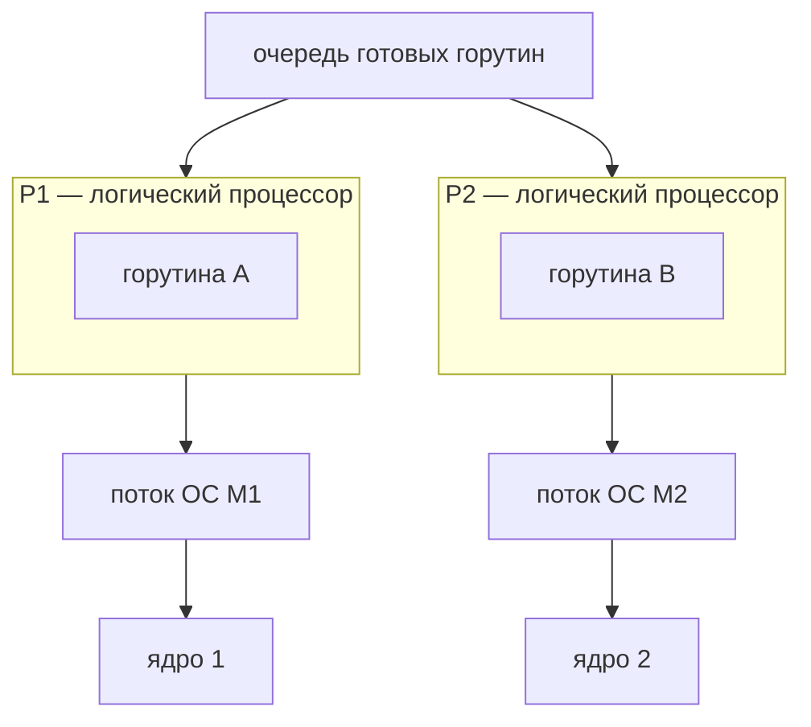
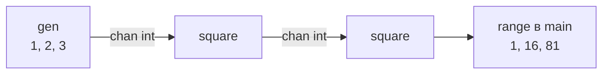
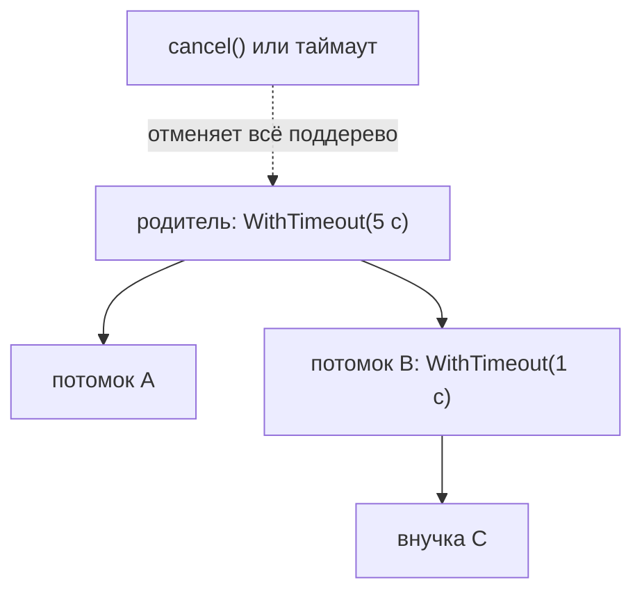
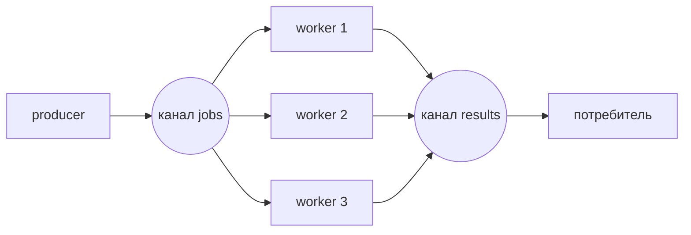

# Глава 5. Конкурентность: горутины, каналы, `select`, `sync`, `context`

**Цели главы:** понять модель конкурентности Go; безопасно запускать параллельную работу; находить гонки данных; отменять операции через `context`; применять базовые паттерны (воркер-пул, пайплайн, fan-in).

⏱ ~2 недели (самая важная и самая сложная глава части I) · предыдущая: [Глава 4](04-moduli-testy-generiki.md) · следующая: [Глава 6](06-http-server.md)

---

## 5.0. Модель: чем это отличается от JavaScript

Тысячи горутин планировщик раскладывает по нескольким потокам ОС — выполнение реально параллельно:



| JavaScript / Node | Go |
|---|---|
| Один поток исполнения + event loop | Планировщик Go раскладывает тысячи **горутин** по нескольким потокам ОС — выполнение **реально параллельно** |
| Конкурентность через колбэки / `Promise` / `async`-`await` | Код пишется **синхронно** (блокирующе), конкурентность — ключевым словом `go` |
| Гонок данных практически нет (код между `await` не прерывается) | Гонки **есть**: две горутины одновременно пишут в одну переменную — неопределённое поведение |
| `Promise.all` | `sync.WaitGroup` / `errgroup` |
| `AbortController` | `context.Context` |
| RxJS `Subject`, `switchMap` | каналы, отмена через `context` |

**Горутина** — легковесная «нить» под управлением рантайма Go: стартовый стек ~2 КБ, создание дешёвое, можно держать **сотни тысяч**. Каждый HTTP-запрос в `net/http` обрабатывается в своей горутине — поэтому конкурентность вам нужна уже в главе 6.

> **Конкурентность ≠ параллелизм.** Конкурентность — структура программы (много независимых задач в процессе). Параллелизм — одновременное исполнение на нескольких ядрах. Go даёт первое и использует второе, когда есть ядра.

## 5.1. Горутины и `WaitGroup`

```go
package main

import (
	"fmt"
	"sync"
)

func main() {
	var wg sync.WaitGroup

	for i := 1; i <= 3; i++ {
		wg.Add(1) // ДО запуска горутины, не внутри неё
		go func() {
			defer wg.Done()
			fmt.Println("воркер", i) // порядок вывода каждый раз разный
		}()
	}

	wg.Wait() // ждём, пока счётчик не станет 0
	fmt.Println("все закончили")
}
```

- `go f(x)` запускает вызов в новой горутине и **сразу** возвращает управление.
- Когда `main` завершается, **все горутины убиваются** — без `Wait` программа может выйти раньше.
- Возвращаемые значения горутины теряются: результат передают через канал или записывают в «свою» ячейку.
- В Go 1.25+ есть сокращение `wg.Go(func() { ... })`, заменяющее `Add`+`go`+`Done`.

## 5.2. Гонки данных и `sync`

```go
package main

import (
	"fmt"
	"sync"
)

func main() {
	var counter int
	var wg sync.WaitGroup
	for i := 0; i < 1000; i++ {
		wg.Add(1)
		go func() {
			defer wg.Done()
			counter++ // ЧТЕНИЕ-ИЗМЕНЕНИЕ-ЗАПИСЬ — не атомарно!
		}()
	}
	wg.Wait()
	fmt.Println(counter) // почти наверняка меньше 1000
}
```

Это **data race**: несколько горутин обращаются к одной переменной, минимум одна пишет, синхронизации нет. Результат не определён (потерянные обновления, битые данные, редкие крэши).

### Детектор гонок

```bash
go run -race main.go
go test -race ./...
```

Он находит гонки **во время выполнения** (замедляет программу в 5–10×) и печатает стеки обеих горутин. **Тесты конкурентного кода всегда гоняйте с `-race`**, в CI — тоже.

> 🪟 **Windows:** `-race` требует cgo и gcc. Если у вас нет компилятора, запускайте в Linux-контейнере (Docker на вашей машине уже есть):
>
> ```powershell
> # PowerShell, из корня учебника
> docker run --rm -v "${PWD}:/src" -w /src golang:1.24 go test -race ./tasks/ch05/...
> ```
> ```bash
> # Git Bash / WSL / macOS / Linux
> docker run --rm -v "$(pwd):/src" -w /src golang:1.24 go test -race ./tasks/ch05/...
> ```
> (Подойдёт любой образ `golang` версии не ниже 1.22. Первый запуск скачивает образ — это нормально.)

<!-- viz:RaceViz -->

### Три способа починить

**1. Мьютекс** — «один за раз»:

```go
var mu sync.Mutex
mu.Lock()
counter++
mu.Unlock()
```

Идиома — `defer mu.Unlock()` сразу после `Lock()`. `sync.RWMutex` разрешает много читателей **или** одного писателя (`RLock`/`RUnlock`).

**2. Атомарные операции** — для одного числа/флага:

```go
var counter atomic.Int64 // import "sync/atomic"
counter.Add(1)
fmt.Println(counter.Load())
```

**3. Передать владение через канал** — только одна горутина «владеет» данными и обрабатывает запросы к ним (см. 5.3).

Прочее из `sync`:

| Тип | Назначение |
|---|---|
| `sync.Mutex`, `sync.RWMutex` | защита общих данных |
| `sync.WaitGroup` | ждать группу горутин |
| `sync.Once` | выполнить действие ровно один раз (ленивая инициализация) |
| `sync.Map` | потокобезопасная мапа для особых случаев (чаще лучше `Mutex` + `map`) |
| `sync.Pool` | пул переиспользуемых объектов (оптимизация, редко) |

> ⚠️ **Мьютекс нельзя копировать** после первого использования: структуру с мьютексом передавайте по указателю. `go vet` ловит это (`copylocks`).

## 5.3. Каналы

**Канал** — типизированная труба между горутинами. «Не общайтесь через общую память — делитесь памятью через общение» (пословица Go).

```go
ch := make(chan int)      // небуферизованный: отправка ждёт получателя (рандеву)
bch := make(chan int, 3)  // буферизованный: отправка блокируется, только если буфер полон

ch <- 42                  // отправить
v := <-ch                 // получить
v, ok := <-ch             // ok == false, если канал закрыт и пуст
close(ch)                 // закрыть: «больше значений не будет»
for v := range ch { }     // читать, пока канал не закроют
```

Правила (выучите — это источник половины багов):

1. **Закрывает отправитель**, а не получатель. Закрывать нужно только если получателю важно знать, что данных больше не будет.
2. **Отправка в закрытый канал — паника.** Двойное закрытие — паника.
3. Чтение из закрытого канала не блокируется: возвращает нулевое значение и `ok == false`.
4. Операции с `nil`-каналом **блокируются навсегда**.
5. Если все горутины заснули: `fatal error: all goroutines are asleep - deadlock!`.

Направленные типы фиксируют намерение в сигнатуре:

```go
func producer(out chan<- int) // только отправка
func consumer(in <-chan int)  // только получение
```

### Пример: конвейер (pipeline)



```go
package main

import "fmt"

func gen(nums ...int) <-chan int {
	out := make(chan int)
	go func() {
		defer close(out) // отправитель закрывает
		for _, n := range nums {
			out <- n
		}
	}()
	return out
}

func square(in <-chan int) <-chan int {
	out := make(chan int)
	go func() {
		defer close(out)
		for n := range in {
			out <- n * n
		}
	}()
	return out
}

func main() {
	for v := range square(square(gen(1, 2, 3))) {
		fmt.Println(v) // 1, 16, 81
	}
}
```

Каждая стадия — своя горутина; данные текут через каналы; закрытие распространяется вниз по цепочке, и `range` в `main` завершается.

## 5.4. `select`

`select` — как `switch`, но по операциям с каналами: выполняется та ветка, которая **готова**; если готовы несколько — выбирается случайная.

```go
select {
case v := <-ch1:
	fmt.Println("из ch1:", v)
case ch2 <- 7:
	fmt.Println("отправили в ch2")
case <-time.After(2 * time.Second):
	fmt.Println("таймаут")
case <-ctx.Done():
	fmt.Println("отмена:", ctx.Err())
default: // если ни одна не готова — не блокироваться
	fmt.Println("пока ничего")
}
```

Типичный цикл воркера:

```go
for {
	select {
	case <-ctx.Done():
		return
	case job, ok := <-jobs:
		if !ok {
			return // канал закрыт
		}
		process(job)
	case <-ticker.C:
		flush()
	}
}
```

## 5.5. `context` — отмена, таймауты, дедлайны

Отмена идёт вниз по дереву: отменили родителя — отменились все потомки.



`context.Context` передаётся **первым параметром** в каждую функцию, которая может быть долгой или ходить в сеть/БД. Это единый механизм «хватит, останавливайся».

```go
package main

import (
	"context"
	"fmt"
	"time"
)

func slowOp(ctx context.Context) error {
	select {
	case <-time.After(1 * time.Second): // имитация долгой работы
		return nil
	case <-ctx.Done():
		return ctx.Err() // context.DeadlineExceeded или context.Canceled
	}
}

func main() {
	ctx, cancel := context.WithTimeout(context.Background(), 100*time.Millisecond)
	defer cancel() // ВСЕГДА вызывайте cancel — освобождает ресурсы

	err := slowOp(ctx)
	fmt.Println(err) // context deadline exceeded
}
```

| Конструктор | Смысл |
|---|---|
| `context.Background()` | корень (в `main`, тестах, фоновых задачах) |
| `WithCancel(parent)` | отмена вручную: `cancel()` |
| `WithTimeout(parent, d)` / `WithDeadline(parent, t)` | автоотмена |
| `WithValue(parent, key, val)` | данные «в рамках запроса» (request ID, пользователь) — **только** их |

Правила:

- Контекст — **первый параметр**, называется `ctx`. **Не храните его в структурах.**
- Отмена идёт **вниз** по дереву: отменили родителя — отменились все потомки.
- `defer cancel()` сразу после создания.
- В HTTP: `r.Context()` отменяется, когда клиент ушёл. Передавайте его в запросы к БД — запрос остановится, если пользователь закрыл вкладку.
- Ключи для `WithValue` — **собственный неэкспортируемый тип**, а не строка: `type ctxKey struct{}`.
- Проверяйте `ctx.Done()` в длинных циклах и при блокирующих операциях; стандартные пакеты (`net/http`, `database/sql`) уже принимают контекст.

> 🔁 **Аналог:** `AbortController.signal` из `fetch`; `takeUntil`/`switchMap`-отмена в RxJS.

## 5.6. Паттерны

### Воркер-пул



Ограничить число одновременно работающих горутин:

```go
func worker(id int, jobs <-chan int, results chan<- int, wg *sync.WaitGroup) {
	defer wg.Done()
	for j := range jobs {
		results <- j * 2
	}
}

func main() {
	jobs := make(chan int)
	results := make(chan int, 100)

	var wg sync.WaitGroup
	for w := 1; w <= 4; w++ { // 4 воркера
		wg.Add(1)
		go worker(w, jobs, results, &wg)
	}

	for i := 0; i < 20; i++ {
		jobs <- i
	}
	close(jobs) // воркеры выйдут из range
	wg.Wait()
	close(results)
}
```

### Fan-out / fan-in

*Fan-out* — несколько воркеров читают один канал; *fan-in* — один канал получает значения из нескольких (задача `merge`).

### Семафор на буферизованном канале

```go
sem := make(chan struct{}, 5) // не более 5 одновременно
for _, u := range urls {
	sem <- struct{}{} // занять слот (блокируется, если все заняты)
	go func() {
		defer func() { <-sem }() // освободить слот
		fetch(u)
	}()
}
```

### `errgroup` — `Promise.all` для Go

Пакет `golang.org/x/sync/errgroup` (внешний, но де-факто стандарт):

```go
import "golang.org/x/sync/errgroup"

g, ctx := errgroup.WithContext(ctx) // ctx отменяется при первой ошибке
g.SetLimit(5)                       // не более 5 одновременно
for _, u := range urls {
	g.Go(func() error {
		return fetch(ctx, u)
	})
}
if err := g.Wait(); err != nil { // первая ошибка
	return err
}
```

### Ограничение частоты

```go
ticker := time.NewTicker(200 * time.Millisecond) // не чаще 5 раз в секунду
defer ticker.Stop()
for _, job := range jobs {
	<-ticker.C
	go run(job)
}
```
Для серьёзных случаев — `golang.org/x/time/rate` (token bucket).

### Грациозное завершение (graceful shutdown)

Сервис должен по `SIGINT`/`SIGTERM` перестать принимать работу, дождаться текущей и выйти:

```go
ctx, stop := signal.NotifyContext(context.Background(), os.Interrupt, syscall.SIGTERM)
defer stop()

// ... запустить воркеры, передав им ctx ...

<-ctx.Done()       // ждём сигнал
fmt.Println("останавливаемся...")
wg.Wait()          // дожидаемся воркеров
```

Версия для HTTP-сервера — в [главе 6](06-http-server.md).

## 5.7. Типичные ошибки

| Ошибка | Последствие | Как избежать |
|---|---|---|
| **Утечка горутины**: отправка в канал, из которого никто не читает | горутина живёт вечно, растёт память | всегда понимайте, **кто и когда** завершит горутину; буферизованный канал или `select` с `ctx.Done()` |
| Запуск горутины на каждый элемент без лимита | миллион горутин → OOM, перегрузка БД | воркер-пул / семафор / `errgroup.SetLimit` |
| `wg.Add(1)` **внутри** горутины | `Wait` может проскочить раньше `Add` | `Add` до `go` |
| Закрытие канала получателем / двойное закрытие | паника | закрывает один владелец-отправитель |
| Копирование мьютекса | сломанная синхронизация | указатели; `go vet` |
| Запись в общую мапу из горутин | `fatal error: concurrent map writes` | `Mutex`, `sync.Map` или владение через канал |
| Забыли `defer cancel()` | утечка таймеров/контекстов | `defer cancel()` сразу |
| Захват переменной цикла (до Go 1.22) | все горутины видят последнее значение | в `go 1.22+` исправлено; в старом коде — копия `i := i` |
| Блокировка без таймаута на внешних вызовах | зависшие запросы копятся | `context` с дедлайном, `http.Client{Timeout}` |

## 5.8. Что выбирать: канал или мьютекс

- **Каналы** — когда передаёте *владение данными*, строите *конвейер*, ждёте *события/сигнала*, координируете *завершение*.
- **Мьютекс** — когда защищаете *общее состояние* (кэш, счётчики, реестр). Это не «плохо» — это прагматично и быстрее.
- **Атомики** — одно число или флаг.
- Не изобретайте: если хватает `errgroup` или `WaitGroup` — берите их.

---

## Задачи

> Запускайте с детектором гонок (см. врезку про Windows): `go test -race ./tasks/ch05/...`

1. 📦🟡 **ParallelSum** — [`tasks/ch05/parsum`](tasks/ch05/parsum/parsum.go). Разбейте слайс на части, считайте в горутинах.
2. 📦🟡 **SafeCounter** — [`tasks/ch05/counter`](tasks/ch05/counter/counter.go). Потокобезопасный счётчик по ключам.
3. 📦🔴 **Воркер-пул** — [`tasks/ch05/workerpool`](tasks/ch05/workerpool/workerpool.go). Лимит параллелизма, порядок результатов, отмена по первой ошибке и по `ctx`.
4. 📦🔴 **Merge (fan-in)** — [`tasks/ch05/merge`](tasks/ch05/merge/merge.go). Слияние каналов на дженериках.
5. 🟢 **Охота на гонку.** Запустите программу из 5.2 с `-race`, прочтите отчёт. Исправьте её **тремя способами**: `Mutex`, `atomic`, канал (одна горутина-владелец счётчика). Для каждого измерьте время при 1 000 000 инкрементов.
6. 🟡 **Параллельный fetcher.** Поднимите `httptest.NewServer` с обработчиком, отвечающим с рандомной задержкой 0–300 мс (и иногда `500`). Напишите `FetchAll(ctx, urls, maxParallel, perRequestTimeout) []Result` (`Result{URL, Status, Err, Duration}`): не более `maxParallel` запросов одновременно, результаты — в порядке `urls`, ошибка одного не останавливает остальных, общая отмена по `ctx`.
7. 🟡 **Graceful shutdown.** Программа запускает 3 воркера, каждый «обрабатывает» задачу 2 секунды в цикле. По `Ctrl+C` — не берёт новые задачи, **дорабатывает текущие**, печатает итог и выходит с кодом 0. Если не успели за 5 секунд — выход с кодом 1.
8. 🟡 **Debounce.** `Debounce(d time.Duration, f func()) (call func())`: `f` вызывается через `d` после **последнего** вызова `call`. Аналог RxJS `debounceTime`. Проверьте тестом с короткими таймаутами (потокобезопасно: `call` могут вызывать из многих горутин).
9. 🔴 **Pipeline с отменой.** Стадии: генератор чисел → возведение в квадрат (3 параллельных воркера, fan-out/fan-in) → фильтр «оканчивается на цифру 1» → приёмник. Все стадии останавливаются по `ctx` без утечек: сравните `runtime.NumGoroutine()` до и после (с небольшой паузой).
10. 🔴 **Pub/Sub брокер в памяти.** `Subscribe(topic string) (msgs <-chan string, unsubscribe func())`, `Publish(topic, msg string)`, `Close()`. Медленный подписчик **не должен блокировать** остальных (буфер на подписчика + политика при переполнении: drop oldest или drop new — выберите и обоснуйте). Без гонок и утечек.
11. 🔴 **Deadlock-лаборатория.** Воспроизведите взаимную блокировку двух мьютексов (`A→B` и `B→A`) и дедлок на небуферизованном канале. Прочтите сообщения рантайма. Исправьте: единый порядок захвата локов; пересмотр владения каналом.

## Самопроверка

- Чем горутина отличается от потока ОС? Что произойдёт, если `main` завершится раньше горутин?
- Что такое гонка данных? Как её найти? Почему «работает у меня» ничего не доказывает?
- Три способа защитить счётчик — и когда какой выбрать.
- Чем буферизованный канал отличается от небуферизованного? Что происходит при чтении из закрытого канала? При записи?
- Кто должен закрывать канал? Что будет при двойном закрытии?
- Что делает `select` с `default`? Как реализовать таймаут?
- Как работает отмена через `context`? Почему нужен `defer cancel()`? Почему контекст не хранят в структуре?
- Как ограничить число одновременно работающих горутин?
- Что такое утечка горутины и как её заметить (`pprof`, глава 15)?

➡️ **Часть I пройдена.** Если все 📦-задачи зелёные и вы можете объяснить самопроверку — переходите к [главе 6. HTTP-сервер](06-http-server.md).
