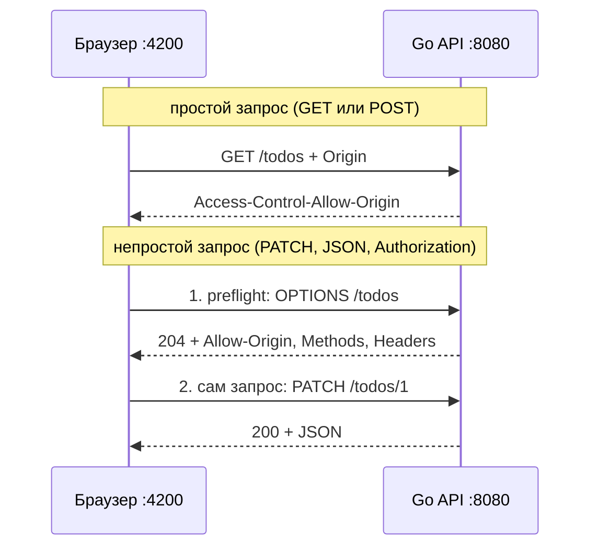
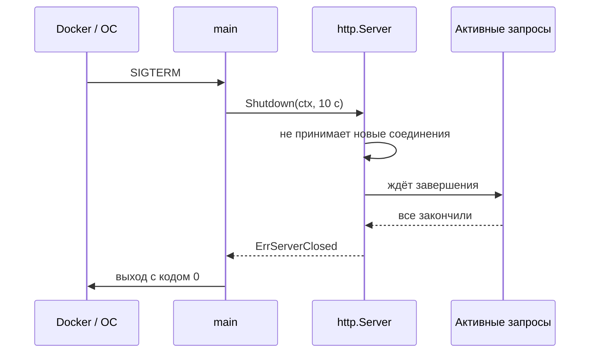

# Глава 6. HTTP-сервер: `net/http`, JSON, middleware, REST

**Цели главы:** написать полноценный HTTP API на стандартной библиотеке; понять middleware, CORS и грациозное завершение; спроектировать REST-интерфейс, с которым приятно работать Angular-клиенту.

⏱ ~1,5 недели · предыдущая: [Глава 5](05-konkurentnost.md) · следующая: [Глава 7](07-sql-postgres.md)

---

## 6.1. Минимальный сервер и интерфейс `http.Handler`

```go
package main

import (
	"fmt"
	"log"
	"net/http"
)

func main() {
	http.HandleFunc("/hello", func(w http.ResponseWriter, r *http.Request) {
		fmt.Fprintln(w, "Привет из Go!")
	})
	log.Fatal(http.ListenAndServe(":8080", nil))
}
```

Вся магия `net/http` — один интерфейс (вспомните главу 3):

```go
type Handler interface {
	ServeHTTP(w http.ResponseWriter, r *http.Request)
}
```

- `http.ResponseWriter` — куда писать ответ (интерфейс `io.Writer` + заголовки + статус).
- `*http.Request` — всё про запрос: метод, URL, заголовки, тело, контекст.
- `http.HandlerFunc` — адаптер, превращающий обычную функцию в `Handler`.
- Каждый запрос обрабатывается **в отдельной горутине** → общее состояние защищайте (глава 5).

### Маршрутизация: `ServeMux` (Go 1.22+)

С Go 1.22 стандартный роутер понимает методы и параметры пути — для большинства API сторонний роутер не нужен:

```go
mux := http.NewServeMux() // свой mux, а не глобальный http.DefaultServeMux

mux.HandleFunc("GET /users", listUsers)
mux.HandleFunc("POST /users", createUser)
mux.HandleFunc("GET /users/{id}", getUser)        // r.PathValue("id")
mux.HandleFunc("DELETE /users/{id}", deleteUser)
mux.HandleFunc("GET /files/{path...}", serveFile) // {path...} — «хвост» пути
mux.HandleFunc("GET /{$}", index)                 // только точно "/"
```

- Побеждает **самый специфичный** шаблон; конфликты обнаруживаются при регистрации (паника на старте — это хорошо).
- Неподходящий метод на существующем пути даёт автоматический `405 Method Not Allowed` с заголовком `Allow`.
- `http.StripPrefix`, `http.FileServer` — раздача статики (например, собранного Angular-приложения!).

### Настройка сервера: таймауты обязательны

`http.ListenAndServe(":8080", nil)` — для примеров. В продакшене задавайте таймауты, иначе медленные клиенты (в том числе злонамеренные, *slowloris*) будут держать соединения вечно:

```go
srv := &http.Server{
	Addr:              ":8080",
	Handler:           mux,
	ReadHeaderTimeout: 5 * time.Second,  // на чтение заголовков
	ReadTimeout:       10 * time.Second, // на чтение всего запроса
	WriteTimeout:      15 * time.Second, // на запись ответа
	IdleTimeout:       60 * time.Second, // keep-alive простой
}
```

## 6.2. Разбор запроса

```go
func getUser(w http.ResponseWriter, r *http.Request) {
	idStr := r.PathValue("id")                // из шаблона /users/{id}
	id, err := strconv.Atoi(idStr)
	...
	q := r.URL.Query()                        // ?limit=10&sort=name
	limit := q.Get("limit")                   // "" если нет
	tags := q["tag"]                          // ?tag=a&tag=b → []string{"a","b"}

	ua := r.Header.Get("User-Agent")
	token := r.Header.Get("Authorization")
	cookie, err := r.Cookie("session")
	ctx := r.Context()                        // отменяется, когда клиент ушёл
}
```

### Тело запроса — JSON

```go
func createUser(w http.ResponseWriter, r *http.Request) {
	r.Body = http.MaxBytesReader(w, r.Body, 1<<20) // не больше 1 МБ — защита от гигантских тел

	var in struct {
		Name  string `json:"name"`
		Email string `json:"email"`
	}
	dec := json.NewDecoder(r.Body)
	dec.DisallowUnknownFields() // опечатки в полях клиента → 400, а не молчаливое игнорирование
	if err := dec.Decode(&in); err != nil {
		writeError(w, http.StatusBadRequest, "invalid JSON body")
		return
	}
	// ... валидация и сохранение
}
```

Тело закрывать на сервере не нужно (`net/http` делает сам).

## 6.3. Формирование ответа

Порядок строго такой: **заголовки → статус → тело**. После первой записи в тело или `WriteHeader` заголовки изменить нельзя; `WriteHeader` — один раз.

```go
func writeJSON(w http.ResponseWriter, status int, v any) {
	w.Header().Set("Content-Type", "application/json")
	w.WriteHeader(status)
	if err := json.NewEncoder(w).Encode(v); err != nil {
		slog.Error("write response", "err", err) // статус уже отправлен — остаётся только логировать
	}
}

func writeError(w http.ResponseWriter, status int, msg string) {
	writeJSON(w, status, map[string]string{"error": msg})
}
```

Если не вызвать `WriteHeader`, статус будет `200`. Для `204 No Content` тела нет.

## 6.4. JSON: что важно знать

```go
type User struct {
	ID        int64      `json:"id"`
	Email     string     `json:"email"`
	Name      string     `json:"name,omitempty"`   // пропустить, если пусто
	Password  string     `json:"-"`                // никогда не сериализуется
	CreatedAt time.Time  `json:"created_at"`       // RFC 3339: "2026-03-01T12:00:00Z"
	DeletedAt *time.Time `json:"deleted_at"`       // nil → null
	Tags      []string   `json:"tags"`             // nil → null, []string{} → []
}
```

Особенности, о которых узнают на собственных граблях:

| Особенность | Что делать |
|---|---|
| `nil`-слайс → `null`, пустой → `[]` | Angular ждёт массив: инициализируйте `[]T{}` |
| Поля **экспортируемые** (с заглавной) | неэкспортируемые не сериализуются — частая причина «пустого» JSON |
| Неизвестные поля при `Decode` **игнорируются** | включайте `DisallowUnknownFields` |
| Числа в `any` → `float64` | декодируйте в типизированные структуры |
| **`int64` > 2⁵³ теряет точность в JavaScript** | большие ID отдавайте строкой (`json:",string"`) или используйте UUID |
| Регистр имён при `Decode` нечувствителен | не полагайтесь на это |
| Нужен кастомный формат | реализуйте `MarshalJSON`/`UnmarshalJSON` или `encoding.TextMarshaler` |
| Частичный разбор | `json.RawMessage` откладывает разбор вложенного куска |

> 🔁 **Контракт с Angular.** Структура Go + теги = ваш `interface User` в TS. Поддерживайте их синхронными вручную — или генерируйте TS-типы из OpenAPI (глава 14).

## 6.5. Middleware


**Middleware** — функция, оборачивающая обработчик. Тип `func(http.Handler) http.Handler`. Это аналог `HttpInterceptor` в Angular: общая логика до и после обработчика.

```go
func logging(next http.Handler) http.Handler {
	return http.HandlerFunc(func(w http.ResponseWriter, r *http.Request) {
		start := time.Now()
		rec := &statusRecorder{ResponseWriter: w, status: http.StatusOK}

		next.ServeHTTP(rec, r) // вызываем «внутренний» обработчик

		slog.Info("request",
			"method", r.Method,
			"path", r.URL.Path,
			"status", rec.status,
			"duration", time.Since(start),
		)
	})
}

// statusRecorder запоминает код ответа, оборачивая ResponseWriter.
type statusRecorder struct {
	http.ResponseWriter
	status int
}

func (r *statusRecorder) WriteHeader(code int) {
	r.status = code
	r.ResponseWriter.WriteHeader(code)
}

// Unwrap нужен http.ResponseController, чтобы «пробиться» к Flush/Hijack оригинала.
func (r *statusRecorder) Unwrap() http.ResponseWriter { return r.ResponseWriter }
```

Соединение в цепочку (задача `Chain` из [`tasks/ch06/middleware`](tasks/ch06/middleware/middleware.go)):

```go
handler := Chain(mux, RequestID, Logging, Recover, CORS)
// Порядок: RequestID → Logging → Recover → CORS → mux
// (первый — самый внешний)
```

Порядок важен: `RequestID` должен быть раньше `Logging` (чтобы id попал в лог), `Recover` — снаружи большинства (чтобы ловить паники), но внутри `Logging` (чтобы 500 всё равно залогировался).

Типичный набор: **request ID, логирование, recover, CORS, таймаут (`http.TimeoutHandler`), авторизация (глава 10), лимиты запросов, сжатие**.

<!-- viz:MiddlewareViz -->

## 6.6. CORS — боль каждого фронтендера (теперь с обратной стороны)

**Same-origin policy:** браузер запрещает JS со страницы `http://localhost:4200` читать ответы от `http://localhost:8080` — это **разные origin** (схема + хост + порт). Сервер должен явно разрешить: заголовками `Access-Control-*`.



Минимальный CORS-middleware:

```go
func cors(allowed []string, next http.Handler) http.Handler {
	allow := make(map[string]bool, len(allowed))
	for _, o := range allowed {
		allow[o] = true
	}
	return http.HandlerFunc(func(w http.ResponseWriter, r *http.Request) {
		origin := r.Header.Get("Origin")
		if origin != "" && allow[origin] {
			h := w.Header()
			h.Set("Access-Control-Allow-Origin", origin) // конкретный origin, не "*", если нужны cookies
			h.Add("Vary", "Origin")
			h.Set("Access-Control-Allow-Credentials", "true")
			if r.Method == http.MethodOptions && r.Header.Get("Access-Control-Request-Method") != "" {
				h.Set("Access-Control-Allow-Methods", "GET, POST, PUT, PATCH, DELETE, OPTIONS")
				h.Set("Access-Control-Allow-Headers", "Content-Type, Authorization")
				h.Set("Access-Control-Max-Age", "600")
				w.WriteHeader(http.StatusNoContent)
				return
			}
		}
		next.ServeHTTP(w, r)
	})
}
```

Важно:
- CORS защищает **браузер пользователя**, а не ваш сервер: `curl` его не уважает. Это не механизм авторизации.
- `Allow-Origin: *` несовместим с `Allow-Credentials: true`.
- **Лучший способ в разработке — вообще обойти CORS**: dev-прокси Angular. Файл `proxy.conf.json`:

```json
{
  "/api": {
    "target": "http://localhost:8080",
    "secure": false,
    "pathRewrite": { "^/api": "" }
  }
}
```
```bash
ng serve --proxy-config proxy.conf.json
```
Браузер видит единый origin `localhost:4200`, запросы на `/api/...` Angular-dev-сервер пересылает на Go. В продакшене то же делает Nginx (глава 9/16): статика и `/api` под одним доменом — CORS не нужен вовсе.

## 6.7. Структура приложения

Обработчики часто хотят зависимостей (сервис, логгер). Идиома: **структура с зависимостями + методы-обработчики**:

```go
type API struct {
	todos  TodoService
	logger *slog.Logger
}

func (a *API) Routes() http.Handler {
	mux := http.NewServeMux()
	mux.HandleFunc("GET /todos", a.listTodos)
	mux.HandleFunc("POST /todos", a.createTodo)
	return mux
}

func (a *API) listTodos(w http.ResponseWriter, r *http.Request) {
	todos, err := a.todos.List(r.Context())
	if err != nil {
		a.logger.Error("list todos", "err", err)
		writeError(w, http.StatusInternalServerError, "internal error")
		return
	}
	writeJSON(w, http.StatusOK, todos)
}
```

Никаких глобальных переменных: зависимости видны и подменяются в тестах (подробно — в главе 11).

## 6.8. Полный пример: сервер с логированием и грациозным завершением



```go
package main

import (
	"context"
	"encoding/json"
	"errors"
	"log/slog"
	"net/http"
	"os"
	"os/signal"
	"syscall"
	"time"
)

type statusRecorder struct {
	http.ResponseWriter
	status int
}

func (r *statusRecorder) WriteHeader(code int) {
	r.status = code
	r.ResponseWriter.WriteHeader(code)
}

func logging(next http.Handler) http.Handler {
	return http.HandlerFunc(func(w http.ResponseWriter, r *http.Request) {
		start := time.Now()
		rec := &statusRecorder{ResponseWriter: w, status: http.StatusOK}
		next.ServeHTTP(rec, r)
		slog.Info("request", "method", r.Method, "path", r.URL.Path,
			"status", rec.status, "duration", time.Since(start))
	})
}

func writeJSON(w http.ResponseWriter, status int, v any) {
	w.Header().Set("Content-Type", "application/json")
	w.WriteHeader(status)
	_ = json.NewEncoder(w).Encode(v)
}

func run() error {
	mux := http.NewServeMux()
	mux.HandleFunc("GET /healthz", func(w http.ResponseWriter, r *http.Request) {
		writeJSON(w, http.StatusOK, map[string]string{"status": "ok"})
	})
	mux.HandleFunc("GET /hello/{name}", func(w http.ResponseWriter, r *http.Request) {
		writeJSON(w, http.StatusOK, map[string]string{"message": "Привет, " + r.PathValue("name")})
	})

	srv := &http.Server{
		Addr:              ":8080",
		Handler:           logging(mux),
		ReadHeaderTimeout: 5 * time.Second,
		ReadTimeout:       10 * time.Second,
		WriteTimeout:      15 * time.Second,
		IdleTimeout:       60 * time.Second,
	}

	// ctx отменится по Ctrl+C или SIGTERM (его шлёт Docker/Kubernetes при остановке)
	ctx, stop := signal.NotifyContext(context.Background(), os.Interrupt, syscall.SIGTERM)
	defer stop()

	errCh := make(chan error, 1)
	go func() {
		slog.Info("listening", "addr", srv.Addr)
		errCh <- srv.ListenAndServe()
	}()

	select {
	case err := <-errCh: // сервер не смог стартовать или упал
		return err
	case <-ctx.Done():
		slog.Info("shutting down")
	}

	// даём активным запросам до 10 секунд на завершение
	shutdownCtx, cancel := context.WithTimeout(context.Background(), 10*time.Second)
	defer cancel()
	if err := srv.Shutdown(shutdownCtx); err != nil {
		return err
	}
	if err := <-errCh; err != nil && !errors.Is(err, http.ErrServerClosed) {
		return err
	}
	return nil
}

func main() {
	if err := run(); err != nil { // идиома: вся логика в run(), main — тонкая обёртка
		slog.Error("fatal", "err", err)
		os.Exit(1)
	}
}
```

Проверка:

```bash
go run .
curl -i localhost:8080/hello/Аня
curl -i -X POST localhost:8080/hello/Аня    # 405 Method Not Allowed + Allow: GET, HEAD
# Ctrl+C в окне сервера — «shutting down», выход с кодом 0
```

> 🪟 **Windows и кириллица в `curl`.** Если передать JSON с русскими буквами прямо в аргументе (`-d '{"title":"выучить Go"}'`), консоль Windows может отправить его **не в UTF-8** — сервер сохранит «кракозябры» (проверено). Надёжный способ — положить тело в файл, сохранённый в UTF-8, и отправить его: `curl -X POST ... --data-binary @body.json`. Тот же приём работает в PowerShell и Git Bash; в Postman/Bruno и в Angular проблемы нет.

**Почему `run()`:** `os.Exit` не выполняет `defer`. Вынося логику в `run() error`, вы сохраняете все `defer`-ы и получаете одно место для обработки фатальных ошибок.

## 6.9. Проектирование REST API

| Принцип | Хорошо | Плохо |
|---|---|---|
| Ресурсы — существительные, во множественном числе | `GET /todos/42` | `GET /getTodo?id=42` |
| Метод выражает действие | `DELETE /todos/42` | `POST /todos/42/delete` |
| Вложенность — для принадлежности | `GET /projects/7/tasks` | глубже 2 уровней — плохо |
| Единый формат ошибок | `{"error":"...","code":"validation_failed","fields":{...}}` | то строка, то HTML, то пустое тело |
| Статус отражает исход | `201` + `Location` при создании, `404`, `409` | `200` с `{"success":false}` |
| Время — ISO 8601 в UTC | `"2026-03-01T12:00:00Z"` | `"01.03.2026"` |
| Версия в пути | `/v1/todos` | ломающие изменения «по тихому» |

**Коды: 400 или 422?** `400` — запрос синтаксически неверен (битый JSON); `422` — синтаксис верный, но данные не проходят валидацию. Многие используют `400` для всего — главное, быть последовательным.

**`PUT` против `PATCH`.** `PUT` заменяет ресурс целиком (идемпотентно), `PATCH` — частично. Для PATCH используйте указатели в структуре (`*string`, `*bool`), чтобы отличить «не прислали» от «прислали пустое».

**Пагинация:**

| Способ | Плюсы | Минусы |
|---|---|---|
| `?limit=20&offset=40` | просто, можно «прыгнуть» на страницу | медленно на больших offset; «дрейф» при вставках |
| **Курсорная** `?limit=20&after=<id/token>` | быстро, стабильно | нельзя прыгнуть на страницу N |

Всегда ограничивайте `limit` сверху (например, 100) и возвращайте метаданные (`total`, `next_cursor`).

**Идемпотентность `POST`.** Клиент может повторить запрос после таймаута. Принимайте заголовок `Idempotency-Key`; повтор с тем же ключом возвращает сохранённый результат, а не создаёт дубль (задача 9).

**Оптимистичные блокировки.** `ETag` + `If-Match`: клиент отправляет версию, которую правит; если на сервере уже новая — `412 Precondition Failed`. Защищает от «потерянного обновления» (глава 7).

**Ошибки без утечек.** Клиенту — безопасное сообщение и код; детали (SQL-ошибка, стек) — только в лог. Единый формат ошибок — спецификация [RFC 9457 Problem Details](https://www.rfc-editor.org/rfc/rfc9457).

## 6.10. Роутеры и фреймворки

| Вариант | Когда |
|---|---|
| **`net/http` (`ServeMux`)** | по умолчанию: хватает для большинства API |
| **[chi](https://github.com/go-chi/chi)** | нужны группы маршрутов, встроенный набор middleware; **100% совместим** с `net/http` |
| gin, echo, fiber | больше «батареек», но свой тип контекста (привязка к фреймворку); fiber вообще не на `net/http` |

Рекомендация: начните со стандартной библиотеки; добавьте `chi`, если станет тесно. Чем меньше магии, тем легче менять и тестировать.

## 6.11. HTTP-клиент

```go
var client = &http.Client{Timeout: 10 * time.Second} // ОДИН клиент на программу: переиспользует соединения

func fetchUser(ctx context.Context, name string) (*User, error) {
	req, err := http.NewRequestWithContext(ctx, http.MethodGet, "https://api.example.com/users/"+url.PathEscape(name), nil)
	if err != nil {
		return nil, err
	}
	req.Header.Set("Accept", "application/json")

	resp, err := client.Do(req)
	if err != nil {
		return nil, fmt.Errorf("request: %w", err)
	}
	defer resp.Body.Close() // обязательно! иначе утечка соединений

	if resp.StatusCode != http.StatusOK {
		return nil, fmt.Errorf("unexpected status %s", resp.Status)
	}
	var u User
	if err := json.NewDecoder(io.LimitReader(resp.Body, 1<<20)).Decode(&u); err != nil {
		return nil, fmt.Errorf("decode: %w", err)
	}
	return &u, nil
}
```

Правила: **у `http.DefaultClient` нет таймаута — не используйте его в продакшене**; всегда `Context` и `defer resp.Body.Close()`; статус `4xx/5xx` — **не** ошибка `Do`, проверяйте сами; повторяйте (retry) только идемпотентные запросы, с экспоненциальной задержкой и jitter.

## 6.12. Тестирование обработчиков

`net/http/httptest` позволяет тестировать без реальной сети:

```go
func TestHealthz(t *testing.T) {
	req := httptest.NewRequest(http.MethodGet, "/healthz", nil)
	rec := httptest.NewRecorder()

	NewHandler().ServeHTTP(rec, req) // вызываем напрямую, без порта

	if rec.Code != http.StatusOK {
		t.Fatalf("status = %d, want 200", rec.Code)
	}
	var body map[string]string
	if err := json.NewDecoder(rec.Body).Decode(&body); err != nil || body["status"] != "ok" {
		t.Errorf("body = %v, err = %v", body, err)
	}
}
```

Для тестов клиента (или сквозных) — `httptest.NewServer(handler)`: поднимает настоящий сервер на случайном порту (`srv.URL`).

## 6.13. Angular → Go

```ts
// todo.service.ts
@Injectable({ providedIn: 'root' })
export class TodoService {
  private http = inject(HttpClient);
  private base = '/api/todos';          // благодаря proxy.conf.json — без CORS

  list(done?: boolean) {
    const params = done === undefined ? {} : { done: String(done) };
    return this.http.get<Todo[]>(this.base, { params });
  }
  create(title: string) { return this.http.post<Todo>(this.base, { title }); }
  toggle(t: Todo)       { return this.http.patch<Todo>(`${this.base}/${t.id}`, { done: !t.done }); }
  remove(id: number)    { return this.http.delete<void>(`${this.base}/${id}`); }
}
```

Interceptor, превращающий `{"error": "..."}` с сервера в читаемые ошибки UI, — ваш Angular-аналог серверному `writeError`. Единый формат ошибок на бэкенде делает такой interceptor тривиальным.

---

## Задачи

1. 📦🟡 **TODO API** — [`tasks/ch06/todoapi`](tasks/ch06/todoapi/todoapi.go). Полный CRUD на `ServeMux`, валидация, единый формат ошибок, потокобезопасность.
2. 📦🟡 **Middleware** — [`tasks/ch06/middleware`](tasks/ch06/middleware/middleware.go). `Chain`, `Recover`, `RequestID`.
3. 🟡 **Живой сервер.** Напишите `main.go`, который поднимает ваш `todoapi.NewHandler()` с таймаутами и грациозным завершением (как в 6.8). Пройдите CRUD в `curl` и сохраните команды в `api.http` / `smoke.sh`.
4. 🟡 **slog-логгер запросов.** Middleware логирует метод, путь, статус, длительность, размер ответа и `request_id`. Проверьте на запросе, где обработчик паникует: статус `500` должен попасть в лог. Продумайте порядок в `Chain`.
5. 🟡 **Пагинация и сортировка.** `GET /todos?limit=&offset=&sort=id|-id|title` с валидацией (`limit` ≤ 100, неизвестный `sort` → 400); верните `X-Total-Count` или оберните ответ: `{"items":[...],"total":N}`.
6. 🟡 **Angular ↔ Go.** Мини-приложение на Angular (список, добавление, переключение, удаление). Сначала **намеренно** получите CORS-ошибку и прочтите её в DevTools (Console + Network, найдите preflight `OPTIONS`). Исправьте двумя способами: (а) CORS-middleware из 6.6; (б) `proxy.conf.json`. Напишите 5 предложений, что выберете для продакшена и почему.
7. 🟡 **HTTP-клиент.** CLI `ghinfo <user>`: запрос к `https://api.github.com/users/<user>`, таймаут, `Context`, разбор нужных полей в структуру; отдельные сообщения для 404, 403 (rate limit), сетевой ошибки; один повтор на 5xx с задержкой. Протестируйте через `httptest.NewServer`.
8. 🔴 **Rate limiting.** Middleware «N запросов в секунду на IP» на `golang.org/x/time/rate` (token bucket), с очисткой неактивных лимитеров и ответом `429` + `Retry-After`. Тест без `time.Sleep`.
9. 🔴 **Idempotency-Key.** Middleware для `POST`: ключ → сохранённый ответ (в памяти, TTL 24 ч). Повтор возвращает тот же статус и тело; параллельные запросы с одним ключом — выполняется один, остальные ждут или получают `409`. Покройте тестами с `-race`.
10. 🔴 **ETag / If-Match.** Для `GET /todos/{id}` отдавайте `ETag` (хэш JSON) и отвечайте `304` на `If-None-Match`; `PATCH` требует `If-Match` и возвращает `412`, если версия устарела.

## Самопроверка

- Что такое `http.Handler` и `http.HandlerFunc`? Как работает `ServeMux` в Go 1.22?
- Почему `ListenAndServe` без таймаутов опасен?
- В каком порядке записываются заголовки, статус и тело ответа? Что будет, если вызвать `WriteHeader` дважды?
- Чем `nil`-слайс в JSON отличается от пустого? Почему `int64`-ID может сломать JS?
- Как устроен middleware и почему порядок в цепочке важен?
- Что такое preflight и зачем он нужен? Почему CORS не защищает сервер?
- Как работает graceful shutdown и почему `main` лучше делать «тонкой»?
- Почему клиент должен иметь таймаут и всегда закрывать `resp.Body`?
- Как спроектировать пагинацию и PATCH так, чтобы клиент не страдал?

➡️ Дальше: [Глава 7. SQL и PostgreSQL](07-sql-postgres.md)
