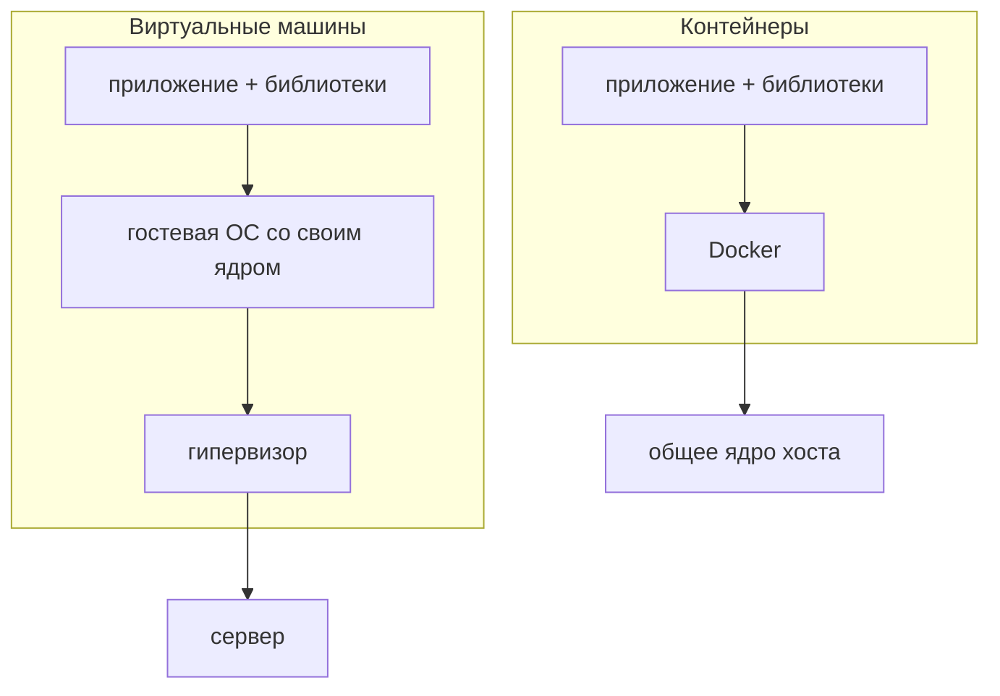
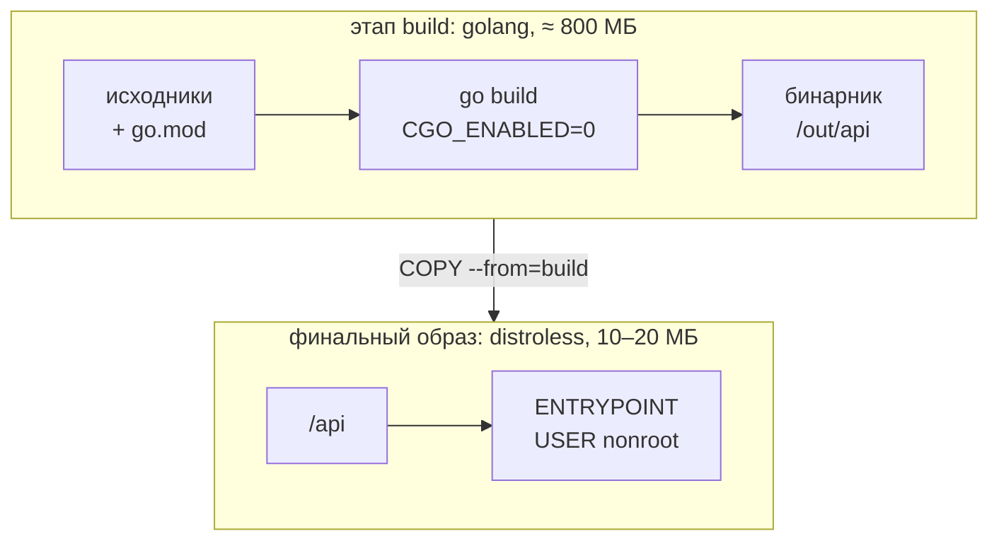
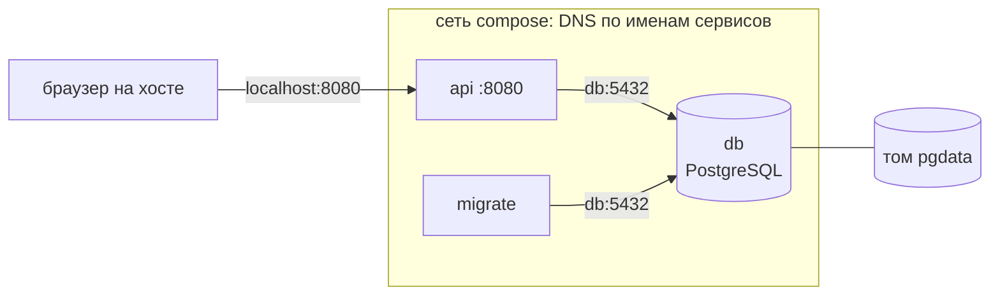

# Глава 9. Docker и Docker Compose

**Цели главы:** понять, что такое контейнер и образ; запускать БД и сервисы одной командой; упаковывать Go-сервис в маленький безопасный образ; поднимать связку «Angular + Go + PostgreSQL» через Compose.

⏱ ~1 неделя · предыдущая: [Глава 8](08-go-i-bd.md) · следующая: [Глава 10](10-auth-bezopasnost.md)

---

## 9.1. Зачем и что это



**Проблема:** «у меня работает». Разные версии ОС, библиотек, Postgres, переменных окружения. **Контейнер** упаковывает приложение **со всем окружением** и запускает одинаково на ноутбуке, в CI и на сервере.

**Контейнер ≠ виртуальная машина.** Контейнер — это обычный процесс Linux, изолированный средствами ядра (*namespaces* — своё «представление» о процессах, сети, файловой системе; *cgroups* — лимиты CPU/памяти). Ядро общее с хостом.

| | Виртуальная машина | Контейнер |
|---|---|---|
| Что внутри | целая ОС со своим ядром | только приложение и его библиотеки |
| Размер | гигабайты | десятки мегабайт |
| Запуск | минуты | доли секунды |
| Изоляция | сильная (гипервизор) | средняя (общее ядро) |

> На Windows/macOS Docker Desktop запускает **маленькую Linux-ВМ** (WSL2), а контейнеры работают в ней — поэтому внутри всегда Linux.

**Ключевые понятия:**

| Термин | Что это | Аналог |
|---|---|---|
| **Образ (image)** | неизменяемый шаблон: слои файловой системы + метаданные | `.exe`-установщик / собранный `dist/` |
| **Контейнер** | запущенный экземпляр образа | запущенный процесс |
| **Dockerfile** | рецепт сборки образа | `package.json` scripts + `ng build` |
| **Registry** | хранилище образов (Docker Hub, GHCR, ECR) | npm registry |
| **Тег** | `postgres:17` — имя версии образа (изменяемое!); надёжнее — `@sha256:` дайджест | semver |
| **Volume** | постоянное хранилище вне контейнера | диск |
| **Compose** | описание набора контейнеров в одном YAML | `docker run` ×N одной командой |

## 9.2. Основные команды

```bash
docker run hello-world                       # скачать образ (если нет) и запустить

# PostgreSQL за одну команду:
docker run -d --name pg \
  -e POSTGRES_PASSWORD=secret \
  -p 5432:5432 \
  -v pgdata:/var/lib/postgresql/data \
  postgres:17

docker ps                    # запущенные (docker ps -a — все)
docker logs -f pg            # логи (следить)
docker exec -it pg psql -U postgres   # выполнить команду ВНУТРИ контейнера (интерактивно)
docker stop pg && docker rm pg        # остановить и удалить контейнер
docker images                # образы;  docker rmi <image> — удалить
docker system df             # сколько места занято;  docker system prune — почистить
```

| Флаг | Значение |
|---|---|
| `-d` | в фоне (detached) |
| `--name` | имя контейнера |
| `-p host:container` | **публикация порта**: `-p 8080:80` — порт 8080 хоста → порт 80 контейнера |
| `-e KEY=val` | переменная окружения |
| `-v name:/path` | подключить том или папку |
| `--rm` | удалить контейнер после остановки |
| `-it` | интерактивный режим с терминалом |
| `--network` | к какой сети подключить |

## 9.3. Данные: контейнеры эфемерны

Файловая система контейнера **исчезает вместе с ним**. Всё, что должно жить дольше (данные БД), — во внешнем хранилище:

| Способ | Пример | Когда |
|---|---|---|
| **Named volume** | `-v pgdata:/var/lib/postgresql/data` | данные БД: управляет Docker, переживает удаление контейнера |
| **Bind mount** | `-v ./src:/app/src` | разработка: папка хоста «внутри» контейнера |
| tmpfs | `--tmpfs /tmp` | временные данные в памяти |

Опыт: запустите Postgres с томом, создайте таблицу, `docker rm -f pg`, запустите снова с тем же томом — таблица на месте. Без тома — всё потеряно (задача 1).

## 9.4. Сети

- Контейнеры в одной **пользовательской сети** (Compose создаёт её сам) обращаются друг к другу **по имени сервиса**: `db:5432`, `api:8080`.
- **`localhost` внутри контейнера — это сам контейнер**, а не ваш компьютер и не соседний сервис. Классическая ошибка №1: приложение в контейнере пытается подключиться к `localhost:5432` → `connection refused`. Нужно `db:5432`.
- С контейнера на хост: `host.docker.internal` (Docker Desktop).
- Порты наружу (`ports:`) нужны только тем сервисам, к которым ходит **хост/браузер**. БД внутри сети наружу публиковать не нужно — а на проде и нельзя.

## 9.5. Dockerfile для Go: multi-stage



Идея: **сборка** в тяжёлом образе с компилятором, **запуск** в минимальном — только бинарник.

```dockerfile
# syntax=docker/dockerfile:1

# ---------- этап 1: сборка ----------
FROM golang:1.24 AS build
WORKDIR /src

# Сначала только манифесты зависимостей: слой с `go mod download`
# переиспользуется из кэша, пока go.mod/go.sum не менялись.
COPY go.mod go.sum ./
RUN go mod download

COPY . .
# CGO_ENABLED=0 — статический бинарник без libc; -ldflags="-s -w" убирает отладочную информацию
RUN CGO_ENABLED=0 go build -trimpath -ldflags="-s -w" -o /out/api ./cmd/api

# ---------- этап 2: запуск ----------
FROM gcr.io/distroless/static-debian12:nonroot
COPY --from=build /out/api /api
EXPOSE 8080
USER nonroot:nonroot
ENTRYPOINT ["/api"]
```

Разбор:

| Инструкция | Назначение |
|---|---|
| `FROM ... AS name` | начало этапа; финальный образ — **последний** этап |
| `WORKDIR` | рабочая папка |
| `COPY src dst` / `COPY --from=build ...` | копирование из контекста / из другого этапа |
| `RUN` | выполнить команду **при сборке** (создаёт слой) |
| `ENV`, `ARG` | переменные окружения / аргументы сборки (**не кладите секреты**: видны в истории образа) |
| `EXPOSE` | документирует порт (не публикует!) |
| `USER` | под кем запускать (**не root**) |
| `ENTRYPOINT` / `CMD` | что запускать; `ENTRYPOINT` — программа, `CMD` — её аргументы по умолчанию |

Что это даёт: образ ≈ **10–20 МБ** вместо ≈ 800 МБ+ у образа `golang`; внутри нет shell, пакетного менеджера и лишних утилит — меньше поверхность атаки.

**Правила хорошего Dockerfile:**

1. **Порядок слоёв = порядок изменчивости.** Редко меняющееся (зависимости) — выше, часто меняющееся (исходники) — ниже, иначе кэш не работает.
2. **`.dockerignore`** — как `.gitignore` для контекста сборки: `.git`, `node_modules`, `bin/`, `*.md`, `.env`. Ускоряет сборку и не утекают секреты.
3. **`ENTRYPOINT` в exec-форме** (`["/api"]`, а не `/api`): процесс становится PID 1 и получает `SIGTERM` — ваш graceful shutdown (глава 6) сработает. В shell-форме сигнал съест `sh`.
4. **Не root:** `USER nonroot`.
5. **Фиксируйте версии** (`golang:1.24`, `postgres:17`), не `latest`.
6. Один процесс на контейнер; логи — в **stdout/stderr** (Docker их соберёт).
7. **Кэш-монтирование BuildKit** ускоряет сборку без лишних слоёв:
   ```dockerfile
   RUN --mount=type=cache,target=/go/pkg/mod \
       --mount=type=cache,target=/root/.cache/go-build \
       CGO_ENABLED=0 go build -o /out/api ./cmd/api
   ```

Варианты базового образа для финального этапа: `distroless/static` (рекомендую), `alpine` (есть shell и `wget` — удобно для healthcheck, ~5 МБ), `scratch` (совсем пусто: нужно вручную положить CA-сертификаты и tzdata).

Сборка и запуск:

```bash
docker build -t todo-api:dev .
docker run --rm -p 8080:8080 -e DATABASE_URL=... todo-api:dev
docker images todo-api        # посмотрите размер
```

## 9.6. Docker Compose



Файл `compose.yaml` описывает весь стек. **Две основные идеи:** сервисы видят друг друга по именам; порядок запуска задаётся условиями готовности.

```yaml
# compose.yaml — Go API + PostgreSQL + миграции
services:
  db:
    image: postgres:17
    environment:
      POSTGRES_USER: app
      POSTGRES_PASSWORD: ${POSTGRES_PASSWORD:?задайте POSTGRES_PASSWORD в .env}
      POSTGRES_DB: todo
    volumes:
      - pgdata:/var/lib/postgresql/data
    healthcheck:
      test: ["CMD-SHELL", "pg_isready -U app -d todo"]
      interval: 3s
      timeout: 3s
      retries: 10
    # ports НЕ публикуем: БД доступна только внутри сети compose

  migrate:
    image: migrate/migrate              # golang-migrate; на проде зафиксируйте версию тега
    command: ["-path=/migrations", "-database=postgres://app:${POSTGRES_PASSWORD}@db:5432/todo?sslmode=disable", "up"]
    volumes:
      - ./migrations:/migrations:ro
    depends_on:
      db:
        condition: service_healthy

  api:
    build: .
    environment:
      DATABASE_URL: postgres://app:${POSTGRES_PASSWORD}@db:5432/todo?sslmode=disable   # хост — имя сервиса: db
      PORT: "8080"
    ports:
      - "8080:8080"
    depends_on:
      migrate:
        condition: service_completed_successfully
    restart: unless-stopped

volumes:
  pgdata:
```

Переменные берутся из файла `.env` рядом с `compose.yaml` (или из окружения):

```bash
# .env  — в .gitignore! В репозитории лежит .env.example без реальных значений
POSTGRES_PASSWORD=change-me
```

```bash
docker compose up -d --build     # собрать и запустить всё
docker compose ps                # состояние
docker compose logs -f api       # логи одного сервиса
docker compose exec db psql -U app -d todo
docker compose run --rm api ...  # разовая команда в контейнере сервиса
docker compose config            # показать итоговую конфигурацию (проверка синтаксиса и подстановок)
docker compose down              # остановить и удалить контейнеры (тома остаются)
docker compose down -v           # + удалить тома (сброс данных!)
```

Полезное:

- `depends_on.condition`: `service_started` (по умолчанию, просто запущен), `service_healthy` (прошёл healthcheck), `service_completed_successfully` (разовая задача типа миграций завершилась с кодом 0).
- **`healthcheck`** — как Compose/оркестратор узнают, что сервис **готов**, а не просто «процесс запущен».
- `profiles` — необязательные сервисы (`pgadmin`, `prometheus`), включаются `--profile`.
- `compose.override.yaml` подхватывается автоматически: добавляйте туда dev-настройки (bind mounts, открытые порты).

### Рабочий процесс разработки

Для Go проще всего **запускать приложение на хосте** (`go run`), а в Docker держать только зависимости (БД, Redis): быстрая перекомпиляция, обычный отладчик. Образ приложения собирается для CI/прода и для финальной проверки «а в контейнере тоже работает?». Для hot reload в контейнере — утилита [`air`](https://github.com/air-verse/air) с bind-mount исходников.

## 9.7. Angular в контейнере: тот же приём

Сборка Angular — это multi-stage в зеркальном отражении: Node нужен только для сборки, раздаёт статику лёгкий nginx.

```dockerfile
# syntax=docker/dockerfile:1
FROM node:22 AS build
WORKDIR /app
COPY package.json package-lock.json ./
RUN npm ci
COPY . .
RUN npm run build -- --configuration production

FROM nginx:1.27-alpine
COPY nginx.conf /etc/nginx/conf.d/default.conf
# путь зависит от имени проекта: dist/<project>/browser (Angular 17+)
COPY --from=build /app/dist/my-app/browser /usr/share/nginx/html
EXPOSE 80
```

```nginx
# nginx.conf
server {
    listen 80;
    root /usr/share/nginx/html;
    index index.html;

    # /api/* → Go-сервис. Слеш в конце proxy_pass отрезает префикс: /api/todos → /todos
    location /api/ {
        proxy_pass http://api:8080/;
        proxy_set_header Host              $host;
        proxy_set_header X-Real-IP         $remote_addr;
        proxy_set_header X-Forwarded-For   $proxy_add_x_forwarded_for;
        proxy_set_header X-Forwarded-Proto $scheme;
    }

    # SPA-fallback: любые пути Angular-роутера отдаём index.html
    location / {
        try_files $uri $uri/ /index.html;
    }
}
```

Добавляем в Compose сервис `web` — и получаем **один origin** (браузер видит только `web:80`), поэтому **CORS не нужен** (глава 6):

```yaml
  web:
    build: ./frontend
    ports:
      - "80:80"
    depends_on:
      - api
```

Именно так выглядит продакшен-схема: единая точка входа (nginx/Caddy), под ней статика и `/api`.

## 9.8. Безопасность и гигиена

- Не запускайте процесс **от root**; минимальный базовый образ.
- **Секреты** — не в Dockerfile, не в образе, не в Git. Передавайте через окружение/секрет-хранилище оркестратора; локально — `.env` вне Git.
- Закрывайте порты БД и Redis от внешнего мира.
- Сканируйте образы на уязвимости: `docker scout cves <image>` или `trivy image <image>`.
- Ограничивайте ресурсы (`mem_limit`, `cpus`) и ставьте `read_only: true` где возможно.
- Обновляйте базовые образы регулярно.

## 9.9. Диагностика

| Симптом | Вероятная причина | Что сделать |
|---|---|---|
| Контейнер сразу завершается | приложение упало | `docker logs <имя>`, смотрите код выхода в `docker ps -a` |
| `connection refused` к БД | в контейнере `localhost` вместо `db`; БД ещё не готова | имя сервиса в DSN; `healthcheck` + `depends_on: service_healthy` |
| `port is already allocated` | порт хоста занят | поменяйте левую часть `-p 5433:5432` или остановите занявшего |
| Сборка не использует кэш | `COPY . .` раньше `go mod download` | порядок слоёв; `.dockerignore` |
| Изменения кода не видны | образ не пересобран | `docker compose up --build` |
| `exec format error` | образ собран под другую архитектуру (arm vs amd64) | `--platform linux/amd64` |
| Место на диске кончилось | старые образы/тома | `docker system df`, `docker system prune` (осторожно с `-a --volumes`) |

---

## Задачи

1. 🟢 **Постоянство данных.** Запустите PostgreSQL одной командой с named volume, создайте таблицу и строку. Удалите контейнер (`docker rm -f`), запустите заново с тем же томом — данные на месте. Повторите **без** тома и объясните разницу. (`docker volume ls`, `docker volume inspect`.)
2. 🟡 **Образ Go-сервиса.** Напишите multi-stage `Dockerfile` для вашего TODO API (из глав 6/8) и `.dockerignore`. Соберите, сравните размеры: (а) образ на `golang:1.24` без multi-stage; (б) `alpine`; (в) `distroless/static`. Проверьте через `docker run`, что `Ctrl+C` останавливает контейнер **быстро** (graceful shutdown работает; если ждёте 10 секунд — вы потеряли сигнал).
3. 🟡 **Compose-стек.** Поднимите `db` + `migrate` + `api` одной командой `docker compose up -d --build`. Обязательно: healthcheck БД, `depends_on` с условиями, пароль из `.env`, том для данных, БД **не опубликована наружу**. Проверьте: `docker compose down` сохраняет данные, `down -v` — стирает.
4. 🟡 **Angular + Go + nginx.** Добавьте сервис `web` из 9.7: `curl http://localhost/api/todos` и страница Angular работают через **один origin** без CORS-middleware. Убедитесь в DevTools (Network), что preflight-запросов нет. Обновите страницу на вложенном маршруте Angular (`/todos/42`) — `try_files` должен отдать `index.html`.
5. 🟡 **Ошибки на вкус.** Намеренно сломайте стек и диагностируйте: (а) в DSN `localhost` вместо `db`; (б) уберите `healthcheck` и `depends_on` — запустите и увидите гонку «API стартовал раньше БД»; (в) возьмите тяжёлую миграцию. Опишите по каждому: симптом → команда диагностики → исправление.
6. 🔴 **Ускорение сборки.** Измерьте время холодной и «горячей» (изменён один `.go`-файл) сборки. Добавьте cache-mounts BuildKit и перенесите `COPY go.mod go.sum` перед исходниками. Сравните цифры; опишите, какие слои кэшируются.
7. 🔴 **Healthcheck без curl.** В distroless нет shell и `curl`. Добавьте в API флаг `-healthcheck` (бинарь делает `GET /healthz` на себя и выходит с кодом 0/1) и пропишите `healthcheck` для сервиса `api` в Compose. Покажите, что `docker compose ps` отображает `healthy`.
8. 🟡 **Безопасность.** Прогоните образ через `trivy image` или `docker scout cves`; запустите контейнер с `read_only: true` и `cap_drop: [ALL]`; убедитесь, что сервис работает под `nonroot` (`docker exec ... id` не сработает в distroless — используйте `docker inspect`). Выпишите найденные проблемы и что исправили.

## Самопроверка

- Чем контейнер отличается от виртуальной машины? Чем образ — от контейнера?
- Что происходит с данными при удалении контейнера? Что такое volume?
- Почему `localhost` внутри контейнера не ведёт к БД на хосте? Как сервисы находят друг друга в Compose?
- Зачем нужен multi-stage build? Что даёт порядок `COPY go.mod` → `go mod download` → `COPY .`?
- Почему `ENTRYPOINT` пишут в exec-форме? Что такое PID 1 и сигналы?
- Чем `EXPOSE` отличается от `-p`?
- Зачем healthcheck и `depends_on: condition`? Чем `service_started` отличается от `service_healthy`?
- Почему в продакшене Angular и API обычно за одним origin?
- Почему нельзя класть пароль в `ENV` Dockerfile?

➡️ Дальше: [Глава 10. Аутентификация и безопасность](10-auth-bezopasnost.md)
