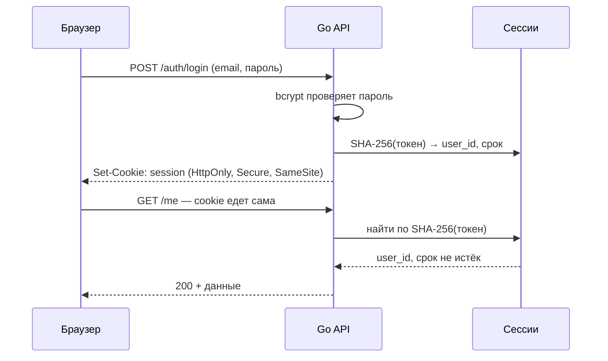
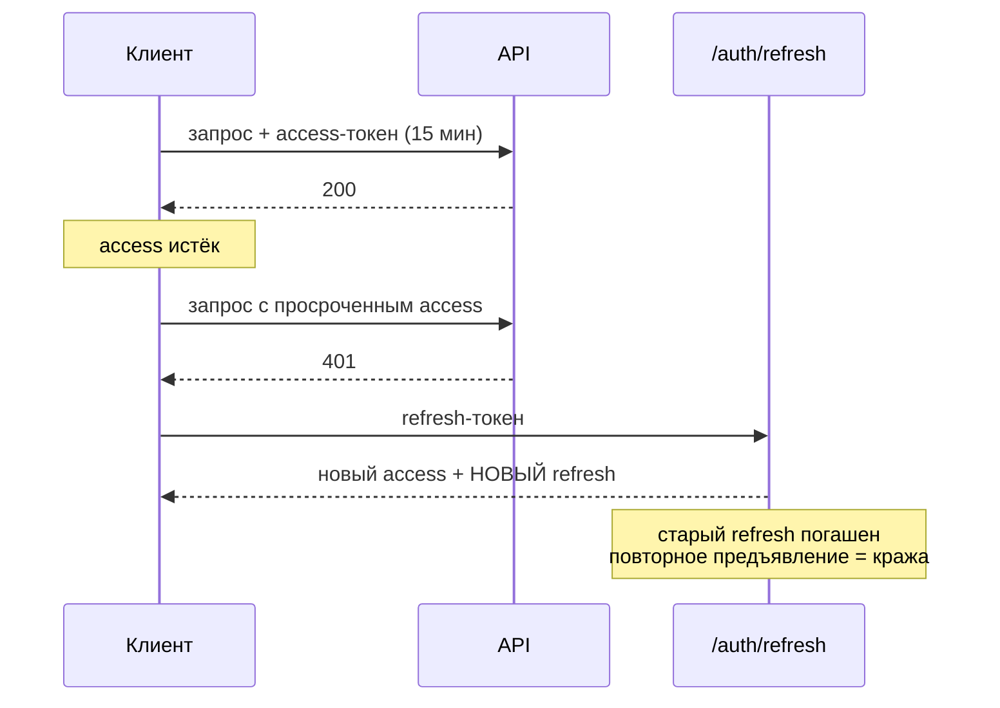
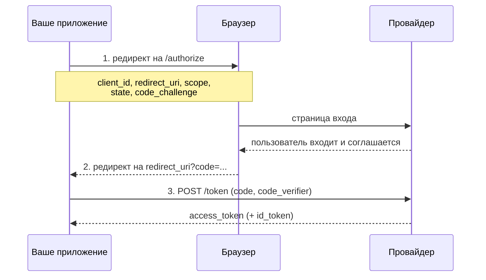
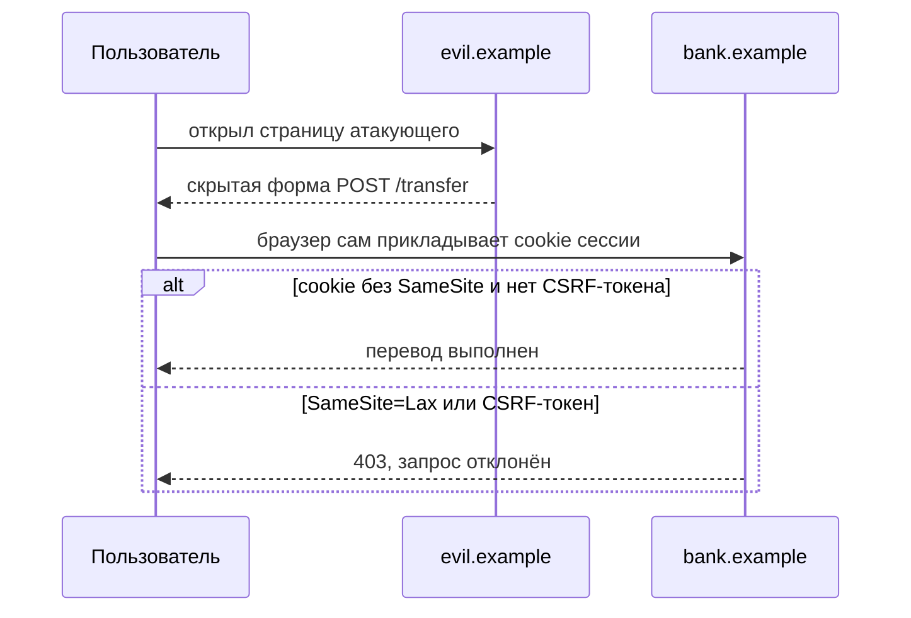

# Глава 10. Аутентификация, авторизация и безопасность

**Цели главы:** безопасно хранить пароли; реализовать вход через серверные сессии и JWT и понимать компромиссы; не допускать главную уязвимость API — нарушенный контроль доступа (IDOR); знать OWASP Top 10, CSRF, CORS, заголовки безопасности и базовую защиту от атак.

⏱ ~1,5 недели · предыдущая: [Глава 9](09-docker.md) · следующая: [Глава 11](11-arhitektura.md)

> ⚠️ Безопасность — область, где «почти правильно» = «уязвимо». Для продакшена на реальных пользователях подумайте о готовом провайдере (Keycloak, Auth0, Firebase Auth, Supabase). Но понимать, как всё устроено, **обязательно**: иначе вы не сможете ни выбрать, ни проверить.

---

## 10.1. Аутентификация и авторизация

| | Вопрос | Ошибка | Пример |
|---|---|---|---|
| **Аутентификация (AuthN)** | «Кто ты?» | `401 Unauthorized` (на деле «не аутентифицирован») | логин и пароль |
| **Авторизация (AuthZ)** | «Что тебе можно?» | `403 Forbidden` | «редактировать можно только свои задачи» |

> **Фронтенд-напоминание.** Route Guard в Angular — это **UX** (не показывать лишние кнопки). Настоящая проверка прав **только на сервере**: любой запрос можно отправить вручную через `curl`.

## 10.2. Пароли

**Правила:**

1. **Никогда** не храните пароль в открытом виде и не шифруйте обратимо. Храните **хэш**.
2. Хэш — специальный **медленный** алгоритм с солью: **`argon2id`**, **`bcrypt`**, `scrypt`. Обычные `SHA-256`/`MD5` **не подходят**: они слишком быстрые, их перебирают миллиардами в секунду.
3. **Соль** (случайная добавка) уникальна для каждого пароля — в `bcrypt` и `argon2` она встроена в строку хэша.
4. Не ограничивайте разумную длину сверху (кроме лимита bcrypt: 72 байта) и не навязывайте «одну заглавную, одну цифру»: важна длина и проверка по списку утёкших паролей (рекомендации NIST). Минимум 8–12 символов.
5. Не логируйте пароли. Не возвращайте хэши в API (`json:"-"`).
6. Сообщения «неверный email или пароль» — **одинаковые** для случаев «нет такого пользователя» и «неверный пароль» (иначе можно перебирать, кто зарегистрирован).

```go
import "golang.org/x/crypto/bcrypt"

func HashPassword(pw string) (string, error) {
	b, err := bcrypt.GenerateFromPassword([]byte(pw), bcrypt.DefaultCost) // cost 10 → ~60–100 мс
	return string(b), err
}

func CheckPassword(hash, pw string) bool {
	return bcrypt.CompareHashAndPassword([]byte(hash), []byte(pw)) == nil
}
```

Медленность — **фича**: на логин уходит ~100 мс, а перебор миллиардов вариантов становится нереальным. (Это же и вектор DoS: ограничивайте частоту логинов, 10.9.)

## 10.3. Серверные сессии



**Идея:** при входе сервер создаёт **случайный непредсказуемый токен**, запоминает у себя «токен → пользователь», а клиенту отдаёт его в **cookie**. Дальше браузер сам присылает cookie с каждым запросом.

```
POST /auth/login {email, password}
  ← 200, Set-Cookie: session=<random>; HttpOnly; Secure; SameSite=Lax
GET /me   (браузер сам добавляет Cookie: session=<random>)
  ← 200 {"id": 1, ...}
POST /auth/logout → сервер удаляет запись; cookie очищается
```

**Атрибуты cookie — обязательны:**

| Атрибут | Зачем |
|---|---|
| `HttpOnly` | JavaScript **не видит** cookie → XSS не украдёт сессию |
| `Secure` | передаётся только по HTTPS |
| `SameSite=Lax` (или `Strict`) | браузер не шлёт cookie на **межсайтовые** POST-запросы → основная защита от CSRF |
| `Path=/`, `Max-Age`/`Expires` | область действия и срок жизни |

**Хранение:** в БД (или Redis, глава 13) лежит **не сам токен, а его SHA-256-хэш**: утечка таблицы сессий не даёт злоумышленнику готовых токенов. Токен — 32 случайных байта из `crypto/rand` (**не** `math/rand`).

### Рабочий пример: логин, сессия, middleware

```go
package main

import (
	"context"
	"crypto/rand"
	"crypto/sha256"
	"encoding/base64"
	"encoding/hex"
	"encoding/json"
	"errors"
	"log"
	"net/http"
	"os"
	"strings"
	"sync"
	"time"

	"golang.org/x/crypto/bcrypt"
)

func HashPassword(pw string) (string, error) {
	b, err := bcrypt.GenerateFromPassword([]byte(pw), bcrypt.DefaultCost)
	return string(b), err
}

func CheckPassword(hash, pw string) bool {
	return bcrypt.CompareHashAndPassword([]byte(hash), []byte(pw)) == nil
}

// ---------- токены ----------

func newToken() (string, error) {
	b := make([]byte, 32)
	if _, err := rand.Read(b); err != nil {
		return "", err
	}
	return base64.RawURLEncoding.EncodeToString(b), nil
}

func hashToken(t string) string { // в хранилище — только хэш токена
	sum := sha256.Sum256([]byte(t))
	return hex.EncodeToString(sum[:])
}

// ---------- хранилище сессий (интерфейс: позже заменим на Postgres/Redis) ----------

type Session struct {
	UserID    int64
	ExpiresAt time.Time
}

var ErrNoSession = errors.New("no session")

type SessionStore interface {
	Create(tokenHash string, s Session)
	Get(tokenHash string) (Session, error)
	Delete(tokenHash string)
}

type memStore struct {
	mu sync.Mutex
	m  map[string]Session
}

func newMemStore() *memStore { return &memStore{m: map[string]Session{}} }

func (s *memStore) Create(h string, v Session) { s.mu.Lock(); s.m[h] = v; s.mu.Unlock() }
func (s *memStore) Delete(h string)            { s.mu.Lock(); delete(s.m, h); s.mu.Unlock() }
func (s *memStore) Get(h string) (Session, error) {
	s.mu.Lock()
	defer s.mu.Unlock()
	v, ok := s.m[h]
	if !ok {
		return Session{}, ErrNoSession
	}
	return v, nil
}

// ---------- HTTP ----------

type user struct {
	ID   int64
	Hash string
}

type Auth struct {
	users        map[string]user // email → пользователь (в реальности — таблица users)
	sessions     SessionStore
	dummyHash    string // для выравнивания времени ответа, если пользователя нет
	cookieSecure bool
}

type userKey struct{} // ключ контекста: собственный тип

func UserID(ctx context.Context) (int64, bool) {
	id, ok := ctx.Value(userKey{}).(int64)
	return id, ok
}

func writeJSON(w http.ResponseWriter, status int, v any) {
	w.Header().Set("Content-Type", "application/json")
	w.WriteHeader(status)
	_ = json.NewEncoder(w).Encode(v)
}

func (a *Auth) login(w http.ResponseWriter, r *http.Request) {
	var in struct {
		Email    string `json:"email"`
		Password string `json:"password"`
	}
	if err := json.NewDecoder(http.MaxBytesReader(w, r.Body, 1<<20)).Decode(&in); err != nil {
		writeJSON(w, http.StatusBadRequest, map[string]string{"error": "bad request"})
		return
	}

	u, found := a.users[strings.ToLower(strings.TrimSpace(in.Email))]
	hash := a.dummyHash // сравниваем с фиктивным хэшем, чтобы время ответа не выдавало,
	if found {          // существует ли такой email
		hash = u.Hash
	}
	if !CheckPassword(hash, in.Password) || !found {
		writeJSON(w, http.StatusUnauthorized, map[string]string{"error": "invalid email or password"})
		return
	}

	token, err := newToken()
	if err != nil {
		writeJSON(w, http.StatusInternalServerError, map[string]string{"error": "internal error"})
		return
	}
	exp := time.Now().Add(24 * time.Hour)
	a.sessions.Create(hashToken(token), Session{UserID: u.ID, ExpiresAt: exp})

	http.SetCookie(w, &http.Cookie{
		Name:     "session",
		Value:    token,
		Path:     "/",
		Expires:  exp,
		HttpOnly: true,
		Secure:   a.cookieSecure,
		SameSite: http.SameSiteLaxMode,
	})
	writeJSON(w, http.StatusOK, map[string]any{"id": u.ID})
}

func (a *Auth) logout(w http.ResponseWriter, r *http.Request) {
	if c, err := r.Cookie("session"); err == nil {
		a.sessions.Delete(hashToken(c.Value))
	}
	http.SetCookie(w, &http.Cookie{Name: "session", Value: "", Path: "/", MaxAge: -1, HttpOnly: true})
	w.WriteHeader(http.StatusNoContent)
}

// Require — middleware: пускает только с действительной сессией.
func (a *Auth) Require(next http.Handler) http.Handler {
	return http.HandlerFunc(func(w http.ResponseWriter, r *http.Request) {
		c, err := r.Cookie("session")
		if err != nil {
			writeJSON(w, http.StatusUnauthorized, map[string]string{"error": "unauthorized"})
			return
		}
		s, err := a.sessions.Get(hashToken(c.Value))
		if err != nil || time.Now().After(s.ExpiresAt) {
			writeJSON(w, http.StatusUnauthorized, map[string]string{"error": "unauthorized"})
			return
		}
		ctx := context.WithValue(r.Context(), userKey{}, s.UserID)
		next.ServeHTTP(w, r.WithContext(ctx))
	})
}

func main() {
	hash, _ := HashPassword("correct-horse-battery")
	dummy, _ := HashPassword("dummy-password-for-timing")
	a := &Auth{
		users:        map[string]user{"anna@example.com": {ID: 1, Hash: hash}},
		sessions:     newMemStore(),
		dummyHash:    dummy,
		cookieSecure: os.Getenv("COOKIE_SECURE") == "1", // локально по http — выключено; в проде ВКЛЮЧИТЬ
	}

	mux := http.NewServeMux()
	mux.HandleFunc("POST /auth/login", a.login)
	mux.HandleFunc("POST /auth/logout", a.logout)
	mux.Handle("GET /me", a.Require(http.HandlerFunc(func(w http.ResponseWriter, r *http.Request) {
		id, _ := UserID(r.Context())
		writeJSON(w, http.StatusOK, map[string]any{"id": id})
	})))

	srv := &http.Server{Addr: ":8080", Handler: mux, ReadHeaderTimeout: 5 * time.Second}
	log.Fatal(srv.ListenAndServe())
}
```

Проверка в терминале (`-c`/`-b` — файл cookie, как «банка» браузера):

```bash
curl -i localhost:8080/me                                  # 401
curl -i -c jar.txt -X POST localhost:8080/auth/login \
     -H 'Content-Type: application/json' \
     -d '{"email":"anna@example.com","password":"correct-horse-battery"}'
curl -i -b jar.txt localhost:8080/me                       # 200 {"id":1}
curl -i -b jar.txt -X POST localhost:8080/auth/logout      # 204
curl -i -b jar.txt localhost:8080/me                       # снова 401
```

**Плюсы сессий:** мгновенный отзыв (удалили запись — пользователь «выброшен»), простота, токен не несёт данных, `HttpOnly`-cookie недоступна JS. **Минусы:** нужно хранилище, общее для всех экземпляров сервера (БД/Redis); при cookie нужна защита от CSRF.

## 10.4. JWT и токены доступа



**JWT (JSON Web Token)** — подписанная строка `header.payload.signature`; в `payload` лежат **claims**: `sub` (кто), `exp` (когда истекает), `iat`, `iss` и ваши поля. Сервер проверяет **подпись** и срок — и ему **не нужно хранилище**: токен самодостаточен.

```go
import "github.com/golang-jwt/jwt/v5"

func issueAccessToken(secret []byte, userID int64) (string, error) {
	now := time.Now()
	claims := jwt.RegisteredClaims{
		Subject:   strconv.FormatInt(userID, 10),
		Issuer:    "todo-api",
		IssuedAt:  jwt.NewNumericDate(now),
		ExpiresAt: jwt.NewNumericDate(now.Add(15 * time.Minute)), // короткая жизнь!
	}
	return jwt.NewWithClaims(jwt.SigningMethodHS256, claims).SignedString(secret)
}

func parseAccessToken(secret []byte, raw string) (int64, error) {
	var claims jwt.RegisteredClaims
	_, err := jwt.ParseWithClaims(raw, &claims,
		func(t *jwt.Token) (any, error) { return secret, nil },
		jwt.WithValidMethods([]string{"HS256"}), // КРИТИЧНО: жёстко указать алгоритм
		jwt.WithIssuer("todo-api"),
		jwt.WithExpirationRequired(),
	)
	if err != nil {
		return 0, err
	}
	return strconv.ParseInt(claims.Subject, 10, 64)
}
```

Полная компилируемая версия (с `main`, выпускающим и проверяющим токен):

```go
package main

import (
	"fmt"
	"strconv"
	"time"

	"github.com/golang-jwt/jwt/v5"
)

func issueAccessToken(secret []byte, userID int64) (string, error) {
	now := time.Now()
	claims := jwt.RegisteredClaims{
		Subject:   strconv.FormatInt(userID, 10),
		Issuer:    "todo-api",
		IssuedAt:  jwt.NewNumericDate(now),
		ExpiresAt: jwt.NewNumericDate(now.Add(15 * time.Minute)),
	}
	return jwt.NewWithClaims(jwt.SigningMethodHS256, claims).SignedString(secret)
}

func parseAccessToken(secret []byte, raw string) (int64, error) {
	var claims jwt.RegisteredClaims
	_, err := jwt.ParseWithClaims(raw, &claims,
		func(t *jwt.Token) (any, error) { return secret, nil },
		jwt.WithValidMethods([]string{"HS256"}),
		jwt.WithIssuer("todo-api"),
		jwt.WithExpirationRequired(),
	)
	if err != nil {
		return 0, err
	}
	return strconv.ParseInt(claims.Subject, 10, 64)
}

func main() {
	secret := []byte("замените-на-длинный-случайный-секрет-из-окружения")

	tok, _ := issueAccessToken(secret, 42)
	fmt.Println("токен:", tok[:30]+"…")

	id, err := parseAccessToken(secret, tok)
	fmt.Println("валидный:", id, err)

	_, err = parseAccessToken([]byte("чужой-секрет"), tok)
	fmt.Println("с чужим секретом:", err) // signature is invalid
}
```

**Критичные особенности JWT:**

- Токен **подписан, но не зашифрован**: payload читается любым (base64). Не кладите туда секреты и лишние персональные данные.
- **Нельзя отозвать до истечения** (без «чёрного списка», который возвращает хранилище и сводит на нет преимущество). Поэтому access-токен живёт **5–15 минут**.
- Всегда жёстко фиксируйте допустимые алгоритмы (`WithValidMethods`): исторические уязвимости `alg: none` и подмены HS256↔RS256.
- Секрет подписи — длинный случайный, из окружения; для нескольких сервисов — асимметричная подпись (`RS256`/`EdDSA`): подписывает один, проверяют все публичным ключом.
- **Refresh-токен:** долгоживущий (дни), хранится **на сервере в виде хэша** (как сессия), даёт новый access-токен. При каждом обновлении выдаётся **новый** refresh-токен, а старый сразу гасится (*rotation*); повторное предъявление уже использованного токена = признак кражи → гасите всё «семейство».

### Сессии или JWT?

| | Серверные сессии (cookie) | JWT (access + refresh) |
|---|---|---|
| Отзыв | мгновенный | только по истечении / через refresh |
| Хранилище на сервере | нужно | access — не нужно; refresh — нужно |
| Масштабирование | общее хранилище (Redis/БД) | access проверяется локально, без обращения к БД |
| Где лежит в браузере | `HttpOnly`-cookie | чаще `localStorage` (**XSS может украсть**) или cookie |
| Защита от CSRF | нужна (`SameSite` + токен) | не нужна, если токен идёт в заголовке `Authorization` |
| Хорош для | **веб-приложений «своего» фронтенда** | мобильные клиенты, межсервисные вызовы, сторонние API |

> **Рекомендация для вашего Angular + Go:** серверные сессии в `HttpOnly; Secure; SameSite=Lax` cookie + единый origin через nginx. Это самый простой и безопасный путь; «JWT в localStorage» — популярная, но слабее защищённая от XSS схема.

## 10.5. OAuth 2.0 и OpenID Connect

**OAuth 2.0** — делегирование доступа («разреши приложению читать мои контакты в Google»); **OpenID Connect (OIDC)** — надстройка для **входа** («Войти через Google/GitHub»): возвращает `id_token` с данными пользователя.

Для SPA и веб-приложений актуален **Authorization Code Flow + PKCE**:



- `state` — защита от CSRF в процессе входа; `PKCE` (`code_challenge`/`code_verifier`) — защита кода от перехвата.
- **Секрет клиента** нельзя класть в SPA (всё в браузере видно). Либо публичный клиент с PKCE, либо **BFF** (*Backend For Frontend*): ваш Go-сервер проводит OAuth, хранит токены у себя и выдаёт браузеру обычную `HttpOnly`-cookie сессию — **лучший паттерн для SPA**.
- Не изобретайте протокол: библиотеки `golang.org/x/oauth2`, `github.com/coreos/go-oidc`, на клиенте — `angular-oauth2-oidc`. Для своего IdP — Keycloak, Ory, Authentik.
- Внешнюю личность сопоставляйте с локальным пользователем по паре `(provider, subject)`, а **не по email** (email может быть неподтверждён или переиспользован).

## 10.6. Авторизация и IDOR

**Нарушенный контроль доступа** — угроза №1 по OWASP. Самая частая форма — **IDOR** (*Insecure Direct Object Reference*): сервер проверил, что вы вошли, но не проверил, что объект **ваш**.

```go
// ❌ Любой вошедший читает ЛЮБУЮ задачу, подставив чужой id
todo, err := repo.Get(ctx, id)

// ✅ Объект запрашивается ВМЕСТЕ с владельцем — чужого просто «нет»
userID, _ := UserID(ctx)
todo, err := repo.GetForUser(ctx, id, userID) // SELECT ... WHERE id = $1 AND user_id = $2
if errors.Is(err, ErrNotFound) { writeError(w, 404, "not found"); return }
```

Почему `404`, а не `403`: ответ `403` подтверждает, что объект с таким id **существует**. Ограничение по владельцу **на уровне SQL** надёжнее проверки после загрузки: нельзя забыть `if`.

Другие модели доступа:

- **RBAC** — роли (`user`, `admin`, `moderator`), разрешения на роль; middleware `RequireRole("admin")`. Различайте: нет входа → `401`; вход есть, прав нет → `403`.
- **ABAC / правила владения** — «автор поста или модератор»; логика в сервисном слое, покрытая тестами.
- **Принцип минимальных привилегий**: по умолчанию — доступа нет.

**Mass assignment.** Не декодируйте тело запроса прямо в доменную структуру/модель БД:

```go
// ❌ клиент пришлёт {"email":"...","is_admin":true} — и станет админом
var u User
json.NewDecoder(r.Body).Decode(&u)

// ✅ отдельная структура ввода с белым списком полей
var in struct {
	Email    string `json:"email"`
	Password string `json:"password"`
	Name     string `json:"name"`
}
```

## 10.7. CSRF и CORS



**CSRF (подделка межсайтовых запросов).** Если авторизация идёт через cookie, то страница `evil.com` может заставить браузер пользователя отправить запрос на ваш сайт — **вместе с его cookie**. Защита, комбинируйте:

1. **`SameSite=Lax`/`Strict`** на cookie сессии — браузер не шлёт её на межсайтовые `POST/PUT/DELETE`. Современная база защиты.
2. **Не делать изменения в `GET`.**
3. **Проверка `Origin`/`Referer`** на изменяющих запросах (в Go 1.25+ есть готовый `http.CrossOriginProtection`).
4. **CSRF-токен** (double-submit cookie): сервер кладёт в cookie случайное значение `XSRF-TOKEN` (читаемое JS), клиент копирует его в заголовок `X-XSRF-TOKEN`, сервер сравнивает. **Angular `HttpClient` делает это автоматически** для изменяющих запросов к тому же origin — вам остаётся реализовать проверку на сервере.
5. Требовать `Content-Type: application/json` и/или кастомный заголовок: «простой» межсайтовый запрос не может их выставить без preflight.

**CORS** (глава 6) — не защита сервера, а ослабление ограничения браузера. Разрешайте **конкретные origin из белого списка**, а не `*`; не отражайте произвольный `Origin` вслепую.

## 10.8. OWASP Top 10 (редакция 2021) для бэкенд-разработчика

| # | Категория | Что делать |
|---|---|---|
| A01 | **Нарушенный контроль доступа** | проверка владельца на каждом запросе (10.6), тесты на IDOR, запрет по умолчанию |
| A02 | Сбои криптографии | HTTPS везде, `argon2id`/`bcrypt`, `crypto/rand`, никакой самодельной криптографии |
| A03 | **Инъекции** | плейсхолдеры SQL (глава 8); не собирайте команды ОС из ввода; экранирование при выводе |
| A04 | Небезопасный дизайн | моделирование угроз (задача 11), лимиты, принцип минимальных привилегий |
| A05 | Неверная конфигурация | не запускать от root, закрыть отладочные эндпоинты (`pprof`!), не отдавать стек-трейсы, заголовки безопасности |
| A06 | Уязвимые/устаревшие компоненты | `govulncheck ./...`, обновление зависимостей, сканирование образов |
| A07 | Ошибки идентификации и аутентификации | лимиты попыток, защита от перебора, надёжный сброс пароля, MFA |
| A08 | Нарушения целостности ПО/данных | проверка подписей, защищённый CI/CD, не десериализовать недоверенное |
| A09 | Недостаточное логирование и мониторинг | аудит входов и отказов, алерты (глава 15); **не** логировать секреты |
| A10 | **SSRF** | не ходить по URL от пользователя без белого списка; запрещать внутренние адреса |

Дополнительно:

- **Path traversal:** `../../etc/passwd` в имени файла → очищайте и ограничивайте корень (`filepath.Clean`, `os.Root` в Go 1.24+, `http.FS`).
- **Таймаут и лимит тела** на всех входах (глава 6) — защита от медленных и гигантских запросов.
- **Тайминговые атаки:** сравнение секретов — `subtle.ConstantTimeCompare`, а не `==`.
- **Перебор пользователей:** одинаковый ответ на «нет email» и «неверный пароль»; одинаковое время (фиктивный хэш, как в примере).
- **Сброс пароля:** одноразовый токен с коротким сроком, хранится хэшем, не раскрывает, есть ли такой email.

### Заголовки безопасности

```go
func securityHeaders(next http.Handler) http.Handler {
	return http.HandlerFunc(func(w http.ResponseWriter, r *http.Request) {
		h := w.Header()
		h.Set("X-Content-Type-Options", "nosniff")
		h.Set("X-Frame-Options", "DENY")
		h.Set("Referrer-Policy", "no-referrer")
		h.Set("Strict-Transport-Security", "max-age=31536000; includeSubDomains") // только при HTTPS!
		next.ServeHTTP(w, r)
	})
}
```

Для HTML-страниц добавьте `Content-Security-Policy`. Чаще эти заголовки выставляет nginx/Caddy (глава 16).

### HTTPS

TLS шифрует канал и подтверждает сервер сертификатом. Сертификаты бесплатные ([Let's Encrypt](https://letsencrypt.org)); на практике TLS **терминируют на reverse proxy** (Caddy получает и продлевает сертификаты сам), а Go-сервис за ним говорит по HTTP внутри сети. Без HTTPS cookie с `Secure` не работают, а пароли идут открытым текстом.

## 10.9. Защита от перебора и злоупотреблений

- **Лимиты запросов** (rate limiting) на `/auth/login`, `/auth/register`, сброс пароля: по IP **и** по аккаунту, ответ `429` + `Retry-After`.
- Экспоненциальная задержка/временная блокировка после серии неудач (аккуратно: не создайте вектор «заблокируй чужой аккаунт»).
- Капча/PoW для публичной регистрации, подтверждение email.
- Двухфакторная аутентификация (TOTP) для важных аккаунтов.
- Для высоких нагрузок счётчики лимитов хранят в Redis (глава 13).

## 10.10. Секреты и зависимости

- **Секреты** (ключи подписи, пароли БД, токены API) — только в окружении/секрет-менеджере (Vault, Docker/Kubernetes secrets, облачные); **никогда в Git**. Если секрет попал в репозиторий — он скомпрометирован, **ротируйте его**, удаление коммита не помогает.
- Для разных окружений — разные секреты.
- `go install golang.org/x/vuln/cmd/govulncheck@latest && govulncheck ./...` — сканирует зависимости **и** определяет, достижим ли уязвимый код. Включайте в CI.
- Обновляйте зависимости регулярно (Dependabot/Renovate); минимизируйте их число.

---

## Задачи

1. 🟡 **Регистрация и вход.** Таблица `users(id, email, password_hash, created_at)` с уникальным индексом по `lower(email)`. `POST /auth/register` (валидация email и длины пароля ≥ 10, `bcrypt`, `409` при дубле), `POST /auth/login`. Ни в одном ответе нет хэша. Тесты: слабый пароль, дубль (в другом регистре), неверный пароль и неизвестный email дают **одинаковый** ответ.
2. 🟡 **Сессии в Postgres.** Таблица `sessions(token_hash, user_id, expires_at)`; cookie с `HttpOnly`, `Secure` (из конфига), `SameSite=Lax`; `POST /auth/logout`; `GET /me`; middleware `Require`; периодическая очистка просроченных. Тесты через `httptest` и `cookiejar`: вход → `/me` 200 → выход → `/me` 401; просроченная сессия → 401 (инжектируйте часы).
3. 🟡 **Владение данными (IDOR).** Привяжите `todos` к пользователю (`user_id` из сессии, **не из тела запроса**). **Сначала напишите тест**: пользователь B пытается `GET/PATCH/DELETE` задачу пользователя A и получает `404`; затем реализуйте `... WHERE id = $1 AND user_id = $2`. Убедитесь, что тест красный на наивной реализации.
4. 🟡 **Angular-клиент.** Страница входа, `AuthService` (`login`, `logout`, `me`), `HttpInterceptor` (на `401` — редирект на вход), `CanActivate`-guard (подчеркните в комментарии: это только UX) и подключение Angular-XSRF: сервер выдаёт cookie `XSRF-TOKEN` и проверяет заголовок `X-XSRF-TOKEN` на `POST/PATCH/DELETE`. Проверьте в DevTools (Application → Cookies), что `session` не виден из JS (`document.cookie`).
5. 🟡 **JWT access + refresh.** Access — 15 мин (`HS256`, `WithValidMethods`), refresh — 7 дней, хранится хэшем в таблице `refresh_tokens(token_hash, user_id, family_id, used_at, expires_at)`, **ротация** при каждом обновлении, **обнаружение повторного использования** (старый refresh предъявлен снова → отозвать всё семейство). Тесты со управляемыми часами.
6. 🔴 **Защита от перебора.** Ограничьте `/auth/login`: не более 5 неудачных попыток на пару (IP, email) за 15 минут → `429` + `Retry-After`; успешный вход сбрасывает счётчик. Одинаковые ответы и время для несуществующих email. Подумайте и напишите, как злоумышленник может обратить вашу защиту в DoS на конкретного пользователя и чем смягчить.
7. 🔴 **RBAC.** Поле `users.role` (`user`/`admin`), middleware `RequireRole`, эндпоинт `GET /admin/users`. Таблица тестов: аноним → 401, обычный пользователь → 403, админ → 200. Изменение роли — только админом и не самому себе.
8. 🟡 **Заголовки и CORS.** Добавьте `securityHeaders` и жёсткий белый список CORS. Проверьте `curl -I`; убедитесь, что `Origin: https://evil.example` не получает `Access-Control-Allow-Origin`, а `Origin: http://localhost:4200` получает.
9. 🟡 **Уязвимости зависимостей.** Запустите `govulncheck ./...` и `go list -m -u all`. Обновите хотя бы одну зависимость и зафиксируйте, что изменилось. Добавьте `govulncheck` в `Makefile`/скрипт.
10. 🔴 **OAuth/OIDC.** Подключите вход через GitHub или локальный Keycloak в Compose: Authorization Code + PKCE через `golang.org/x/oauth2`, проверка `state`, сопоставление `(provider, subject)` → локальный пользователь, выдача **вашей** cookie-сессии (BFF-паттерн).
11. 🟡 **Модель угроз.** Для вашего API составьте таблицу: активы (что защищаем), точки входа, 10 угроз по **STRIDE** (Spoofing, Tampering, Repudiation, Information disclosure, DoS, Elevation of privilege), текущие меры, остаточный риск, что сделаете.
12. 🔴 **Взломайте себя.** Через `curl` выполните против **своего локального** сервиса 6 атак: SQL-инъекция, IDOR, mass assignment (`is_admin`), CSRF (простая HTML-форма с другого origin), перебор пароля, path traversal (если есть раздача файлов). Для каждой: запрос → ожидаемый вред → какой тест/правка закрывает.

## Самопроверка

- Чем аутентификация отличается от авторизации? `401` от `403`?
- Почему пароль нельзя шифровать и почему `SHA-256` не подходит? Что такое соль? Зачем bcrypt медленный?
- Что делают `HttpOnly`, `Secure`, `SameSite`? От каких атак защищает каждый?
- Почему в хранилище кладут хэш токена сессии, а не сам токен?
- Из чего состоит JWT? Подписан или зашифрован? Почему нельзя «отозвать» и как это смягчают? Зачем `WithValidMethods`?
- Что такое refresh-токен, ротация и обнаружение повторного использования?
- Когда сессии лучше JWT и наоборот? Почему «JWT в `localStorage`» рискован?
- Что такое IDOR и как закрыть его на уровне SQL? Почему `404`, а не `403`?
- Как работает CSRF и чем он отличается от CORS? Как Angular помогает с XSRF?
- Что такое mass assignment? SSRF? Path traversal?
- Что делать, если секрет попал в Git?

➡️ Дальше: [Глава 11. Архитектура приложения](11-arhitektura.md)
