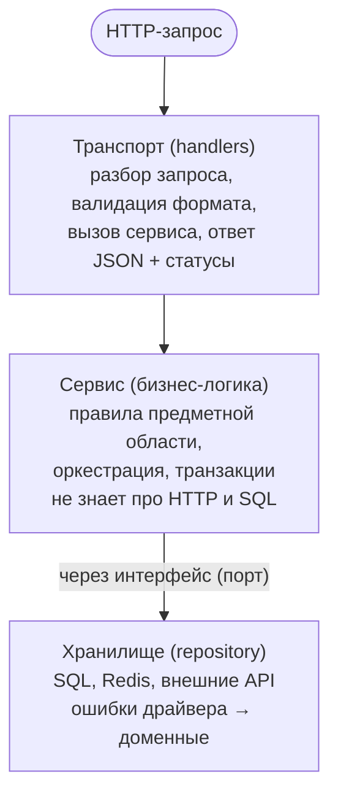
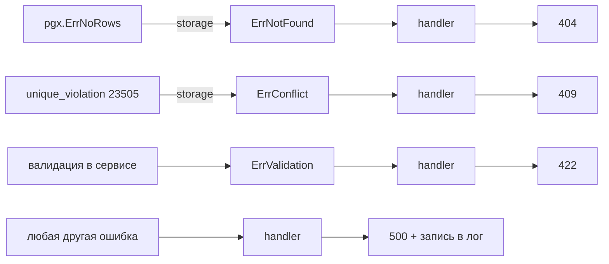
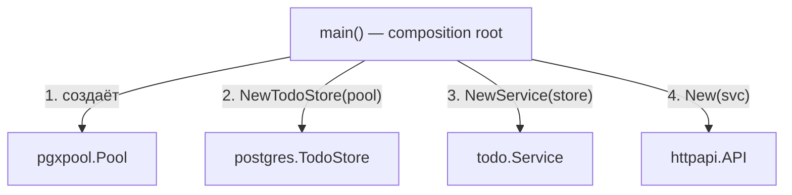

# Глава 11. Архитектура приложения: слои, зависимости, конфигурация, логирование

**Цели главы:** организовать код сервиса так, чтобы его было легко менять и тестировать; научиться внедрять зависимости «руками»; выносить конфигурацию в окружение; настроить структурное логирование; не скатиться в излишнюю «архитектурность».

⏱ ~1 неделя · предыдущая: [Глава 10](10-auth-bezopasnost.md) · следующая: [Глава 12](12-testirovanie.md)

---

## 11.1. Зачем нужна архитектура — и где её предел

Цель архитектуры — **упростить изменения и проверку**: чтобы замена БД, добавление эндпоинта или правка бизнес-правила не требовали переписывать полпроекта, а тесты можно было писать без поднятия всего мира.

> **Предупреждение для тех, кто пришёл из Angular/Java-мира.** В Go культура противоположна «enterprise»: **минимум абстракций, максимум ясности**. Интерфейс на каждую структуру, `AbstractFactory`, `IUserService`, пять слоёв на один CRUD — это антипаттерны. Усложняйте код только когда боль уже ощущается (дублирование, невозможность протестировать, сложность поиска).

## 11.2. Слои

Классическая схема для веб-сервиса из трёх слоёв:



**Правило направления зависимостей:** транспорт → сервис → хранилище. Внутренние слои **ничего не знают** о внешних: сервис не импортирует `net/http`, хранилище не знает о JSON-тегах ответа.

| Слой | Знает про | Не знает про |
|---|---|---|
| handlers | `net/http`, JSON, сервис | SQL, `pgx` |
| service | доменные типы и ошибки, интерфейс хранилища | HTTP, статусы, `pgx` |
| storage | SQL, драйвер | HTTP |

**Бизнес-логика — в сервисе, не в обработчиках.** Обработчик «тонкий»: разобрал → вызвал → ответил. Тогда логику можно тестировать без HTTP, а тот же сервис подключить к CLI, очереди или gRPC.

### Потоки ошибок

Каждый слой переводит ошибки на свой уровень:



### Модели: одна или три?

| Модель | Где живёт | Пример |
|---|---|---|
| **Входной/выходной DTO** | транспорт | `createTodoRequest{Title}`, JSON-теги |
| **Доменная сущность** | сервис | `Todo{ID, Title, Done}` |
| **Строка БД** | хранилище | `db`-теги, `pgtype.Text` |

Для маленьких сервисов нормально **одна структура** на всё (как в главе 8). Разделяйте, когда формы начинают расходиться (поле только для БД, поле только для API, секретные поля). Главное правило: **типы драйвера БД и ORM не протекают в обработчики**.

## 11.3. Внедрение зависимостей вручную



Вспомните Angular DI: контейнер сам создаёт сервисы и подставляет их по типам. В Go — **никакого контейнера**: зависимости создаются в одном месте — **composition root** (корне композиции), обычно `main()` — и передаются конструкторами.

```go
func run(cfg Config, log *slog.Logger) error {
	pool, err := pgxpool.New(ctx, cfg.DatabaseURL)   // 1. инфраструктура
	...
	store := postgres.NewTodoStore(pool)             // 2. хранилище
	svc := todo.NewService(store, log)               // 3. сервис получает хранилище
	api := httpapi.New(svc, log)                     // 4. транспорт получает сервис
	return serve(cfg, api.Routes())                  // 5. запуск
}
```

Принципы:

- **Конструктор `NewX(deps...) *X`** принимает всё необходимое и возвращает готовый объект. Никаких `Init()` после создания.
- **Интерфейс объявляет потребитель** (глава 3): сервис описывает минимальный `todoStore` у себя. В тестах вы подставляете фейк, не трогая БД.
- **Никаких глобальных переменных и `init()` с побочными эффектами** (глобальный `db`, глобальный `logger`) — они прячут зависимости и ломают тесты.
- Необязательные настройки — **функциональные опции**:
  ```go
  type Option func(*Server)
  func WithTimeout(d time.Duration) Option { return func(s *Server) { s.timeout = d } }
  func NewServer(addr string, opts ...Option) *Server { s := &Server{addr: addr, timeout: 10 * time.Second}; for _, o := range opts { o(s) }; return s }
  ```
- Генераторы DI ([google/wire](https://github.com/google/wire), `uber-go/fx`) существуют, но **для большинства сервисов не нужны**: ручная сборка в `main` — 20–50 строк, зато всё явно.

## 11.4. Структура проекта

Для типичного сервиса:

```
todo/
├── go.mod
├── cmd/
│   └── api/
│       └── main.go              ← только сборка зависимостей и запуск
├── internal/
│   ├── config/                  ← чтение и проверка конфигурации
│   ├── todo/                    ← ФИЧА: сущность, сервис, интерфейсы
│   │   ├── todo.go              (доменные типы и ошибки)
│   │   ├── service.go
│   │   └── service_test.go
│   ├── httpapi/                 ← транспорт: роутер, handlers, middleware
│   └── postgres/                ← реализация хранилищ на pgx
├── migrations/
├── Dockerfile
├── compose.yaml
├── Makefile
└── README.md
```

Организация по **фичам** (`todo`, `user`, `billing`) обычно удобнее, чем по техническим слоям (`handlers/`, `services/`, `models/` на весь проект): всё про одну возможность лежит рядом, меньше перекрёстных импортов. Выбирайте то, что даёт меньше циклов и проще навигация; не копируйте чужие шаблоны слепо («golang-standards/project-layout» — не стандарт, а один из вариантов).

- Всё нетривиальное кладите в `internal/` — публичного API у сервиса, как правило, нет.
- Пакеты называйте по смыслу, а не `utils`, `common`, `helpers`, `models`, `types`.
- Один пакет — одна ответственность; **циклические импорты — признак неверной границы**.

## 11.5. Конфигурация (12-factor)

Принципы [12-factor app](https://12factor.net/ru/): конфигурация — **в окружении**, а не в коде и не в образе. Один и тот же образ работает в dev, staging, prod; отличаются только переменные.

```go
type Config struct {
	Addr        string        // ADDR=":8080"
	DatabaseURL string        // DATABASE_URL — обязательно
	LogLevel    slog.Level    // LOG_LEVEL=debug|info|warn|error
	ReqTimeout  time.Duration // REQUEST_TIMEOUT=10s
}

func Load() (Config, error) {
	cfg := Config{Addr: ":8080", ReqTimeout: 10 * time.Second} // значения по умолчанию
	if v := os.Getenv("ADDR"); v != "" {
		cfg.Addr = v
	}
	if cfg.DatabaseURL = os.Getenv("DATABASE_URL"); cfg.DatabaseURL == "" {
		return Config{}, errors.New("DATABASE_URL is required")
	}
	if v := os.Getenv("LOG_LEVEL"); v != "" {
		if err := cfg.LogLevel.UnmarshalText([]byte(v)); err != nil {
			return Config{}, fmt.Errorf("LOG_LEVEL: %w", err)
		}
	}
	return cfg, nil
}
```

- **Читайте окружение один раз** при старте, в одном пакете, дальше передавайте структуру. Не разбрасывайте `os.Getenv` по коду.
- **Fail fast:** неверная или отсутствующая конфигурация → программа **не стартует** с понятным сообщением, а не падает через час.
- Библиотеки: [`caarlos0/env`](https://github.com/caarlos0/env) (теги в структуре), `kelseyhightower/envconfig`, `spf13/viper` (тяжёлая). Для начала достаточно стандартной библиотеки.
- Секреты — тоже через окружение/секрет-менеджер, **не логируйте конфиг целиком**.
- Для CLI-флагов — пакет `flag`; приоритет обычно: флаг > окружение > значение по умолчанию.

## 11.6. Структурное логирование: `log/slog`

Логи — основной инструмент диагностики вживую. Пишите **структурно** (пары «ключ-значение»), а не склеенными строками: так их можно фильтровать и агрегировать (Loki, Elasticsearch).

```go
log := slog.New(slog.NewJSONHandler(os.Stdout, &slog.HandlerOptions{Level: cfg.LogLevel}))
slog.SetDefault(log)

log.Info("order created", "order_id", 42, "user_id", 7, "total", 129.9)
// {"time":"…","level":"INFO","msg":"order created","order_id":42,"user_id":7,"total":129.9}

log.Error("save failed", "err", err, "order_id", 42)
reqLog := log.With("request_id", rid)          // дочерний логгер с общими полями
log.InfoContext(ctx, "…")                      // контекстные варианты
```

| Правило | Почему |
|---|---|
| Пишите в **stdout** | собирает Docker/Kubernetes; не управляйте файлами сами |
| JSON в проде, текст (`NewTextHandler`) локально | машинная обработка vs удобство глаз |
| Уровни: `Debug` (подробности), `Info` (события), `Warn` (странно, но работаем), `Error` (сбой операции) | фильтрация шума |
| Логируйте на **границах** (обработчик, воркер), а не на каждом слое | ошибка «залогирована и возвращена» даёт дубли |
| **Никаких секретов и ПДн**: пароли, токены, номера карт, полные email | утечка через логи — частая причина инцидентов |
| В каждой записи — `request_id` (глава 6) | склеить все строки одного запроса |

## 11.7. Транзакции и контекст в слоях

- **Контекст** (`ctx`) идёт сквозь все слои первым параметром; таймаут задаётся на входе (middleware/сервер), отмена доходит до SQL.
- **Границу транзакции определяет сервис** (там знают бизнес-операцию целиком), а не репозиторий. Типичный приём: сервис получает `TxRunner` с методом `InTx(ctx, func(repos) error)` — внутри которого все репозитории работают поверх одной `tx` (глава 8: `DBTX`).
- Не передавайте `*sql.Tx`/`pgx.Tx` в обработчики.

## 11.8. Чистая / гексагональная архитектура — без фанатизма

**Hexagonal (ports & adapters)** и **Clean Architecture** предлагают ту же идею, что и 11.2: **домен в центре, технологии (HTTP, БД, очереди) — адаптеры по краям**, зависимости направлены внутрь. Интерфейсы-«порты» объявляет домен, адаптеры их реализуют.

В Go эта идея уже «встроена»: интерфейсы на стороне потребителя + пакеты `internal`. Для небольшого сервиса три слоя из 11.2 — и есть hexagonal. Добавляйте формализм (отдельные модели на каждый слой, use-case-классы), только когда:

- у системы **несколько точек входа** (HTTP + gRPC + очередь + CLI) с общей логикой;
- домен **сложный** и живёт годами;
- над кодом работает **много команд**.

**Modular monolith → микросервисы.** Начинайте с одного сервиса, разбитого на модули (пакеты фич с чёткими границами). Выделяйте микросервисы, когда есть реальная причина (независимое масштабирование, независимые команды и релизы), — не раньше: распределённая система в разы сложнее (сеть, согласованность, наблюдаемость — глава 17).

## 11.9. Антипаттерны

| Антипаттерн | Чем плох | Что вместо |
|---|---|---|
| Интерфейс на каждую структуру («на будущее») | шум, нет выгоды | интерфейс — когда есть 2+ реализации или нужна подмена в тестах; объявлять у потребителя |
| `IUserService`, `UserServiceImpl` | Java-акцент | `type Service struct`; интерфейс называют по поведению |
| Возврат интерфейса из конструктора | скрывает конкретный тип, ломает расширение | «принимай интерфейсы, возвращай структуры» |
| Пакеты `utils`, `common`, `models` | свалка, циклы | пакеты по смыслу и фичам |
| Глобальное состояние (`var db *sql.DB`, `init()`) | скрытые зависимости, ломает тесты | конструкторы и composition root |
| Бизнес-логика в обработчиках | не тестируется без HTTP, дублируется | тонкий handler + сервис |
| Типы БД/ORM в API | утечки, связность | отдельные DTO / преобразование в слое хранилища |
| `context.Context` в поле структуры | неочевидная отмена | параметром первого аргумента |
| `panic` вместо ошибок | падение сервиса | `error`; `recover` только на границах |
| Огромные интерфейсы (10+ методов) | сложно подменять | маленькие интерфейсы из 1–3 методов |
| Преждевременные микросервисы | сложность без пользы | модульный монолит |

## 11.10. Рабочий пример: три слоя в одном файле

Компактный, но полноценный пример, показывающий все идеи главы: конфигурация, `slog`, интерфейс в потребителе, доменные ошибки, перевод ошибок в HTTP, ручная сборка в `main`. (В реальном проекте каждый блок живёт в своём пакете — см. 11.4.)

```go
package main

import (
	"context"
	"encoding/json"
	"errors"
	"fmt"
	"log/slog"
	"net/http"
	"os"
	"strconv"
	"strings"
	"sync"
	"time"
)

// ===================== domain =====================

type Todo struct {
	ID    int64  `json:"id"`
	Title string `json:"title"`
	Done  bool   `json:"done"`
}

var (
	ErrNotFound   = errors.New("not found")
	ErrValidation = errors.New("validation failed")
)

// ===================== service =====================

// todoStore объявлен ЗДЕСЬ — в потребителе, и содержит только то, что ему нужно.
type todoStore interface {
	Insert(ctx context.Context, t Todo) (Todo, error)
	Get(ctx context.Context, id int64) (Todo, error)
	List(ctx context.Context) ([]Todo, error)
}

type TodoService struct {
	store todoStore
	log   *slog.Logger
}

func NewTodoService(store todoStore, log *slog.Logger) *TodoService {
	return &TodoService{store: store, log: log.With("component", "todo-service")}
}

func (s *TodoService) Create(ctx context.Context, title string) (Todo, error) {
	title = strings.TrimSpace(title)
	if n := len([]rune(title)); n < 1 || n > 200 {
		return Todo{}, fmt.Errorf("%w: title must be 1..200 characters", ErrValidation)
	}
	t, err := s.store.Insert(ctx, Todo{Title: title})
	if err != nil {
		return Todo{}, fmt.Errorf("create todo: %w", err)
	}
	s.log.InfoContext(ctx, "todo created", "id", t.ID)
	return t, nil
}

func (s *TodoService) Get(ctx context.Context, id int64) (Todo, error) {
	t, err := s.store.Get(ctx, id)
	if err != nil {
		return Todo{}, fmt.Errorf("get todo %d: %w", id, err)
	}
	return t, nil
}

func (s *TodoService) List(ctx context.Context) ([]Todo, error) { return s.store.List(ctx) }

// ===================== storage (адаптер: в памяти) =====================

type memStore struct {
	mu    sync.Mutex
	next  int64
	items []Todo
}

func (m *memStore) Insert(_ context.Context, t Todo) (Todo, error) {
	m.mu.Lock()
	defer m.mu.Unlock()
	m.next++
	t.ID = m.next
	m.items = append(m.items, t)
	return t, nil
}

func (m *memStore) Get(_ context.Context, id int64) (Todo, error) {
	m.mu.Lock()
	defer m.mu.Unlock()
	for _, t := range m.items {
		if t.ID == id {
			return t, nil
		}
	}
	return Todo{}, ErrNotFound // хранилище отдаёт ДОМЕННУЮ ошибку
}

func (m *memStore) List(_ context.Context) ([]Todo, error) {
	m.mu.Lock()
	defer m.mu.Unlock()
	return append([]Todo{}, m.items...), nil // копия, и [] (не null) для пустого списка
}

// ===================== transport =====================

type API struct {
	svc *TodoService
	log *slog.Logger
}

func (a *API) Routes() http.Handler {
	mux := http.NewServeMux()
	mux.HandleFunc("GET /todos", a.list)
	mux.HandleFunc("POST /todos", a.create)
	mux.HandleFunc("GET /todos/{id}", a.get)
	return mux
}

func (a *API) create(w http.ResponseWriter, r *http.Request) {
	var in struct {
		Title string `json:"title"`
	}
	if err := json.NewDecoder(http.MaxBytesReader(w, r.Body, 1<<20)).Decode(&in); err != nil {
		a.fail(w, r, fmt.Errorf("%w: invalid JSON", ErrValidation))
		return
	}
	t, err := a.svc.Create(r.Context(), in.Title)
	if err != nil {
		a.fail(w, r, err)
		return
	}
	a.json(w, http.StatusCreated, t)
}

func (a *API) get(w http.ResponseWriter, r *http.Request) {
	id, err := strconv.ParseInt(r.PathValue("id"), 10, 64)
	if err != nil {
		a.fail(w, r, fmt.Errorf("%w: id must be an integer", ErrValidation))
		return
	}
	t, err := a.svc.Get(r.Context(), id)
	if err != nil {
		a.fail(w, r, err)
		return
	}
	a.json(w, http.StatusOK, t)
}

func (a *API) list(w http.ResponseWriter, r *http.Request) {
	todos, err := a.svc.List(r.Context())
	if err != nil {
		a.fail(w, r, err)
		return
	}
	a.json(w, http.StatusOK, todos)
}

func (a *API) json(w http.ResponseWriter, status int, v any) {
	w.Header().Set("Content-Type", "application/json")
	w.WriteHeader(status)
	_ = json.NewEncoder(w).Encode(v)
}

// fail — ЕДИНСТВЕННОЕ место, где доменные ошибки превращаются в HTTP-статусы.
func (a *API) fail(w http.ResponseWriter, r *http.Request, err error) {
	switch {
	case errors.Is(err, ErrValidation):
		a.json(w, http.StatusUnprocessableEntity, map[string]string{"error": err.Error()})
	case errors.Is(err, ErrNotFound):
		a.json(w, http.StatusNotFound, map[string]string{"error": "not found"})
	default:
		a.log.ErrorContext(r.Context(), "internal error", "err", err, "path", r.URL.Path) // подробности — в лог
		a.json(w, http.StatusInternalServerError, map[string]string{"error": "internal error"})
	}
}

// ===================== config =====================

type Config struct {
	Addr     string
	LogLevel slog.Level
}

func LoadConfig() (Config, error) {
	cfg := Config{Addr: ":8080"}
	if v := os.Getenv("ADDR"); v != "" {
		cfg.Addr = v
	}
	if v := os.Getenv("LOG_LEVEL"); v != "" {
		if err := cfg.LogLevel.UnmarshalText([]byte(v)); err != nil {
			return Config{}, fmt.Errorf("LOG_LEVEL: %w", err)
		}
	}
	return cfg, nil
}

// ===================== composition root =====================

func run() error {
	cfg, err := LoadConfig()
	if err != nil {
		return err // fail fast
	}
	log := slog.New(slog.NewJSONHandler(os.Stdout, &slog.HandlerOptions{Level: cfg.LogLevel}))

	store := &memStore{}                        // 1. хранилище
	svc := NewTodoService(store, log)           // 2. сервис получает хранилище
	api := &API{svc: svc, log: log}             // 3. транспорт получает сервис

	srv := &http.Server{
		Addr:              cfg.Addr,
		Handler:           api.Routes(),
		ReadHeaderTimeout: 5 * time.Second,
	}
	log.Info("listening", "addr", cfg.Addr)
	return srv.ListenAndServe() // (graceful shutdown — как в главе 6)
}

func main() {
	if err := run(); err != nil {
		fmt.Fprintln(os.Stderr, "fatal:", err)
		os.Exit(1)
	}
}
```

Заметьте, что `TodoService` можно проверить, **не запуская HTTP и без БД**: достаточно передать ему фейк `todoStore` (глава 12). А замена `memStore` на реализацию поверх `pgx` не меняет ни строчки в сервисе и обработчиках.

## 11.11. Документация решений

- **README**: что делает сервис, как запустить (`docker compose up`), переменные окружения, как гонять тесты.
- **ADR** (*Architecture Decision Record*) — короткий файл «контекст → решение → последствия» на каждое значимое решение (почему Postgres, почему сессии вместо JWT). Через полгода вы скажете себе спасибо.
- Контракт API — **OpenAPI** (глава 14).
- `Makefile`/`justfile` с целями `run`, `test`, `lint`, `migrate`, `docker-build` — единая точка входа для людей и CI.

---

## Задачи

1. 🟢 **Прочитайте и запустите** пример 11.10. Сделайте `POST` с пустым заголовком (ожидаете `422`), `GET /todos/999` (`404`), `GET /todos/abc` (`422`). Посмотрите логи в JSON; запустите с `LOG_LEVEL=debug` и неверным `LOG_LEVEL=loud` (должен быть fail fast).
2. 🟡 **Рефакторинг в пакеты.** Разложите пример по структуре из 11.4: `internal/todo` (домен + сервис), `internal/httpapi`, `internal/memstore`, `internal/config`, `cmd/api/main.go`. Убедитесь, что `todo` **не импортирует** `net/http`, а `httpapi` не импортирует `memstore`. Нарисуйте граф зависимостей (`go list -f '{{.ImportPath}}: {{.Imports}}' ./...` или `go mod graph`).
3. 🟡 **Postgres-адаптер.** Напишите `internal/postgres.TodoStore` (из главы 8), реализующий `todoStore`. Хранилище переводит `pgx.ErrNoRows` в `todo.ErrNotFound`. Замените `memStore` в `main`, **не меняя** сервис и обработчики — это и есть проверка архитектуры.
4. 🟡 **Конфигурация.** Расширьте `Config`: `DATABASE_URL` (обязательно), `REQUEST_TIMEOUT` (`time.Duration`), `LOG_FORMAT=json|text`. Напишите тесты `Load()` с `t.Setenv`: обязательное поле, значения по умолчанию, ошибка парсинга. Добавьте `.env.example` и раздел в README.
5. 🟡 **Логирование запросов.** Добавьте middleware с `request_id`, логгер с `request_id` кладётся в контекст запроса; сервис пишет `slog.InfoContext(ctx, ...)` и в записи автоматически присутствует `request_id` (подсказка: собственный `slog.Handler`-обёртка, достающий поле из `ctx`). Проверьте, что запись об ошибке 500 не содержит тело запроса и секретов.
6. 🟡 **Транзакционная граница.** Добавьте операцию «перенести все задачи пользователя A пользователю B» как **одну** транзакцию в сервисе (через `TxRunner`, глава 8). Тест: если вставка для одной задачи падает, ничего не меняется.
7. 🔴 **Модуль и пользователи.** Добавьте вторую фичу `user` (регистрация/вход из главы 10) отдельным пакетом. Убедитесь, что пакеты фич не импортируют друг друга напрямую: общение — через интерфейсы или через слой сборки. Обсудите, где проходит граница модулей.
8. 🟡 **ADR.** Напишите 3 коротких ADR для вашего проекта: «Хранилище — PostgreSQL», «Аутентификация — серверные сессии», «Роутер — `net/http` ServeMux». В каждом — рассмотренные альтернативы и последствия.
9. 🟡 **Ревью антипаттернов.** Возьмите любой открытый Go-проект (или свой старый код) и найдите ≥ 5 пунктов из таблицы 11.9. Для каждого — что исправили бы и зачем.

## Самопроверка

- Какие слои у типичного веб-сервиса и что каждый знает/не знает?
- Где должна жить бизнес-логика и почему «тонкий» обработчик — это хорошо?
- Как ошибка `pgx.ErrNoRows` превращается в HTTP `404`? Кто за какой шаг отвечает?
- Что такое composition root? Чем ручное DI в Go отличается от DI-контейнера Angular?
- Почему интерфейс объявляют на стороне потребителя? Что это даёт тестам?
- Что говорит принцип 12-factor о конфигурации? Что значит fail fast?
- Чем структурное логирование лучше `fmt.Println`? Что нельзя писать в логи?
- Когда оправданы hexagonal/clean-абстракции, а когда это перебор?
- Почему «модульный монолит» — хороший старт, а микросервисы — не по умолчанию?

➡️ Дальше: [Глава 12. Тестирование](12-testirovanie.md)
