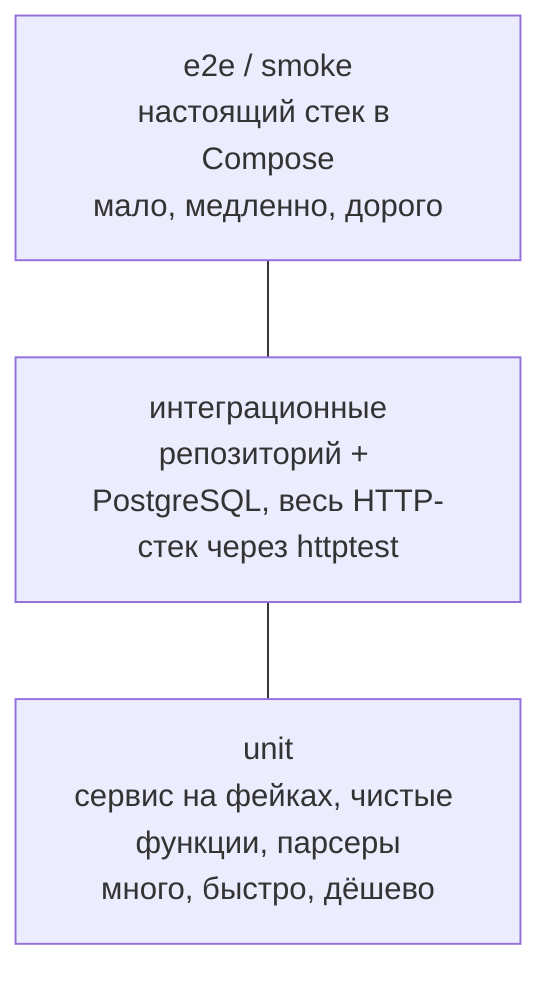

# Глава 12. Тестирование бэкенда

**Цели главы:** выстроить разумную стратегию тестов; писать unit-тесты на фейках, тесты HTTP-обработчиков, интеграционные тесты против настоящей БД; не писать хрупкие тесты; использовать фаззинг, бенчмарки и детектор гонок.

⏱ ~1 неделя · предыдущая: [Глава 11](11-arhitektura.md) · следующая: [Глава 13](13-redis-ocheredi.md)

> Основы (`TestXxx`, table-driven, `t.Run`, бенчмарки, фаззинг, покрытие) вы уже видели в [главе 4](04-moduli-testy-generiki.md). Здесь — как тестировать **сервис целиком**.

---

## 12.1. Что и как тестировать

Фронтендер знает пирамиду: много unit-тестов, меньше интеграционных, ещё меньше e2e. На бэкенде картина та же, но другие «слои»:



| Что | Как | Скорость |
|---|---|---|
| Бизнес-логика (сервис) | unit, фейк хранилища | мс |
| Чистые функции, парсеры, валидаторы | table-driven + фаззинг | мс |
| HTTP-контракт (статусы, JSON, ошибки) | `httptest` на роутере с фейком/памятью | мс |
| SQL-запросы, миграции, транзакции | интеграционные против настоящей PostgreSQL | сотни мс |
| Работа стека целиком | smoke/e2e в Compose | секунды |

**Принципы:**

1. Тестируйте **поведение** (что видит вызывающий), а не реализацию (какие внутренние функции вызваны) — иначе любой рефакторинг ломает тесты.
2. **SQL нельзя проверить моком.** Мок скажет «запрос вызван», но не скажет, что он **правильный**. Репозиторий тестируют на настоящей БД.
3. Тест должен быть **детерминированным**: без зависимости от времени, порядка, случайности, сети.
4. **Покрытие — индикатор, а не цель.** 80% строк с бессмысленными проверками хуже 60% с хорошими. Смотрите `go tool cover -html`, чтобы найти *непротестированные ветки ошибок*.
5. Каждый найденный баг сначала **воспроизводится тестом**, потом исправляется.

## 12.2. Unit-тесты на фейках

В Go принято **писать тестовые двойники руками**: структура, реализующая нужный интерфейс. Это проще и читаемее, чем генерация моков (`gomock`, `mockery`, `testify/mock`), и не привязывает тест к порядку вызовов.

| Двойник | Что делает |
|---|---|
| **Stub** | возвращает заготовленные ответы |
| **Fake** | облегчённая рабочая реализация (мапа вместо БД) |
| **Spy** | запоминает, как его вызывали |
| **Mock** | проверяет ожидания вызовов (используйте экономно) |

Тест сервиса из [главы 11.10](11-arhitektura.md) (файл `main_test.go` рядом с кодом):

```go
// main_test.go
package main

import (
	"context"
	"errors"
	"io"
	"log/slog"
	"net/http"
	"net/http/httptest"
	"strings"
	"testing"
)

var errBoom = errors.New("boom")

// fakeStore — ручной двойник: поведение настраивается полями.
type fakeStore struct {
	insertErr error
	items     []Todo
	inserted  []Todo
}

func (f *fakeStore) Insert(_ context.Context, t Todo) (Todo, error) {
	if f.insertErr != nil {
		return Todo{}, f.insertErr
	}
	t.ID = int64(len(f.inserted) + 1)
	f.inserted = append(f.inserted, t)
	return t, nil
}

func (f *fakeStore) Get(_ context.Context, id int64) (Todo, error) {
	for _, t := range f.items {
		if t.ID == id {
			return t, nil
		}
	}
	return Todo{}, ErrNotFound
}

func (f *fakeStore) List(context.Context) ([]Todo, error) { return f.items, nil }

var quiet = slog.New(slog.NewTextHandler(io.Discard, nil)) // молчаливый логгер для тестов

func TestServiceCreate(t *testing.T) {
	tests := []struct {
		name      string
		title     string
		store     *fakeStore
		wantErr   error
		wantTitle string
	}{
		{"пробелы по краям обрезаются", "  купить молоко ", &fakeStore{}, nil, "купить молоко"},
		{"пустой заголовок", "   ", &fakeStore{}, ErrValidation, ""},
		{"слишком длинный (201 символ)", strings.Repeat("я", 201), &fakeStore{}, ErrValidation, ""},
		{"ровно 200 символов — допустимо", strings.Repeat("я", 200), &fakeStore{}, nil, strings.Repeat("я", 200)},
		{"ошибка хранилища сохраняется в цепочке", "x", &fakeStore{insertErr: errBoom}, errBoom, ""},
	}
	for _, tt := range tests {
		t.Run(tt.name, func(t *testing.T) {
			svc := NewTodoService(tt.store, quiet)

			got, err := svc.Create(context.Background(), tt.title)

			if !errors.Is(err, tt.wantErr) { // errors.Is(nil, nil) == true
				t.Fatalf("err = %v, want %v", err, tt.wantErr)
			}
			if err == nil && got.Title != tt.wantTitle {
				t.Errorf("title = %q, want %q", got.Title, tt.wantTitle)
			}
			if tt.wantErr != nil && len(tt.store.inserted) != 0 {
				t.Error("при ошибке в хранилище ничего не должно попасть")
			}
		})
	}
}
```

Обратите внимание: тесты **не знают**, как устроен сервис внутри, и **не требуют** БД. Падают они понятными сообщениями. Добавить кейс — одна строка.

### Тестируйте и «несчастливые» пути

Ошибки хранилища, таймауты, пустые вводы, граничные значения (0, 1, max, max+1), `nil`, Unicode, повторные вызовы. Чаще всего баги — именно там.

## 12.3. Тесты HTTP-обработчиков

Проверяем **контракт API**: статусы, заголовки, форму JSON, формат ошибок — на настоящем роутере, но без сети:

```go
func TestAPI(t *testing.T) {
	svc := NewTodoService(&memStore{}, quiet)
	h := (&API{svc: svc, log: quiet}).Routes()

	do := func(method, path, body string) *httptest.ResponseRecorder {
		t.Helper()
		req := httptest.NewRequest(method, path, strings.NewReader(body))
		rec := httptest.NewRecorder()
		h.ServeHTTP(rec, req)
		return rec
	}

	t.Run("создание", func(t *testing.T) {
		rec := do("POST", "/todos", `{"title":"a"}`)
		if rec.Code != http.StatusCreated {
			t.Fatalf("status = %d, body = %s", rec.Code, rec.Body)
		}
	})
	t.Run("валидация → 422", func(t *testing.T) {
		if rec := do("POST", "/todos", `{"title":""}`); rec.Code != http.StatusUnprocessableEntity {
			t.Errorf("status = %d, want 422", rec.Code)
		}
	})
	t.Run("не найдено → 404", func(t *testing.T) {
		if rec := do("GET", "/todos/999", ""); rec.Code != http.StatusNotFound {
			t.Errorf("status = %d, want 404", rec.Code)
		}
	})
	t.Run("неверный метод → 405", func(t *testing.T) {
		if rec := do("DELETE", "/todos", ""); rec.Code != http.StatusMethodNotAllowed {
			t.Errorf("status = %d, want 405", rec.Code)
		}
	})
}
```

Приёмы:

- Для сравнения JSON декодируйте ответ в структуру (или в `map[string]any`) — не сравнивайте строки: порядок полей и пробелы не важны.
- **Golden-файлы:** эталонный ответ лежит в `testdata/*.golden`; флаг `-update` перезаписывает его. Хорошо для больших ответов.
- Нужен тест «по сети» (клиент, таймауты, TLS) — `httptest.NewServer(h)` и `srv.URL`.
- Тестируйте **middleware** отдельно (как в задачах главы 6).

## 12.4. Интеграционные тесты с настоящей БД

Что проверяют: что SQL выполняется, что миграции применимы, что ограничения срабатывают, что транзакции откатываются, что индексы/`ON CONFLICT` ведут себя как задумано.

### Вариант 1: Compose + build-тег

Поднимаете тестовую БД (`docker compose up -d db`), а интеграционные тесты помечаете тегом, чтобы обычный `go test ./...` оставался быстрым:

```go
//go:build integration

package postgres_test
```

```bash
go test -tags=integration ./...
```

DSN берётся из окружения (`TEST_DATABASE_URL`); если не задан — `t.Skip`.

### Вариант 2: testcontainers-go — БД поднимается из теста

Библиотека сама запускает контейнер на случайном порту и убирает его после:

```go
import (
	"context"
	"testing"
	"time"

	"github.com/testcontainers/testcontainers-go"
	"github.com/testcontainers/testcontainers-go/modules/postgres"
	"github.com/testcontainers/testcontainers-go/wait"
)

func startPostgres(t *testing.T) string {
	t.Helper()
	ctx := context.Background()

	ctr, err := postgres.Run(ctx, "postgres:17-alpine",
		postgres.WithDatabase("test"),
		postgres.WithUsername("test"),
		postgres.WithPassword("test"),
		testcontainers.WithWaitStrategy(
			wait.ForLog("database system is ready to accept connections").
				WithOccurrence(2).WithStartupTimeout(60*time.Second)),
	)
	if err != nil {
		t.Fatalf("start postgres: %v", err)
	}
	t.Cleanup(func() { _ = testcontainers.TerminateContainer(ctr) })

	dsn, err := ctr.ConnectionString(ctx, "sslmode=disable")
	if err != nil {
		t.Fatal(err)
	}
	return dsn
}
```

Запускать контейнер **один раз на пакет** (в `TestMain`), а не на каждый тест — иначе медленно:

```go
var pool *pgxpool.Pool

func TestMain(m *testing.M) {
	// 1) поднять контейнер, 2) применить миграции, 3) создать pool, 4) m.Run(), 5) очистка
	os.Exit(run(m))
}
```

(Для CI Docker есть везде, поэтому testcontainers удобен.)

### Изоляция тестов друг от друга

| Способ | Идея | Плюс / минус |
|---|---|---|
| **Транзакция + `ROLLBACK`** | каждый тест работает в своей `tx`, откатывает в `t.Cleanup` | быстро, можно `t.Parallel()`; нельзя тестировать сам `COMMIT` и многоконнекционные сценарии |
| `TRUNCATE` перед тестом | очистка таблиц | просто; тесты идут по очереди |
| База-шаблон | `CREATE DATABASE t_123 TEMPLATE base` | полная изоляция, параллельно; чуть тяжелее |

```go
func newTestTx(t *testing.T) pgx.Tx {
	t.Helper()
	tx, err := pool.Begin(context.Background())
	if err != nil {
		t.Fatal(err)
	}
	t.Cleanup(func() { _ = tx.Rollback(context.Background()) })
	return tx
}

func TestTodoRepo_Get_NotFound(t *testing.T) {
	t.Parallel()
	repo := NewTodoRepo(newTestTx(t)) // репозиторий принимает DBTX — подойдёт и tx
	_, err := repo.Get(context.Background(), 123456)
	if !errors.Is(err, ErrNotFound) {
		t.Fatalf("err = %v, want ErrNotFound", err)
	}
}
```

### Что обязательно проверить в интеграционных тестах

- Все методы репозитория: успех, «не найдено», нарушение уникальности/`CHECK`/внешнего ключа.
- Транзакции: откат при ошибке в середине; **конкурентный** сценарий (50 горутин покупают последний товар — [глава 8, задача 4](08-go-i-bd.md)).
- Миграции: накат «с нуля», `down` и снова `up`.

## 12.5. Время, случайность, внешний мир

Недетерминизм — главная причина «флакающих» тестов.

- **Время:** внедряйте источник времени. Не `time.Now()` в логике, а поле `now func() time.Time` (в тесте — фиксированное значение). Не используйте `time.Sleep` для «подождать».
- В Go 1.24/1.25 появился пакет `testing/synctest`: даёт «виртуальное время» для кода с таймерами и горутинами (в 1.25 — стабильный). Если ваш код активно использует таймеры, посмотрите на него.
- **Случайность/ID:** передавайте генератор (`func() string`) или фиксируйте seed.
- **Внешние HTTP-сервисы:** `httptest.NewServer`, имитирующий их (с нужными статусами и задержками), и конфигурируемый базовый URL клиента.
- **Файловая система:** `t.TempDir()`.
- **Порядок итерации мапы:** сортируйте перед сравнением.

## 12.6. Конкурентность в тестах

- Запускайте **`go test -race ./...`** всегда в CI (на Windows — через Docker/WSL, глава 5).
- Тесты, пишущие в общее состояние, не должны использовать `t.Parallel()` без изоляции; идеально — каждый тест создаёт собственный экземпляр сервиса.
- Утечки горутин ловит [`go.uber.org/goleak`](https://github.com/uber-go/goleak): `defer goleak.VerifyNone(t)` или `goleak.VerifyTestMain(m)`.
- Таймауты в тестах конкурентного кода: `select` с `time.After`, `context.WithTimeout` — чтобы зависший тест падал, а не висел вечно (флаг `-timeout 30s`).

## 12.7. Другие виды проверок

| Вид | Когда | Как |
|---|---|---|
| **Контрактные тесты** | несколько реализаций интерфейса (память, Postgres, Redis) | один набор тестов `func testStore(t *testing.T, s Store)`, запускаемый на каждой реализации |
| **Фаззинг** | парсеры, валидаторы, декодеры | `FuzzXxx`, свойство «не паникует» и «round-trip» (глава 4) |
| **Property-based** | инварианты на широком классе входов | `pgregory.net/rapid` и аналоги |
| **Бенчмарки** | горячие пути | `go test -bench -benchmem`; сравнение до/после — [`benchstat`](https://pkg.go.dev/golang.org/x/perf/cmd/benchstat) |
| **Нагрузочные** | пропускная способность, p95 | `k6`, `vegeta`, `hey` (глава 15) |
| **Smoke / e2e** | «стек вообще поднимается» | `docker compose up`, затем `curl`/Go-тест на публичный API; в CI после деплоя на staging |
| **Тесты безопасности** | IDOR, права, инъекции | как автотесты (глава 10) |

## 12.8. TDD в Go

*Красный → зелёный → рефакторинг*: напишите падающий тест, минимальный код, чтобы он прошёл, затем улучшите. Особенно хорошо работает для:

- чистой бизнес-логики (расчёты, правила, парсеры);
- воспроизведения багов;
- уточнения API: тест — первый «пользователь» вашего кода.

Для практики: книга/сайт [Learn Go with Tests](https://quii.gitbook.io/learn-go-with-tests). Не фанатейте: исследовательский код (когда вы ещё не знаете, что хотите) можно писать без тестов и потом «закреплять» поведение тестами.

## 12.9. Гигиена тестов

- **Именуйте** тесты и подтесты как требования: `"пустой заголовок → ErrValidation"`.
- Сообщение об ошибке: **что вызвали, что получили, что ждали** (`t.Errorf("Create(%q) = %v, want %v", ...)`).
- Вспомогательные функции начинайте с `t.Helper()`.
- Тест **не зависит** от других тестов и порядка; общее состояние — только неизменяемое.
- **Не отключайте** флакающие тесты молча: либо чините (обычно время/гонка), либо удаляйте. Стабильность набора — доверие к нему.
- Тестовые данные — рядом с тестом (`testdata/`), маленькие и осмысленные.
- Запуск в CI: `go vet ./... && go test -race -cover ./...` (+ интеграционные с тегом).
- Утилиты: `gotestsum` (читаемый вывод), `go test -json`, `-shuffle=on` (случайный порядок — ловит скрытые зависимости), `-count=N` (повторы для поиска флаков).

---

## Задачи

1. 🟢 **Тесты для главы 11.** Скопируйте `main_test.go` из 12.2–12.3 рядом с программой из 11.10, запустите `go test -v`. Добавьте кейсы: `Get` существующей задачи, `Get` несуществующей (`ErrNotFound`), `List` пустого списка (в JSON — `[]`, не `null`). Откройте `go test -coverprofile=c.out && go tool cover -html=c.out` и найдите непокрытые строки.
2. 🟡 **TDD-ката «Банковский счёт».** Не открывая решений, **сначала тест**, потом код: `Account` с `Deposit(amount)`, `Withdraw(amount)` (ошибка `ErrInsufficientFunds`), `Balance()`, суммы в копейках `int64`, отрицательные/нулевые суммы запрещены, история операций. Не менее 12 кейсов; каждый кейс добавляйте по циклу «красный → зелёный».
3. 🟡 **Тест в стиле «поймай баг».** Дана функция расчёта скидки (напишите её сами с 4 ветвями: нет скидки; 10% при сумме ≥ 100; 15% для членов клуба; максимум 30%) и 5 **намеренно сломанных** её копий (ошибка на границе `>` вместо `>=`, округление, порядок применения скидок, …). Напишите набор тестов, который падает на **каждой** сломанной копии и проходит на правильной. Это и есть «мутационное тестирование» вручную.
4. 🟡 **Контрактные тесты.** Интерфейс `Store { Get/Put/Delete }`. Реализации: `MemoryStore`, `FileStore` (JSON), в будущем Redis/Postgres. Один набор `func testStoreContract(t *testing.T, newStore func(t *testing.T) Store)` запускается на каждой реализации. Сколько общего поведения вы закрепили?
5. 🟡 **Интеграционные тесты репозитория.** Для `TodoRepo` (глава 8) напишите набор с тегом `integration`, запускаемый против БД из Compose (`TEST_DATABASE_URL`). Изоляция — через `newTestTx`. Проверьте: создание, чтение, нарушение `CHECK` (пустой заголовок), `ErrNotFound`, каскад удаления пользователя. Тесты должны проходить при `-shuffle=on -count=3 -parallel 4`.
6. 🔴 **testcontainers.** Замените зависимость от Compose на `testcontainers-go`: один контейнер Postgres на пакет в `TestMain`, миграции накатываются один раз (`goose` как библиотека или чтение `.sql` из `embed.FS`). Измерьте время всего набора.
7. 🔴 **Тест гонки и откатов.** Для `PlaceOrder` (глава 8): 50 горутин покупают последние 10 штук; ровно 10 успехов; остаток 0; суммарная сумма заказов совпадает. Запустите с `-race -count=20`. Затем **сломайте** реализацию (замените атомарный `UPDATE ... WHERE stock >= $2` на «прочитал-сравнил-записал») и убедитесь, что тест это ловит.
8. 🟡 **Время без `Sleep`.** Реализуйте `RateLimiter` или кэш с TTL, принимающий `now func() time.Time`. Тест, который «перематывает» время вперёд на час за микросекунды. Бонус: перепишите на `testing/synctest`.
9. 🟡 **Golden-тест.** Эндпоинт, возвращающий большой JSON (отчёт). Сохраните ответ в `testdata/report.golden`, сравнивайте байты, добавьте флаг `-update`.
10. 🔴 **Фаззинг парсера.** Напишите парсер строки запроса вида `sort=-created_at,title&limit=50` в структуру. `FuzzParse`: «не паникует», «валидный результат парсится обратно в эквивалентную строку». Запустите `go test -fuzz=FuzzParse -fuzztime=60s`; чините найденное.
11. 🟡 **Pipeline проверок.** `Makefile` с целями `lint`, `test`, `test-race`, `test-integration`, `cover`; в `README` — как их запускать. Проверьте, что `make test` проходит на чистом клоне.

## Самопроверка

- Как выглядит пирамида тестов бэкенда и что в каждом слое проверяется?
- Почему SQL нельзя нормально проверить моком? Как тестировать репозиторий?
- Чем фейк отличается от мока? Почему в Go предпочитают писать двойники руками?
- Как изолировать интеграционные тесты друг от друга? Плюсы/минусы каждого способа?
- Почему нельзя использовать `time.Sleep` и `time.Now()` напрямую в тестируемом коде? Чем заменить?
- Что делает `-race`, `-shuffle`, `-count`, `-short`, build-тег `integration`?
- Что такое контрактный тест? Что такое golden-файл?
- Зачем нужен фаззинг и какие свойства проверяют?
- Почему покрытие 100% не означает отсутствие багов?

➡️ **Часть II пройдена.** Дальше — [Часть III: Продакшен. Глава 13. Кэш, Redis, очереди](13-redis-ocheredi.md)
