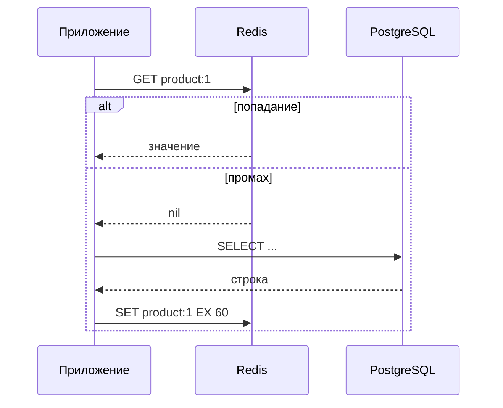
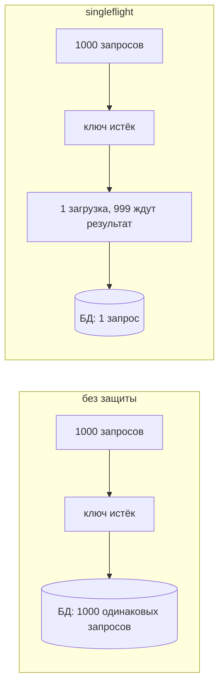
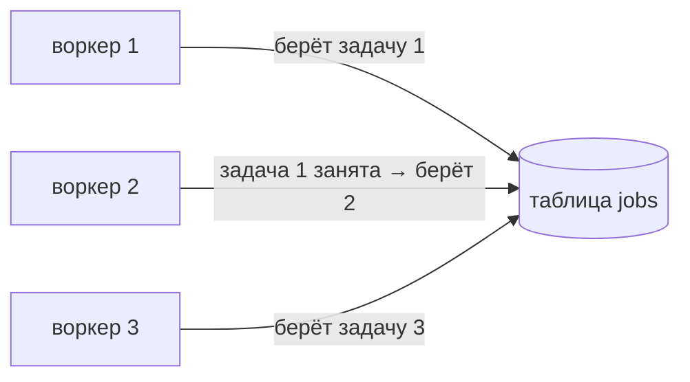

# Глава 13. Кэширование, Redis, очереди и realtime

**Цели главы:** понять, когда и как кэшировать, и какие проблемы это создаёт; пользоваться Redis; выносить тяжёлую работу в фон через очереди; отправлять обновления в Angular в реальном времени (SSE/WebSocket).

⏱ ~1,5 недели · предыдущая: [Глава 12](12-testirovanie.md) · следующая: [Глава 14](14-api-grpc.md)

---

## 13.1. Кэширование

**Кэш** — быстрое хранилище копий дорогих в получении данных. Принцип тот же, что в браузере и Angular (`shareReplay`, HTTP-кэш), но на сервере.

> «В программировании две сложные вещи: инвалидация кэша и придумывание имён.» Кэш — это **копия**, а копия может устареть. Не кэшируйте, пока не **измерили**, что без кэша медленно.

**Уровни кэширования (от клиента к БД):**

| Уровень | Что кэшируется | Инструмент |
|---|---|---|
| Браузер / CDN | статика, публичные ответы | `Cache-Control`, `ETag`, CDN |
| Reverse proxy | целые HTTP-ответы | nginx/Varnish |
| **Приложение** (общий кэш) | результаты запросов, вычислений, сессии | **Redis** |
| Приложение (в памяти процесса) | маленькие справочники | `map` + мьютекс, LRU (ваша задача главы 4) |
| БД | страницы, планы | `shared_buffers` PostgreSQL |

### Паттерны



| Паттерн | Как работает | Когда |
|---|---|---|
| **Cache-aside** (ленивая загрузка) | читаем из кэша; промах → читаем из БД → кладём в кэш | **по умолчанию** |
| Write-through | запись идёт и в кэш, и в БД | нужна свежесть, много чтений |
| Write-behind | пишем в кэш, в БД — позже пакетами | высокая нагрузка на запись, допустима потеря |
| Read-through | кэш сам загружает из источника | если библиотека/слой это умеет |

### Проблемы кэша



- **Устаревание и инвалидация.** Способы: **TTL** (истекает само), удаление ключа при изменении данных (`DEL` после `UPDATE`), версионирование ключей (`user:42:v7`). Сочетайте TTL с явной инвалидацией — TTL страхует от забытых случаев.
- **Cache stampede («стадо»).** Популярный ключ истёк — тысячи запросов одновременно идут в БД. Защита: `singleflight` (один запрос загружает, остальные ждут его результат), случайный разброс TTL (jitter), «мягкое» устаревание.
- **Cache penetration.** Запросы к несуществующим ключам всегда мимо кэша. Защита: кэшировать и «пусто» (с коротким TTL).
- **Холодный старт.** После рестарта кэш пуст → всплеск нагрузки на БД.
- **Сериализация.** В Redis лежат байты: JSON/MessagePack/Protobuf; версионируйте формат.
- **Кэш не источник правды.** Приложение обязано работать (медленнее), если Redis недоступен: деградируйте, а не падайте.

## 13.2. Redis

**Redis** — in-memory хранилище структур данных «ключ → значение». Очень быстрый (сотни тысяч операций в секунду на одном узле), одно ядро на команды → операции **атомарны**.

| Тип | Команды | Для чего |
|---|---|---|
| String | `GET`, `SET key val EX 60`, `INCR`, `SETNX` | кэш, счётчики, блокировки |
| Hash | `HSET`, `HGETALL` | объект «по полям» |
| List | `LPUSH`, `BRPOP` | простые очереди |
| Set | `SADD`, `SISMEMBER` | уникальные множества, теги |
| Sorted Set | `ZADD`, `ZRANGE` | рейтинги, отложенные задачи, скользящие окна |
| Stream | `XADD`, `XREADGROUP` | журнал событий (лёгкая альтернатива Kafka) |
| Pub/Sub | `PUBLISH`, `SUBSCRIBE` | рассылка без гарантий доставки |

**Ключевые свойства:**

- **TTL** на ключах: `SET key val EX 60`; `EXPIRE`, `TTL`. Без TTL кэш растёт вечно.
- **Вытеснение** при нехватке памяти (`maxmemory-policy`: `allkeys-lru` для кэша; `noeviction` — если Redis хранит нужные данные).
- **Персистентность:** RDB (снимки) и AOF (журнал команд) — необязательна; для чистого кэша выключают. Redis — **не замена основной БД**.
- Конвенция имён ключей: `сущность:id:поле`, например `user:42:profile`, `rl:login:1.2.3.4`.
- Запуск для разработки: `docker run -d --name redis -p 6379:6379 redis:7`. Консоль: `docker exec -it redis redis-cli`.

### Клиент `go-redis` и cache-aside с защитой от «стада»

```go
package main

import (
	"context"
	"encoding/json"
	"errors"
	"fmt"
	"math/rand/v2"
	"os"
	"time"

	"github.com/redis/go-redis/v9"
	"golang.org/x/sync/singleflight"
)

type Cache struct {
	rdb *redis.Client
	ttl time.Duration
	sf  singleflight.Group
}

func NewCache(rdb *redis.Client, ttl time.Duration) *Cache {
	return &Cache{rdb: rdb, ttl: ttl}
}

// GetOrLoad — cache-aside: кэш → (промах) → источник → кэш.
// Одновременные промахи по одному ключу сливаются в ОДНУ загрузку (singleflight).
func GetOrLoad[T any](ctx context.Context, c *Cache, key string, load func(context.Context) (T, error)) (T, error) {
	var zero T

	b, err := c.rdb.Get(ctx, key).Bytes()
	if err == nil {
		var v T
		if json.Unmarshal(b, &v) == nil {
			return v, nil // попадание
		}
		// испорченная запись — считаем промахом
	} else if !errors.Is(err, redis.Nil) {
		// Redis недоступен: кэш не критичен — деградируем и идём в источник.
	}

	res, err, _ := c.sf.Do(key, func() (any, error) {
		v, err := load(ctx)
		if err != nil {
			return nil, err
		}
		if data, err := json.Marshal(v); err == nil {
			// jitter ±10% — ключи, созданные одновременно, не истекут одновременно
			ttl := c.ttl + time.Duration(rand.Int64N(int64(c.ttl)/5)) - c.ttl/10
			_ = c.rdb.Set(ctx, key, data, ttl).Err() // ошибка записи в кэш не должна ронять запрос
		}
		return v, nil
	})
	if err != nil {
		return zero, err
	}
	return res.(T), nil
}

// Invalidate — явная инвалидация после изменения данных.
func (c *Cache) Invalidate(ctx context.Context, keys ...string) error {
	return c.rdb.Del(ctx, keys...).Err()
}

// Allow — ограничитель частоты «не более limit запросов за window» (фиксированное окно).
// INCR и установка TTL — в одной транзакции, чтобы ключ не остался без срока жизни.
func Allow(ctx context.Context, rdb *redis.Client, key string, limit int64, window time.Duration) (bool, error) {
	pipe := rdb.TxPipeline()
	incr := pipe.Incr(ctx, key)
	pipe.ExpireNX(ctx, key, window) // установить TTL только если его ещё нет (Redis 7+)
	if _, err := pipe.Exec(ctx); err != nil {
		return false, err
	}
	return incr.Val() <= limit, nil
}

type Product struct {
	ID    int
	Name  string
	Price int
}

func main() {
	rdb := redis.NewClient(&redis.Options{Addr: envOr("REDIS_ADDR", "localhost:6379")})
	defer rdb.Close()

	cache := NewCache(rdb, time.Minute)
	ctx := context.Background()

	loads := 0
	slowDB := func(ctx context.Context) (Product, error) { // «дорогой» источник
		loads++
		time.Sleep(100 * time.Millisecond)
		return Product{ID: 1, Name: "Laptop", Price: 129900}, nil
	}

	for i := 0; i < 3; i++ {
		p, err := GetOrLoad(ctx, cache, "product:1", slowDB)
		fmt.Println(p, err, "обращений к «БД»:", loads)
	}
	ok, _ := Allow(ctx, rdb, "rl:demo", 5, time.Second)
	fmt.Println("разрешён запрос:", ok)
}

func envOr(k, def string) string {
	if v := os.Getenv(k); v != "" {
		return v
	}
	return def
}
```

### Тестируем Redis-код без Redis: `miniredis`

[`miniredis`](https://github.com/alicebob/miniredis) — настоящий Redis-совместимый сервер **внутри процесса теста**: быстро, без Docker, с возможностью «перематывать время». Для логики кэша — идеально (для проверки нюансов конкретной версии Redis берите testcontainers).

```go
// cache_test.go — лежит рядом с кодом выше
package main

import (
	"context"
	"sync"
	"sync/atomic"
	"testing"
	"time"

	"github.com/alicebob/miniredis/v2"
	"github.com/redis/go-redis/v9"
)

func newTestCache(t *testing.T, ttl time.Duration) (*Cache, *miniredis.Miniredis, *redis.Client) {
	t.Helper()
	mr := miniredis.RunT(t) // сам остановится по завершении теста
	rdb := redis.NewClient(&redis.Options{Addr: mr.Addr()})
	t.Cleanup(func() { rdb.Close() })
	return NewCache(rdb, ttl), mr, rdb
}

func TestCacheAside(t *testing.T) {
	c, mr, _ := newTestCache(t, time.Minute)
	var loads atomic.Int32
	load := func(ctx context.Context) (Product, error) {
		loads.Add(1)
		return Product{ID: 1, Name: "Laptop"}, nil
	}
	ctx := context.Background()

	GetOrLoad(ctx, c, "p:1", load)
	GetOrLoad(ctx, c, "p:1", load)
	if loads.Load() != 1 {
		t.Fatalf("loads = %d, want 1 (второй вызов должен прийти из кэша)", loads.Load())
	}

	mr.FastForward(2 * time.Minute) // «прошло две минуты» — TTL истёк мгновенно
	GetOrLoad(ctx, c, "p:1", load)
	if loads.Load() != 2 {
		t.Fatalf("loads = %d, want 2 после истечения TTL", loads.Load())
	}
}

func TestStampedeProtection(t *testing.T) {
	c, _, _ := newTestCache(t, time.Minute)
	var loads atomic.Int32
	load := func(ctx context.Context) (Product, error) {
		loads.Add(1)
		time.Sleep(100 * time.Millisecond) // пока идёт загрузка, остальные присоединяются
		return Product{ID: 1}, nil
	}

	var wg sync.WaitGroup
	for i := 0; i < 50; i++ {
		wg.Add(1)
		go func() { defer wg.Done(); GetOrLoad(context.Background(), c, "hot", load) }()
	}
	wg.Wait()
	if n := loads.Load(); n != 1 {
		t.Fatalf("loads = %d, want 1: 50 одновременных промахов должны слиться в одну загрузку", n)
	}
}

func TestRateLimit(t *testing.T) {
	_, mr, rdb := newTestCache(t, time.Minute)
	ctx := context.Background()
	for i := 1; i <= 5; i++ {
		if ok, err := Allow(ctx, rdb, "rl", 5, time.Second); err != nil || !ok {
			t.Fatalf("запрос %d: ok=%v err=%v, want разрешён", i, ok, err)
		}
	}
	if ok, _ := Allow(ctx, rdb, "rl", 5, time.Second); ok {
		t.Fatal("6-й запрос в окне должен быть отклонён")
	}
	mr.FastForward(2 * time.Second) // окно прошло
	if ok, _ := Allow(ctx, rdb, "rl", 5, time.Second); !ok {
		t.Fatal("после окна запросы снова разрешены")
	}
}
```

## 13.3. Redis для ограничения частоты и сессий

- **Rate limiting** в нескольких экземплярах сервиса возможен только с общим хранилищем — Redis. Фиксированное окно (пример выше) просто, но допускает всплеск на границе окон; **скользящее окно** (sorted set) и **token bucket** (Lua-скрипт) точнее.
- **Сессии** (глава 10): `SET session:<hash> <user_id> EX 86400` — мгновенный отзыв (`DEL`), автоочистка по TTL.
- **Распределённая блокировка** (`SET lock:x <id> NX PX 30000`): годится для «не запускать задачу дважды» с оговорками (клиент мог зависнуть после истечения срока); для строгой корректности — токены ограждения (*fencing tokens*) или блокировки в самой БД (`SELECT … FOR UPDATE`, advisory locks).

## 13.4. Асинхронная обработка и очереди

Зачем выносить работу из HTTP-запроса:

| Задача | Почему не в запросе |
|---|---|
| Отправка писем/SMS/push | внешний сервис медленный и ненадёжный |
| Генерация отчётов, PDF, картинок | секунды и минуты |
| Импорт/экспорт, пересчёты | длительные |
| Вебхуки партнёрам | нужны повторы при сбоях |
| Развязка сервисов | «заказ оформлен» → склад, почта, аналитика |
| Сглаживание пиков | очередь буферизует всплеск |

**Схема:** обработчик быстро кладёт **задачу/сообщение** в очередь и отвечает `202 Accepted`; **воркеры** (отдельные процессы/горутины) разбирают очередь с ретраями. Клиент узнаёт результат опросом статуса, SSE/WebSocket или письмом.

### Виды систем

| Тип | Примеры | Модель |
|---|---|---|
| **Очередь задач** | Redis (`asynq`), **PostgreSQL (`river`)**, RabbitMQ | «одно сообщение — один исполнитель», ack/retry |
| **Брокер сообщений** | RabbitMQ, NATS | маршрутизация (exchange, subject), pub/sub |
| **Журнал событий (лог)** | **Kafka**, Redis Streams, Redpanda | упорядоченный неизменяемый лог; потребители хранят свою позицию (offset); можно перечитать; масштабирование партициями |

**Выбор:** начните с **очереди в PostgreSQL** (`river` или собственная таблица `jobs`) — нет новой инфраструктуры, а задачу можно создать **в той же транзакции**, что и бизнес-изменение. Redis-очередь — если Redis уже есть и нужна скорость. Kafka — для потоков событий большого объёма и нескольких независимых потребителей; это тяжёлая инфраструктура.

### Очередь на PostgreSQL: `SKIP LOCKED`



```sql
CREATE TABLE jobs (
    id         bigint      GENERATED ALWAYS AS IDENTITY PRIMARY KEY,
    kind       text        NOT NULL,
    payload    jsonb       NOT NULL,
    status     text        NOT NULL DEFAULT 'queued' CHECK (status IN ('queued','running','done','failed')),
    attempts   integer     NOT NULL DEFAULT 0,
    run_at     timestamptz NOT NULL DEFAULT now(),
    created_at timestamptz NOT NULL DEFAULT now()
);
CREATE INDEX idx_jobs_ready ON jobs (run_at) WHERE status = 'queued';

-- Воркер забирает следующую задачу. FOR UPDATE SKIP LOCKED: строки, уже захваченные
-- другими воркерами, ПРОПУСКАЮТСЯ, поэтому десятки воркеров не мешают друг другу.
WITH next AS (
    SELECT id FROM jobs
    WHERE status = 'queued' AND run_at <= now()
    ORDER BY run_at, id
    FOR UPDATE SKIP LOCKED
    LIMIT 1
)
UPDATE jobs SET status = 'running', attempts = attempts + 1
FROM next
WHERE jobs.id = next.id
RETURNING jobs.id, jobs.kind, jobs.payload, jobs.attempts;
```

После обработки: `UPDATE jobs SET status = 'done'`; при ошибке — вернуть в `queued` с `run_at = now() + backoff` либо в `failed` после N попыток. Воркер, упавший посреди работы, оставляет `running` — нужен «reaper», возвращающий давно зависшие задачи.

### Семантика доставки — главное, что надо понимать

| Гарантия | Как получается | Цена |
|---|---|---|
| At-most-once | отправили и забыли | возможна потеря |
| **At-least-once** | ack **после** обработки + ретраи | **возможны дубли** |
| Exactly-once | на практике = at-least-once + **идемпотентный потребитель** | сложность |

> Практическое правило: **все обработчики сообщений должны быть идемпотентными** (повторная обработка безвредна). Приём: таблица `processed_messages(message_id PRIMARY KEY)`; обработчик в одной транзакции вставляет `message_id` (`ON CONFLICT DO NOTHING`) и выполняет эффект — если вставка не прошла, сообщение уже обработано.

### Ещё приёмы

- **Transactional outbox.** Как гарантированно опубликовать событие, если изменение БД и отправка в брокер — разные системы? Записать событие в таблицу `outbox` **в той же транзакции**, что и изменение; отдельный процесс публикует из `outbox` и помечает отправленным. Нет «записали в БД, но не отправили».
- **Ретраи с экспоненциальной задержкой и jitter**, чтобы не добивать упавший сервис синхронными повторами:

```go
package main

import (
	"fmt"
	"math/rand/v2"
	"time"
)

// backoff: base·2^attempt, не больше max, с «полным» разбросом [d/2, d).
func backoff(attempt int, base, max time.Duration) time.Duration {
	d := base << attempt
	if d <= 0 || d > max {
		d = max
	}
	return d/2 + time.Duration(rand.Int64N(int64(d/2)))
}

func main() {
	for attempt := 0; attempt < 8; attempt++ {
		fmt.Printf("попытка %d: ждать ≈ %v\n", attempt, backoff(attempt, time.Second, time.Minute).Round(100*time.Millisecond))
	}
}
```

- **Dead letter queue (DLQ):** сообщения, исчерпавшие попытки, откладываются в отдельную очередь/статус для разбора вручную. Не теряйте их молча.
- **Приоритеты, отложенные задачи, расписания (cron)**: `river`/`asynq` умеют; для простого расписания — планировщик вне приложения (cron/Kubernetes CronJob), чтобы при нескольких экземплярах задача не запускалась дважды.
- Брокеры: RabbitMQ — `github.com/rabbitmq/amqp091-go`; Kafka — `github.com/twmb/franz-go` или `segmentio/kafka-go`; NATS — `github.com/nats-io/nats.go`.

## 13.5. Realtime: SSE и WebSocket

Как отправить Angular-клиенту «заказ обработан» без опроса каждые 2 секунды?

| Технология | Направление | Подходит для | Заметки |
|---|---|---|---|
| **SSE** (Server-Sent Events) | сервер → клиент | уведомления, прогресс, ленты | обычный HTTP, авто-переподключение, проще всего; в браузере `EventSource` |
| **WebSocket** | двунаправленно | чаты, игры, совместное редактирование | свой протокол поверх HTTP-upgrade; библиотеки `github.com/coder/websocket`, `gorilla/websocket` |
| Long polling | запрос «висит» до события | запасной вариант | проще всего инфраструктурно |

**SSE на `net/http`:**

```go
package main

import (
	"fmt"
	"log"
	"net/http"
	"time"
)

func progress(w http.ResponseWriter, r *http.Request) {
	w.Header().Set("Content-Type", "text/event-stream")
	w.Header().Set("Cache-Control", "no-cache")

	rc := http.NewResponseController(w)
	// WriteTimeout сервера оборвал бы долгий поток — для этого обработчика отключаем дедлайн записи.
	_ = rc.SetWriteDeadline(time.Time{})

	for i := 1; i <= 5; i++ {
		select {
		case <-r.Context().Done(): // клиент ушёл — выходим, иначе утечка горутины
			return
		case <-time.After(500 * time.Millisecond):
		}
		fmt.Fprintf(w, "id: %d\ndata: {\"progress\": %d}\n\n", i, i*20) // пустая строка завершает событие
		if err := rc.Flush(); err != nil {                               // отправить буфер клиенту СЕЙЧАС
			return
		}
	}
	fmt.Fprint(w, "event: done\ndata: {}\n\n")
}

func main() {
	mux := http.NewServeMux()
	mux.HandleFunc("GET /events", progress)
	log.Fatal(http.ListenAndServe(":8081", mux))
}
```

Клиент:

```ts
const es = new EventSource('/api/events', { withCredentials: true });
es.onmessage = (e) => console.log(JSON.parse(e.data));
es.addEventListener('done', () => es.close());
// Обернуть в Observable: new Observable(sub => { const es = new EventSource(...); es.onmessage = e => sub.next(JSON.parse(e.data)); return () => es.close(); })
```

Нюансы: `EventSource` не умеет свои заголовки (используйте cookie-сессию); прокси должны **не буферизовать** (`proxy_buffering off` в nginx для этого пути); при нескольких экземплярах сервиса события нужно доставлять через общий канал (Redis Pub/Sub, NATS, Postgres `LISTEN/NOTIFY`): клиент подключён к одному экземпляру, а событие произошло на другом.

---

## Задачи

1. 🟢 **Redis руками.** Запустите Redis в Docker, поэкспериментируйте в `redis-cli`: `SET/GET/EXPIRE/TTL`, `INCR`, `HSET`, `ZADD/ZRANGE`, `LPUSH/BRPOP`. Покажите, как ключ исчезает по TTL.
2. 🟡 **Cache-aside.** Подключите `GetOrLoad` из 13.2 к эндпоинту `GET /products/{id}` (данные из Postgres, глава 8). Добавьте метрики hit/miss (счётчики), инвалидацию при `PUT/DELETE`. Замерьте латентность с кэшем и без (`hey`/`k6`).
3. 🟡 **Тесты на miniredis.** Запустите тесты из 13.2. Добавьте: «Redis недоступен → запрос всё равно успешен» (остановите `miniredis` через `mr.Close()`), «ошибка загрузчика не кэшируется», «пустой результат кэшируется с коротким TTL» (защита от penetration).
4. 🟡 **Rate limiter на Redis.** Подключите `Allow` как middleware к `/auth/login` (глава 10): ключ по IP, `429` + `Retry-After`. Затем реализуйте **скользящее окно** на sorted set (`ZADD`, `ZREMRANGEBYSCORE`, `ZCARD`) и сравните поведение на границе окна.
5. 🟡 **Очередь на Postgres.** Таблица `jobs` и запрос с `SKIP LOCKED` из 13.4. Напишите воркер (пул горутин), который берёт задачи, «отправляет письмо» (имитация, 20% ошибок), делает до 5 попыток с `backoff` и по исчерпании ставит `failed`. Запустите 3 экземпляра воркера и докажите, что ни одна задача не выполнена дважды (`SELECT kind, count(*) … GROUP BY`).
6. 🟡 **Идемпотентность.** Добавьте `processed_messages` и сделайте обработчик «начислить бонус» безопасным при повторной доставке. Тест: одно сообщение доставлено 5 раз → бонус начислен один раз.
7. 🔴 **Outbox.** Реализуйте: заказ создаётся и в той же транзакции записывается событие `order.created` в `outbox`; «relay» публикует их (в Redis Stream или NATS) и помечает отправленными; потребитель создаёт уведомление. Смоделируйте падение между публикацией и пометкой — убедитесь, что событие может уйти дважды, а потребитель остаётся корректным.
8. 🟡 **SSE-прогресс.** Эндпоинт «тяжёлый отчёт»: `POST /reports` → `202` + id, воркер считает 10 секунд и публикует прогресс; `GET /reports/{id}/events` стримит его по SSE; Angular показывает прогресс-бар. Проверьте поведение при обрыве соединения (нет утечки горутин).
9. 🔴 **Несколько экземпляров.** Запустите два экземпляра API; событие, созданное на одном, должно дойти до SSE-клиента, подключённого к другому — через Redis Pub/Sub или Postgres `LISTEN/NOTIFY`.
10. 🔴 **DLQ и «ядовитые» сообщения.** Добавьте сообщение, которое всегда падает; убедитесь, что оно не блокирует остальные, уходит в `failed`/DLQ после N попыток, а по нему срабатывает алерт-лог. Напишите страницу/эндпоинт для повторной отправки вручную.

## Самопроверка

- Какие паттерны кэширования вы знаете? Чем cache-aside отличается от write-through?
- Что такое cache stampede и как с ним бороться? Что даёт `singleflight`?
- Почему приложение должно работать при недоступном кэше?
- Как комбинировать TTL и явную инвалидацию?
- Зачем нужны очереди? Что такое at-least-once и почему нужна идемпотентность?
- Что делает `FOR UPDATE SKIP LOCKED`? Зачем «reaper»?
- Что такое transactional outbox и какую проблему он решает?
- Чем SSE отличается от WebSocket? Когда что выбрать? Что делать при нескольких экземплярах сервера?
- Что такое DLQ?

➡️ Дальше: [Глава 14. API: REST углублённо, OpenAPI, gRPC](14-api-grpc.md)
