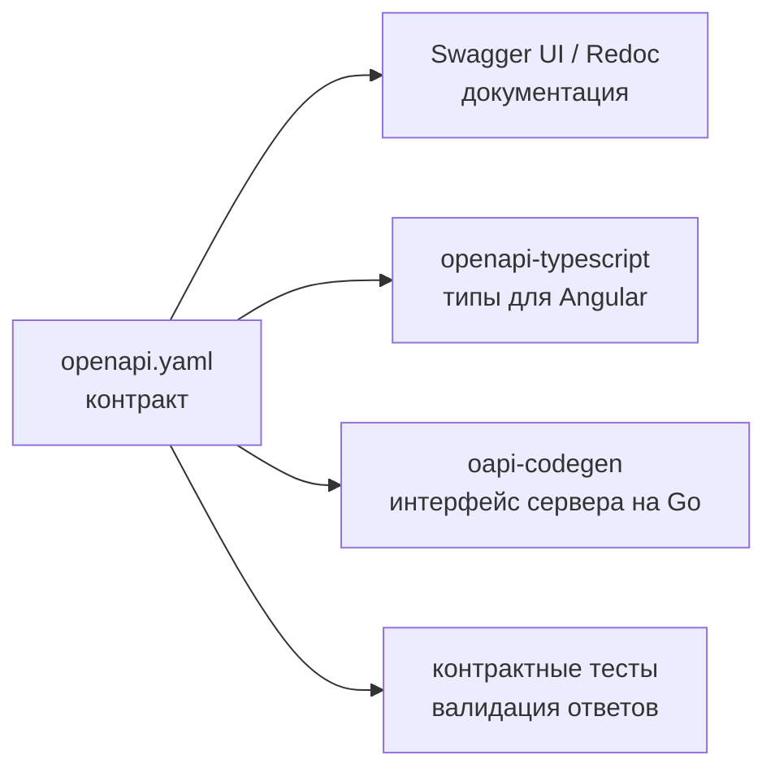
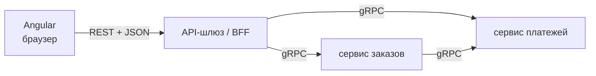

# Глава 14. Проектирование API: REST углублённо, OpenAPI, GraphQL, gRPC

**Цели главы:** проектировать API, которые трудно сломать и приятно использовать; описывать контракт в OpenAPI и получать из него **типы для Angular**; понимать, когда нужны GraphQL и gRPC.

⏱ ~1 неделя · предыдущая: [Глава 13](13-redis-ocheredi.md) · следующая: [Глава 15](15-observability.md)

---

## 14.1. REST: что стоит довести до ума

Основы вы уже знаете (глава 6). Что отличает «рабочий» API от «хорошего»:

### Моделирование

| Задача | Решение |
|---|---|
| Коллекция и элемент | `GET /todos`, `GET /todos/{id}` |
| Принадлежность | `GET /projects/{id}/tasks` (до двух уровней вложенности; глубже — плоские URL с фильтром `?project_id=`) |
| **Действие**, не вписывающееся в CRUD | подресурс-глагол: `POST /orders/{id}/cancel`, `POST /payments/{id}/refund` |
| Долгая операция | `POST /reports` → `202 Accepted` + `Location: /reports/42`; клиент опрашивает `GET /reports/42` (`status: pending|done|failed`) или подписывается по SSE (глава 13) |
| Массовые операции | `POST /todos:batch` или `POST /todos/bulk` с массивом, с частичным результатом по каждому элементу |
| Загрузка файлов | `multipart/form-data` для небольших; для больших — **pre-signed URL** в объектное хранилище (S3): клиент грузит напрямую, мимо вашего сервера |

### Запросы коллекций

Единые параметры для всех списков — клиентам (и вашему Angular-коду) жить проще:

```
GET /todos?done=false&limit=20&cursor=eyJpZCI6NDJ9&sort=-created_at,title&fields=id,title
```

`limit` с верхней границей; курсорная пагинация (глава 8); `sort` с префиксом `-` для убывания; белый список полей сортировки/фильтрации.

### Ошибки: Problem Details (RFC 9457)

Единый машиночитаемый формат ошибок со стабильными кодами — основа для обработки на клиенте:

```json
{
  "type": "https://api.example.com/errors/validation",
  "title": "Validation failed",
  "status": 422,
  "detail": "Одно или несколько полей содержат ошибки",
  "instance": "/todos",
  "errors": [
    { "field": "title", "code": "too_long", "message": "максимум 200 символов" }
  ]
}
```

`Content-Type: application/problem+json`. Angular-interceptor разбирает `errors[]` и подсвечивает поля формы — вот почему поле `field` стоит договориться называть **как поле формы**. Не ломайте формат между эндпоинтами.

### Версионирование и совместимость

- **Аддитивные изменения** (новое необязательное поле, новый эндпоинт) — не ломающие. Клиенты **должны игнорировать неизвестные поля**.
- **Ломающие** — удаление/переименование поля, смена типа, новая обязательная валидация. Для них — новая версия (`/v2/...` в пути — самый простой и заметный способ).
- Устаревание объявляйте заранее: заголовки `Deprecation` и `Sunset`, срок поддержки, метрики использования старой версии.
- Не меняйте **смысл** существующих значений молча.

### Прочее, что экономит дни

- **Идемпотентность** `POST`: заголовок `Idempotency-Key` (глава 6).
- **Конкурентные правки:** `ETag` / `If-Match` → `412` (глава 6).
- **Кэширование:** `Cache-Control`, `ETag`, `304 Not Modified`; `Vary` при зависимости ответа от заголовков.
- **Сжатие** `gzip`/`br` (обычно на прокси), **HTTP/2** — «из коробки» на TLS.
- **Заголовки лимитов:** `RateLimit-Limit/Remaining/Reset`, `Retry-After` при `429`.
- **Единицы и форматы:** деньги — целые минимальные единицы + валюта (`{"amount": 12990, "currency": "RUB"}`); время — RFC 3339 в UTC; идентификаторы — строки (если могут быть > 2⁵³).
- **Вебхуки** (когда сервис сам вызывает клиента): подписывайте тело `HMAC-SHA256`, повторяйте доставку с backoff, присылайте идентификатор события для дедупликации.

Проверка подписи вебхука (сравнение — только в постоянное время!):

```go
package main

import (
	"crypto/hmac"
	"crypto/sha256"
	"encoding/hex"
	"fmt"
)

func sign(secret, body []byte) string {
	mac := hmac.New(sha256.New, secret)
	mac.Write(body)
	return hex.EncodeToString(mac.Sum(nil))
}

func verify(secret, body []byte, sigHex string) bool {
	got, err := hex.DecodeString(sigHex)
	if err != nil {
		return false
	}
	mac := hmac.New(sha256.New, secret)
	mac.Write(body)
	return hmac.Equal(mac.Sum(nil), got) // не ==: защита от тайминговых атак
}

func main() {
	secret := []byte("whsec_demo")
	body := []byte(`{"event":"order.paid","id":42}`)

	sig := sign(secret, body)
	fmt.Println("подпись:", sig[:16]+"…")
	fmt.Println("валидна:", verify(secret, body, sig))
	fmt.Println("тело подменено:", verify(secret, []byte(`{"event":"order.paid","id":43}`), sig))
}
```

## 14.2. OpenAPI: контракт, из которого растёт всё остальное



**OpenAPI** (бывший Swagger) — формат описания HTTP API в YAML/JSON: пути, параметры, схемы запросов и ответов, ошибки, авторизация. Один документ становится:

- **документацией** (Swagger UI, Redoc);
- **источником типов и клиента** для Angular (никакого ручного дублирования `interface Todo`);
- **источником серверных заготовок** на Go;
- основой **контрактных тестов** и валидации запросов.

Готовая спецификация вашего TODO API из главы 6 — в [`labs/api/openapi.yaml`](labs/api/openapi.yaml) (проверена валидатором OpenAPI 3.0.3). Фрагмент:

```yaml
paths:
  /todos/{id}:
    parameters:
      - name: id
        in: path
        required: true
        schema: { type: integer, minimum: 1 }
    patch:
      operationId: updateTodo
      requestBody:
        required: true
        content:
          application/json:
            schema: { $ref: "#/components/schemas/UpdateTodo" }
      responses:
        "200": { description: Обновлённая задача, content: { application/json: { schema: { $ref: "#/components/schemas/Todo" } } } }
        "404": { $ref: "#/components/responses/NotFound" }
components:
  schemas:
    Todo:
      type: object
      required: [id, title, done]
      properties:
        id:    { type: integer, format: int64 }
        title: { type: string, minLength: 1 }
        done:  { type: boolean }
```

### Два подхода

| | **Spec-first** (сначала контракт) | **Code-first** (контракт из кода) |
|---|---|---|
| Идея | пишете YAML, генерируете код и клиентов | пишете Go с аннотациями, генерируете YAML (`swaggo/swag`) |
| Плюс | контракт — предмет договорённости фронта и бэка **до** кода; нельзя «случайно» сломать | меньше дублирования, быстрее старт |
| Минус | нужна дисциплина и генерация | аннотации рассинхронизируются с кодом |
| Рекомендация | командам, где фронт и бэк работают параллельно (**вы — именно такой случай**) | одиночным проектам |

### Типы для Angular из спецификации

Генератор [`openapi-typescript`](https://openapi-ts.dev) превращает YAML в TypeScript-типы:

```bash
npx openapi-typescript labs/api/openapi.yaml -o src/app/api/schema.d.ts
```

Реальный результат для нашей спецификации:

```ts
export interface components {
    schemas: {
        Todo: {
            /** Format: int64 */
            id: number;
            title: string;
            done: boolean;
        };
        CreateTodo: {
            title: string;
        };
        UpdateTodo: {
            title?: string;
            done?: boolean;
        };
        Error: {
            error: string;
        };
    };
    // ... responses, paths, operations
}
```

Использование в Angular-сервисе — типы всегда равны контракту:

```ts
import type { components } from './api/schema';
type Todo = components['schemas']['Todo'];
type CreateTodo = components['schemas']['CreateTodo'];

@Injectable({ providedIn: 'root' })
export class TodoApi {
  private http = inject(HttpClient);
  list(done?: boolean)       { return this.http.get<Todo[]>('/api/todos', { params: done === undefined ? {} : { done } }); }
  create(body: CreateTodo)   { return this.http.post<Todo>('/api/todos', body); }
}
```

Если бэкенд поменяет контракт — `tsc` на фронте **упадёт при сборке**, а не пользователь в рантайме. Для полноценных клиентов с готовыми Angular-сервисами есть `ng-openapi-gen` и OpenAPI Generator.

**На стороне Go:** [`oapi-codegen`](https://github.com/oapi-codegen/oapi-codegen) по спецификации генерирует типы запросов/ответов и интерфейс сервера (поддерживает стандартный `net/http`); вам остаётся реализовать методы интерфейса. Версии и флаги генератора меняются — сверяйтесь с его README. Альтернатива — писать YAML по готовому коду и проверять соответствие контрактными тестами (валидация ответов по схеме, например библиотекой `kin-openapi`).

Документацию отдаёт Swagger UI/Redoc: статическая страница, читающая `openapi.yaml` (можно встроить в бинарник через `embed`).

## 14.3. GraphQL — коротко

**GraphQL** — язык запросов: клиент сам описывает, **какие поля** ему нужны, и получает их одним запросом.

```graphql
query {
  user(id: 7) { name  todos(first: 5) { title done } }
}
```

| Плюсы | Минусы |
|---|---|
| Нет over/under-fetching, один запрос вместо нескольких | Сложнее кэширование (всё `POST /graphql`), мониторинг, ограничение сложности запросов |
| Строгая схема и самодокументирование | **N+1** на стороне сервера (лечится *dataloader*-ом) |
| Удобно для разнородных клиентов (web, mobile) | Авторизация на уровне **полей**, защита от «дорогих» запросов (глубина, стоимость) |

В Go — `github.com/99designs/gqlgen` (spec-first, кодогенерация), в Angular — Apollo Angular. Когда брать: много разных клиентов с разными потребностями в данных, агрегирующий слой (**BFF**) над несколькими сервисами. Для типичного CRUD-API с одним фронтендом REST + OpenAPI проще.

## 14.4. gRPC и Protobuf

**gRPC** — фреймворк RPC (вызов удалённых функций) поверх **HTTP/2** с бинарной сериализацией **Protocol Buffers**. Основной сценарий — **общение сервисов друг с другом**, а не браузера.

### `.proto`: контракт

```proto
// proto/todo/v1/todo.proto
syntax = "proto3";

package todo.v1;
option go_package = "example.com/todo/gen/todo/v1;todov1";

import "google/protobuf/timestamp.proto";

message Todo {
  int64 id = 1;                       // НОМЕР поля — часть бинарного формата, не имя!
  string title = 2;
  bool done = 3;
  google.protobuf.Timestamp created_at = 4;
}

message GetTodoRequest   { int64 id = 1; }
message ListTodosRequest { int32 page_size = 1; string page_token = 2; }
message ListTodosResponse {
  repeated Todo todos = 1;
  string next_page_token = 2;
}
message WatchRequest { int64 user_id = 1; }
message TodoEvent {
  enum Kind { KIND_UNSPECIFIED = 0; KIND_CREATED = 1; KIND_UPDATED = 2; KIND_DELETED = 3; }
  Kind kind = 1;
  Todo todo = 2;
}

service TodoService {
  rpc GetTodo(GetTodoRequest) returns (Todo);                       // унарный: запрос → ответ
  rpc ListTodos(ListTodosRequest) returns (ListTodosResponse);
  rpc Watch(WatchRequest) returns (stream TodoEvent);               // сервер шлёт поток
  // rpc Upload(stream Chunk) returns (Result);                    // клиент шлёт поток
  // rpc Chat(stream Msg) returns (stream Msg);                    // двунаправленный поток
}
```

**Правила совместимости Protobuf** (аналог «не ломайте API»):

- **Никогда не меняйте номер и тип** существующего поля и не переиспользуйте номер удалённого — пометьте `reserved 5;`.
- Новое поле — новый номер; старые клиенты его игнорируют, а старые данные дают значение по умолчанию.
- Нулевое значение enum — всегда `..._UNSPECIFIED`.
- Различение «не задано» и «0/пусто» — через `optional` или обёртки.

### Генерация кода

Инструмент [`buf`](https://buf.build) (или `protoc` с плагинами `protoc-gen-go` и `protoc-gen-go-grpc`):

```yaml
# buf.gen.yaml
version: v2
plugins:
  - remote: buf.build/protocolbuffers/go
    out: gen
    opt: paths=source_relative
  - remote: buf.build/grpc/go
    out: gen
    opt: paths=source_relative
```
```bash
buf generate      # создаст gen/todo/v1/todo.pb.go и todo_grpc.pb.go
```

### Сервер и клиент на Go

```go
// Сервер: реализуем сгенерированный интерфейс
type todoServer struct {
	todov1.UnimplementedTodoServiceServer // для совместимости вперёд
	svc *todo.Service                     // та же бизнес-логика, что и у HTTP (глава 11)
}

func (s *todoServer) GetTodo(ctx context.Context, req *todov1.GetTodoRequest) (*todov1.Todo, error) {
	t, err := s.svc.Get(ctx, req.GetId())
	switch {
	case errors.Is(err, todo.ErrNotFound):
		return nil, status.Error(codes.NotFound, "todo not found") // доменная ошибка → код gRPC
	case err != nil:
		return nil, status.Error(codes.Internal, "internal error")
	}
	return &todov1.Todo{Id: t.ID, Title: t.Title, Done: t.Done}, nil
}

func main() {
	lis, _ := net.Listen("tcp", ":9090")
	gs := grpc.NewServer(grpc.UnaryInterceptor(authInterceptor)) // interceptor — аналог middleware
	todov1.RegisterTodoServiceServer(gs, &todoServer{svc: svc})
	log.Fatal(gs.Serve(lis))
}

// Клиент
conn, err := grpc.NewClient("localhost:9090", grpc.WithTransportCredentials(insecure.NewCredentials()))
defer conn.Close()
client := todov1.NewTodoServiceClient(conn)

ctx, cancel := context.WithTimeout(context.Background(), 2*time.Second) // ДЕДЛАЙН — обязателен
defer cancel()
t, err := client.GetTodo(ctx, &todov1.GetTodoRequest{Id: 1})
```

Ключевое:

- **Дедлайны.** Клиент задаёт срок через `context`; он **передаётся по цепочке сервисов** — «зависших» запросов нет.
- **Interceptors** (унарные и потоковые) — для авторизации, логирования, метрик, трассировки; метаданные (`metadata`) — аналог заголовков.
- **Ошибки** — коды `codes.*`; примерно: `InvalidArgument`≈400, `Unauthenticated`≈401, `PermissionDenied`≈403, `NotFound`≈404, `AlreadyExists`≈409, `ResourceExhausted`≈429, `Internal`≈500, `Unavailable`≈503 (ретраить можно), `DeadlineExceeded`≈504.
- **Health checking** (`grpc.health.v1`) и **reflection** (чтобы инструменты вроде `grpcurl` видели методы).
- **Браузер не говорит на «чистом» gRPC.** Варианты: **gRPC-Web** (+ прокси), [**Connect**](https://connectrpc.com) (совместим с gRPC, работает по HTTP/1.1 и JSON, есть клиент для TypeScript), или **grpc-gateway** — генерирует REST-фасад из `.proto`.

### REST, GraphQL или gRPC?



| | REST + JSON | GraphQL | gRPC |
|---|---|---|---|
| Клиент | любой, **браузер напрямую** | браузер/мобильные | сервис ↔ сервис, мобильные |
| Контракт | OpenAPI | схема GraphQL | `.proto` (строгий) |
| Эффективность | средняя (текст) | гибкие запросы, но тяжёлый сервер | высокая (бинарный, HTTP/2, потоки) |
| Кэширование HTTP | отличное | сложное | нет |
| Отладка `curl` | тривиально | можно | `grpcurl` |
| Выбирайте для | публичных и веб-API **(по умолчанию)** | разнородных клиентов, BFF | внутренних межсервисных вызовов, потоков |

Типичная архитектура: **снаружи REST/JSON** (для Angular), **внутри gRPC** (между сервисами), и тот же слой бизнес-логики за обоими транспортами (глава 11).

---

## Задачи

1. 🟢 **Валидация контракта.** Скопируйте [`labs/api/openapi.yaml`](labs/api/openapi.yaml), откройте его в Swagger Editor (editor.swagger.io) или Redoc. Найдите различия между спецификацией и вашей реализацией TODO API (`tasks/ch06/todoapi`): коды ошибок, формат `Location`, валидацию. Исправьте то, что расходится, **в одну из сторон** — и обоснуйте, в какую.
2. 🟡 **Типы для Angular.** Сгенерируйте `schema.d.ts` из спецификации и подключите в Angular-приложение вместо ручных `interface`. Намеренно измените поле в спецификации (`done` → `completed`) и перегенерируйте: убедитесь, что `tsc` указывает на **все** места, которые надо поправить.
3. 🟡 **Документация.** Встройте `openapi.yaml` в Go-бинарник (`//go:embed`) и отдавайте на `GET /openapi.yaml`, а по `GET /docs` — страницу Swagger UI/Redoc (из CDN или статики). Проверьте, что документация открывается в браузере.
4. 🟡 **Единый формат ошибок.** Перейдите на Problem Details: `Content-Type: application/problem+json`, `errors[]` по полям. Обновите спецификацию (`ProblemDetails` схема), Go-обработчики и Angular-interceptor, подсвечивающий ошибки полей реактивной формы.
5. 🟡 **Валидация по схеме.** Добавьте контрактные тесты: для каждого ответа вашего API проверять тело на соответствие схеме из `openapi.yaml` (`github.com/getkin/kin-openapi` — `openapi3filter`). Тест должен падать, если вы удалите обязательное поле из ответа.
6. 🟡 **Асинхронная операция.** `POST /reports` → `202` + `Location`, `GET /reports/{id}` со статусами, `DELETE` для отмены. Опишите в OpenAPI. Клиент опрашивает с экспоненциальной паузой.
7. 🟡 **Вебхуки.** Реализуйте отправку события `todo.completed` на URL подписчика с подписью `HMAC-SHA256` и идентификатором события; ретраи с backoff (глава 13); приёмник, проверяющий подпись и **дедуплицирующий** по id события. Тесты на подмену тела и повтор.
8. 🔴 **gRPC.** Опишите `TodoService` из 14.4 в `.proto`, сгенерируйте код (`buf`), реализуйте сервер поверх **того же** сервисного слоя, что и HTTP, добавьте клиент в виде CLI. Реализуйте: унарные методы, серверный поток `Watch`, interceptor с проверкой токена из `metadata`, дедлайн на клиенте и обработку `codes.NotFound`.
9. 🔴 **Сравнение.** На одной и той же выборке (1000 задач) сравните размер ответа и время: JSON REST, gzip JSON, gRPC. Составьте таблицу и объясните, когда разница важна, а когда нет.
10. 🟡 **Совместимость.** В `.proto` добавьте поле, затем удалите другое с `reserved`; покажите на примере (старый клиент, новый сервер и наоборот), что бинарный формат остаётся совместимым. Что сломается, если переиспользовать номер поля?

## Самопроверка

- Как моделировать действия, которые не вписываются в CRUD? Долгие операции? Загрузку файлов?
- Что такое Problem Details и зачем единый формат ошибок?
- Какие изменения API ломающие, а какие нет? Что такое `Deprecation` и `Sunset`?
- Что такое OpenAPI и чем spec-first отличается от code-first? Что вы получаете «бесплатно» из спецификации?
- Как контракт защищает Angular от рассинхронизации с бэкендом?
- Когда стоит брать GraphQL, а когда достаточно REST? Что такое dataloader?
- Что такое gRPC, Protobuf и номера полей? Какие правила совместимости нельзя нарушать?
- Что такое дедлайн в gRPC и как он путешествует по цепочке сервисов?
- Почему браузер не может говорить на gRPC напрямую и что с этим делать?
- Почему сравнение подписей вебхуков делают через `hmac.Equal`?

➡️ Дальше: [Глава 15. Наблюдаемость](15-observability.md)
