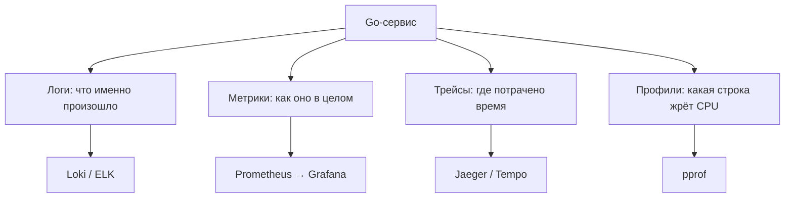

# Глава 15. Наблюдаемость: логи, метрики, трейсы, профилирование

**Цели главы:** видеть, что происходит в работающем сервисе; снимать метрики Prometheus; понимать, как читать латентность (p95/p99); находить узкие места в Go с помощью `pprof`; проверять сервис нагрузкой.

⏱ ~1 неделя · предыдущая: [Глава 14](14-api-grpc.md) · следующая: [Глава 16](16-linux-cicd-deploy.md)

---

## 15.0. Зачем



На фронтенде у вас есть DevTools: видно запросы, ошибки, профиль. На сервере, который крутится где-то в облаке под тысячами запросов, их нет — вы **слепы**, пока не построите наблюдаемость заранее. **Observability** — способность понять внутреннее состояние системы по её внешним сигналам.

Три столпа (плюс профилирование):

| Сигнал | Вопрос, на который отвечает | Пример |
|---|---|---|
| **Логи** | *Что именно произошло?* | «заказ 42: оплата отклонена, код 51» |
| **Метрики** | *Как оно в целом? Тренды? Алерты?* | 5xx = 2%, p95 = 480 мс, 120 горутин |
| **Трейсы** | *Где потрачено время в цепочке сервисов?* | запрос 800 мс: 700 мс — вызов платёжного сервиса |
| **Профили** | *Какая строка кода жрёт CPU/память?* | 60% CPU — `regexp.MustCompile` в горячем пути |

## 15.1. Логи (углубление главы 11)

- Структурные JSON-логи в stdout (`slog`), **единый `request_id`** в каждой записи.
- Сквозной идентификатор: Angular-interceptor может генерировать `X-Request-ID` и показывать его в сообщении «Что-то пошло не так (код: `a1b2…`)» — поддержка по этому коду находит все логи запроса.
- Уровни: `ERROR` — требует внимания человека; не засоряйте им ожидаемые события (404, невалидный ввод — это `INFO`/`WARN` или метрика).
- Собирают и ищут централизованно: **Loki** (+Grafana), ELK/OpenSearch, облачные сервисы. Логи на диске сервера — не решение.
- Не логируйте ПДн и секреты. Не логируйте в горячем цикле — это дорого.

## 15.2. Метрики и Prometheus

**Метрика** — число, меняющееся во времени. **Prometheus** периодически **опрашивает** (*scrape*) эндпоинт `/metrics` вашего сервиса и хранит временные ряды; **Grafana** рисует графики; **Alertmanager** шлёт оповещения.

### Типы метрик

| Тип | Что это | Пример |
|---|---|---|
| **Counter** | только растёт | `http_requests_total`, `errors_total` |
| **Gauge** | растёт и падает | `in_flight_requests`, `queue_size`, `go_goroutines` |
| **Histogram** | распределение по «корзинам» (buckets) | время ответа → считаются перцентили |
| Summary | перцентили на стороне клиента | редко; histogram агрегируется лучше |

### Что измерять: RED и USE

- **RED** (для запросов сервиса): **R**ate — запросов/с, **E**rrors — доля ошибок, **D**uration — латентность (p50/p95/p99).
- **USE** (для ресурсов — CPU, память, соединения БД, очередь): **U**tilization, **S**aturation, **E**rrors.
- Google-овские **4 золотых сигнала**: latency, traffic, errors, saturation.

### Живой пример: метрики + health + pprof

```go
package main

import (
	"encoding/json"
	"log/slog"
	"net/http"
	_ "net/http/pprof" // регистрирует /debug/pprof/* в http.DefaultServeMux
	"os"
	"strconv"
	"sync/atomic"
	"time"

	"github.com/prometheus/client_golang/prometheus"
	"github.com/prometheus/client_golang/prometheus/promauto"
	"github.com/prometheus/client_golang/prometheus/promhttp"
)

var (
	httpRequests = promauto.NewCounterVec(prometheus.CounterOpts{
		Name: "http_requests_total",
		Help: "Число HTTP-запросов.",
	}, []string{"method", "route", "status"})

	httpDuration = promauto.NewHistogramVec(prometheus.HistogramOpts{
		Name:    "http_request_duration_seconds",
		Help:    "Длительность обработки запроса.",
		Buckets: []float64{.005, .01, .025, .05, .1, .25, .5, 1, 2.5},
	}, []string{"method", "route"})

	inFlight = promauto.NewGauge(prometheus.GaugeOpts{
		Name: "http_in_flight_requests",
		Help: "Запросы, обрабатываемые прямо сейчас.",
	})
)

type statusRecorder struct {
	http.ResponseWriter
	status int
}

func (r *statusRecorder) WriteHeader(code int) {
	r.status = code
	r.ResponseWriter.WriteHeader(code)
}

// metrics — middleware. ВАЖНО: метка route — это ШАБЛОН маршрута («GET /hello/{name}»),
// а не сырой путь: иначе на каждый id появится новый временной ряд (взрыв кардинальности).
func metrics(next http.Handler) http.Handler {
	return http.HandlerFunc(func(w http.ResponseWriter, r *http.Request) {
		start := time.Now()
		inFlight.Inc()
		defer inFlight.Dec()

		rec := &statusRecorder{ResponseWriter: w, status: http.StatusOK}
		next.ServeHTTP(rec, r)

		route := r.Pattern // Go 1.23+: заполняется ServeMux после маршрутизации
		if route == "" {
			route = "unmatched" // 404 по неизвестным путям — единая метка, а не мусор от сканеров
		}
		httpRequests.WithLabelValues(r.Method, route, strconv.Itoa(rec.status)).Inc()
		httpDuration.WithLabelValues(r.Method, route).Observe(time.Since(start).Seconds())
	})
}

func main() {
	log := slog.New(slog.NewJSONHandler(os.Stdout, nil))
	var ready atomic.Bool
	ready.Store(true)

	mux := http.NewServeMux()
	mux.HandleFunc("GET /hello/{name}", func(w http.ResponseWriter, r *http.Request) {
		time.Sleep(20 * time.Millisecond) // имитация работы
		_ = json.NewEncoder(w).Encode(map[string]string{"hello": r.PathValue("name")})
	})
	// liveness: «процесс жив» — оркестратор перезапустит при отказе
	mux.HandleFunc("GET /healthz", func(w http.ResponseWriter, r *http.Request) { w.WriteHeader(http.StatusOK) })
	// readiness: «готов принимать трафик» (БД доступна, прогрев завершён) — иначе балансировщик уберёт из ротации
	mux.HandleFunc("GET /readyz", func(w http.ResponseWriter, r *http.Request) {
		if !ready.Load() {
			http.Error(w, "not ready", http.StatusServiceUnavailable)
			return
		}
		w.WriteHeader(http.StatusOK)
	})

	// Служебный порт ТОЛЬКО на localhost: /metrics и /debug/pprof не должны быть доступны из интернета.
	go func() {
		admin := http.NewServeMux()
		admin.Handle("GET /metrics", promhttp.Handler())
		admin.Handle("/debug/pprof/", http.DefaultServeMux) // pprof уже зарегистрирован выше импортом
		log.Info("admin listening", "addr", "127.0.0.1:6060")
		if err := http.ListenAndServe("127.0.0.1:6060", admin); err != nil {
			log.Error("admin server", "err", err)
		}
	}()

	srv := &http.Server{Addr: ":8080", Handler: metrics(mux), ReadHeaderTimeout: 5 * time.Second}
	log.Info("api listening", "addr", srv.Addr)
	log.Error("server stopped", "err", srv.ListenAndServe())
}
```

Что делает `/metrics` (реальный вывод после нескольких запросов):

```
# HELP http_request_duration_seconds Длительность обработки запроса.
# TYPE http_request_duration_seconds histogram
http_request_duration_seconds_bucket{method="GET",route="GET /hello/{name}",le="0.025"} 3
http_request_duration_seconds_bucket{method="GET",route="GET /hello/{name}",le="+Inf"} 3
http_request_duration_seconds_count{method="GET",route="GET /hello/{name}"} 3
# HELP http_requests_total Число HTTP-запросов.
# TYPE http_requests_total counter
http_requests_total{method="GET",route="GET /hello/{name}",status="200"} 3
http_requests_total{method="GET",route="unmatched",status="404"} 1
```

Вместе с вашими метриками «бесплатно» отдаются метрики рантайма Go и процесса: `go_goroutines`, `go_memstats_alloc_bytes`, `go_gc_duration_seconds`, `process_cpu_seconds_total`, `process_open_fds`.

**Кардинальность.** Каждая уникальная комбинация значений меток — **отдельный временной ряд** в памяти Prometheus. Метка со значением вроде `user_id`, полного URL или текста ошибки способна «положить» мониторинг. В метках — только **ограниченные** множества (метод, шаблон маршрута, класс статуса).

### Prometheus + Grafana в Compose

```yaml
# monitoring/compose.yaml
services:
  prometheus:
    image: prom/prometheus
    volumes:
      - ./prometheus.yml:/etc/prometheus/prometheus.yml:ro
    ports:
      - "9090:9090"
    extra_hosts:
      - "host.docker.internal:host-gateway"   # достучаться до сервиса, запущенного на хосте

  grafana:
    image: grafana/grafana
    ports:
      - "3000:3000"
    depends_on:
      - prometheus
```

```yaml
# monitoring/prometheus.yml
global:
  scrape_interval: 5s
scrape_configs:
  - job_name: todo-api
    static_configs:
      - targets: ["host.docker.internal:6060"]
```

Запросы **PromQL**, которые вы будете писать чаще всего:

```
sum(rate(http_requests_total[5m])) by (route)                                  # RPS по маршрутам
sum(rate(http_requests_total{status=~"5.."}[5m])) / sum(rate(http_requests_total[5m]))   # доля 5xx
histogram_quantile(0.95, sum(rate(http_request_duration_seconds_bucket[5m])) by (le, route))   # p95
go_goroutines                                                                  # утечка горутин — монотонный рост
```

### Перцентили вместо среднего

Среднее время ответа 100 мс может скрывать, что 1% запросов занимает 5 секунд. Смотрите **p50** (типичный), **p95**, **p99** (хвост). Хвост важен: при цепочке из 10 сервисов «редкий» медленный ответ становится частым.

### SLI, SLO, алерты

- **SLI** — измеримый показатель качества («доля запросов быстрее 300 мс и без 5xx»).
- **SLO** — цель по нему («99,9% за 30 дней»). Разница с 100% — **бюджет ошибок**: пока он есть — можно выкатывать новое, закончился — приоритет надёжности.
- Алертите на **симптомы, видимые пользователю** (рост 5xx, p95 выше порога, `/readyz` не отвечает), а не на причины («CPU 80%»). Каждый алерт должен быть **срочным и требовать действия** — иначе его перестанут читать.

## 15.3. Трейсинг

Запрос проходит несколько сервисов и БД. **Распределённая трассировка** связывает всё в одно дерево:

```
trace 7f3a… (812 ms)
└─ span: HTTP POST /orders                  812 ms   (api)
   ├─ span: SELECT users …                    9 ms   (postgres)
   ├─ span: payment.Charge                  700 ms   (payment-service)  ← вот где время
   │   └─ span: HTTP POST provider.com      690 ms
   └─ span: INSERT orders …                  12 ms   (postgres)
```

- **Span** — отрезок работы (имя, время, атрибуты, ошибка); **trace** — дерево спанов одного запроса.
- Идентификатор трассы передаётся между сервисами в заголовке **W3C `traceparent`**; внутри процесса — в `context.Context` (ещё одна причина, почему `ctx` везде).
- Стандарт и библиотеки — **OpenTelemetry (OTel)**: SDK в приложении → **OTLP** → коллектор → хранилище (Jaeger, Grafana Tempo).

```go
// Схема подключения (версии пакетов см. в документации OpenTelemetry для Go):
handler := otelhttp.NewHandler(mux, "http")             // автоматические спаны для входящих запросов

tracer := otel.Tracer("todo-api")
ctx, span := tracer.Start(ctx, "PlaceOrder")            // свой спан вокруг бизнес-операции
defer span.End()
span.SetAttributes(attribute.Int("order.items", len(items)))
if err != nil {
	span.RecordError(err)
	span.SetStatus(codes.Error, err.Error())
}
```

Автоинструментирование есть для `net/http` (`otelhttp`), gRPC, `pgx` (`otelpgx`), Redis. На клиенте OTel для браузера связывает фронтовые запросы с бэкенд-трассой — вы увидите путь от клика до SQL.

## 15.4. Профилирование Go: `pprof`

Метрики говорят «**что-то** медленно», профиль — «**где именно**». `net/http/pprof` (подключён в примере выше) публикует профили на служебном порту.

```bash
# CPU: собирает 30 секунд и открывает интерактивный UI с flame graph
go tool pprof -http=:8081 "http://localhost:6060/debug/pprof/profile?seconds=30"

# Топ потребителей из терминала
go tool pprof -top "http://localhost:6060/debug/pprof/profile?seconds=10"

# Память (живые объекты) и число горутин (поиск утечек)
go tool pprof -http=:8081 http://localhost:6060/debug/pprof/heap
curl "http://localhost:6060/debug/pprof/goroutine?debug=1" | head -50
```

Как читать `-top`:

| Колонка | Смысл |
|---|---|
| `flat` | время **в самой функции** |
| `cum` | время функции **вместе с вызовами из неё** |
| `flat%`, `cum%` | доли от общего |

Ищите функции с большим `flat` — они «жгут» CPU сами; большой `cum` при малом `flat` — функция вызывает что-то тяжёлое. **На практике начинайте с `-top -cum`:** по `flat` в начале списка часто стоят `runtime.*` (GC, аллокации, блокировки), а ваш виновник «размазан» по вызовам и виден именно в кумулятивной сортировке (так и будет в задаче 5). Режимы просмотра в UI: Graph, **Flame Graph** (ширина прямоугольника = доля времени), Source.

**Другое:** `go tool trace` (планировщик, GC, блокировки), профили блокировок (`block`, `mutex`), профилирование в тестах (`go test -bench . -cpuprofile cpu.out -memprofile mem.out`), **escape analysis** (`go build -gcflags=-m` — какие значения уезжают в кучу).

**Правила:** профилируйте **под нагрузкой, похожей на боевую**; сначала измеряйте, потом оптимизируйте; сравнивайте «до/после» одним и тем же бенчмарком (`benchstat`). Не публикуйте `/debug/pprof` в интернет.

### Память и GC в контейнерах

- Go — язык со сборщиком мусора. Параметры: **`GOGC`** (по умолчанию 100: цель кучи = 2× живых данных) и **`GOMEMLIMIT`** (мягкий лимит памяти). В контейнере с лимитом памяти задавайте `GOMEMLIMIT` примерно **на 10% ниже** лимита контейнера — иначе OOM-killer убьёт процесс прежде, чем GC успеет поджаться.
- Число потоков: `GOMAXPROCS` в контейнерах с CPU-лимитом должно учитывать лимит. Начиная с Go 1.25 рантайм делает это сам; в более старых версиях используйте `go.uber.org/automaxprocs`.
- Меньше аллокаций → меньше работы GC: переиспользуйте буферы (`sync.Pool`), заранее задавайте ёмкость слайсов (`make([]T, 0, n)`), не склеивайте строки в цикле (`strings.Builder`).

## 15.5. Нагрузочное тестирование

Узнать пределы сервиса лучше **до** боевого трафика.

```bash
# hey: быстро, одной командой (30 секунд, 50 одновременных)
hey -z 30s -c 50 http://localhost:8080/hello/world

# vegeta: ровная нагрузка 200 запросов в секунду
echo "GET http://localhost:8080/hello/world" | vegeta attack -rate=200 -duration=30s | vegeta report
```

```js
// k6: сценарии на JavaScript — вам привычно
import http from 'k6/http';
import { check, sleep } from 'k6';

export const options = {
  stages: [{ duration: '30s', target: 100 }, { duration: '1m', target: 100 }, { duration: '10s', target: 0 }],
  thresholds: { http_req_failed: ['rate<0.01'], http_req_duration: ['p(95)<300'] },
};

export default function () {
  const res = http.get('http://localhost:8080/hello/world');
  check(res, { 'status 200': (r) => r.status === 200 });
  sleep(1);
}
```

Что смотреть: **пропускную способность** (RPS), **p95/p99**, долю ошибок, насыщение (CPU, пул соединений БД, горутины). Запускайте клиента **не на той же машине**, что и сервис, и на данных, похожих на боевые. Нагрузка растёт ступенчато до **точки перелома** — это и есть ваша ёмкость.

## 15.6. Как разбирать инцидент

1. **Симптом:** что видит пользователь? Когда началось? (алерт, графики RED).
2. **Что изменилось?** Деплой, конфиг, миграция, трафик, зависимость. Откат — самый быстрый первый шаг.
3. **Локализация:** какой маршрут/сервис/зависимость? (метрики по маршрутам, трейсы).
4. **Причина:** логи по `request_id`, профили, `EXPLAIN ANALYZE` медленного запроса, `pg_stat_activity`.
5. **Исправление и проверка** по метрикам.
6. **Разбор без поиска виноватых** (*blameless postmortem*): что случилось, почему не заметили раньше, какие улучшения (тест, алерт, дашборд).

---

## Задачи

1. 🟢 **Запустите и посмотрите.** Соберите программу из 15.2, сделайте несколько запросов (`/hello/a`, `/hello/b`, `/nope`), откройте `http://localhost:6060/metrics`. Найдите свои метрики и метрики рантайма. Объясните, почему у `/hello/a` и `/hello/b` **один** временной ряд, а у `/nope` — `unmatched`.
2. 🟡 **Метрики к вашему API.** Добавьте middleware метрик в TODO API (RED по маршрутам), счётчик бизнес-событий (`todos_created_total`), gauge `db_pool_in_use` из `pool.Stat()` (глава 8). Проверьте, что метка маршрута — шаблон, а не путь.
3. 🟡 **Prometheus + Grafana.** Поднимите стек из 15.2 в Compose, добавьте источник данных в Grafana, постройте панели: RPS, доля 5xx, p95 по маршрутам, `go_goroutines`, `http_in_flight_requests`. Экспортируйте дашборд в JSON и положите в репозиторий.
4. 🟡 **Логи + `request_id`.** Свяжите всё: middleware кладёт `request_id` в контекст и ответ; все `slog`-записи содержат его; Angular-interceptor добавляет заголовок `X-Request-ID` и показывает код в сообщении об ошибке. Вызовите ошибку и найдите **все** её логи по коду.
5. 🔴 **Охота на узкое место (pprof).** Добавьте в программу из 15.2 такой обработчик (он **намеренно плохой**):

   ```go
   mux.HandleFunc("GET /slow", func(w http.ResponseWriter, r *http.Request) {
   	var sb string
   	for i := 0; i < 2000; i++ {
   		re := regexp.MustCompile(`^item-(\d+)$`)
   		s := fmt.Sprintf("item-%d", i)
   		if m := re.FindStringSubmatch(s); m != nil {
   			sb += m[1] + ","
   		}
   	}
   	fmt.Fprintf(w, "%d bytes\n", len(sb))
   })
   ```
   Нагрузите его (`hey -z 20s -c 8 http://localhost:8080/slow`) и **одновременно** снимите CPU-профиль (`go tool pprof -top -cum …`). Найдите главного виновника, объясните **две** проблемы в коде, исправьте и покажите «до/после» (RPS, p95, доля CPU). Бонус: напишите бенчмарк (`-benchmem`) обеих версий.

   *Ориентир (на проверочном прогоне автора):* обработчик занимал ≈ 53% всех CPU-сэмплов; из них `regexp.MustCompile` ≈ 40% (то есть три четверти времени обработчика уходит на компиляцию регулярки, которая каждый раз одна и та же), `runtime.mallocgc` ≈ 21% (лишние аллокации от конкатенации `sb +=`). По `flat` же сверху — `runtime.semasleep`, `memmove`, `memclr`: GC и копирование — следствие. Ваши цифры будут другими, но картина должна совпасть.
6. 🟡 **Утечка горутин.** Сделайте обработчик, который запускает горутину, блокирующуюся на канале навсегда. Нагрузите, наблюдайте рост `go_goroutines` и профиль `goroutine?debug=1`. Исправьте через `context`.
7. 🟡 **Нагрузочный тест.** Прогоните k6/vegeta с растущей нагрузкой на TODO API с Postgres. Найдите точку перелома: при каких RPS p95 превысил 300 мс или появились ошибки? Что стало узким местом (CPU сервиса, пул соединений, БД)? Увеличьте/уменьшите `MaxConns` пула и покажите влияние.
8. 🟡 **Health и readiness.** `/healthz` (жив ли процесс) и `/readyz` (ping БД с таймаутом 1 с). Сделайте так, чтобы при остановке (`SIGTERM`) сервис **сначала** начал отвечать `503` на `/readyz`, подождал несколько секунд (балансировщик убирает из ротации), и только потом остановил сервер (graceful shutdown, глава 6). Настройте `healthcheck` в Compose.
9. 🔴 **Трейсинг.** Подключите OpenTelemetry: `otelhttp` на входе, `otelpgx` для БД, свой спан вокруг бизнес-операции; поднимите Jaeger (Compose), найдите трейс запроса, укажите самый длинный спан. Передайте `traceparent` во внешний HTTP-вызов и убедитесь, что трасса не рвётся.
10. 🟡 **Алерты и SLO.** Определите SLI/SLO для вашего API (например, 99% запросов < 300 мс, 99,5% без 5xx за 7 дней). Запишите PromQL для SLI и два правила алертов (симптом: высокая доля 5xx; симптом: p95 > порога 10 минут). Опишите, что **должен сделать** дежурный при срабатывании каждого.

## Самопроверка

- В чём разница между логами, метриками, трейсами и профилями? Что используете для каких вопросов?
- Какие бывают типы метрик Prometheus? Почему для латентности нужен histogram?
- Что такое RED и USE? Что такое кардинальность меток и почему нельзя класть в метки `user_id`?
- Почему средняя латентность вводит в заблуждение? Что такое p95/p99?
- Что такое SLI, SLO, бюджет ошибок? На что нужно настраивать алерты?
- Чем liveness отличается от readiness?
- Что такое trace и span? Как контекст трассы передаётся между сервисами?
- Как читать `flat` и `cum` в `pprof`? Как найти утечку горутин?
- Зачем `GOMEMLIMIT` в контейнере? Почему `/debug/pprof` нельзя выставлять наружу?
- Как правильно проводить нагрузочное тестирование?

➡️ Дальше: [Глава 16. Linux, сеть, CI/CD и деплой](16-linux-cicd-deploy.md)
