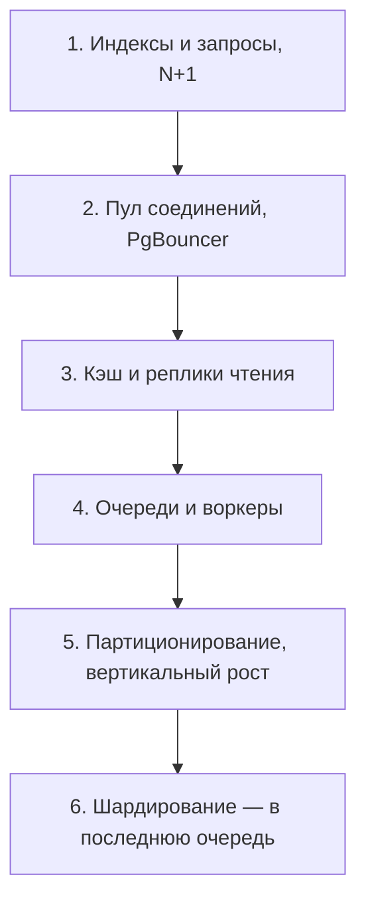
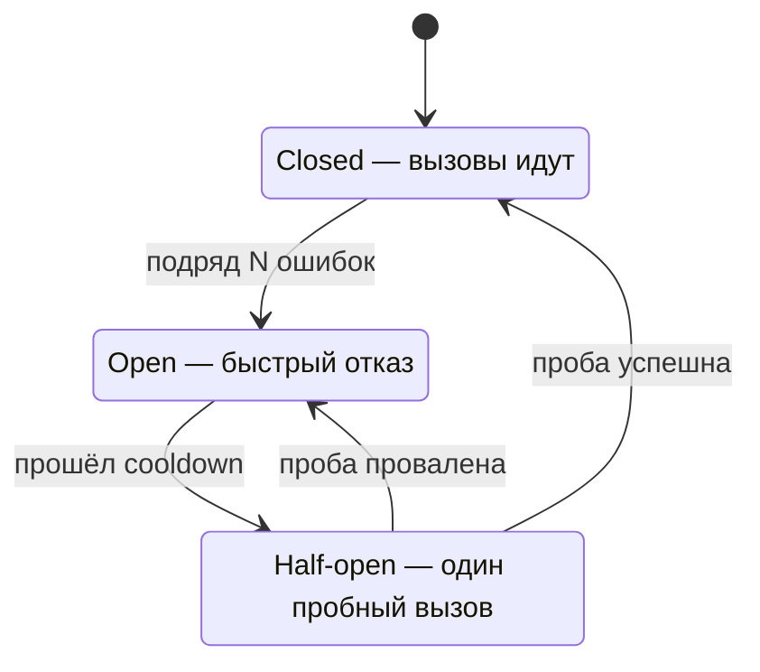
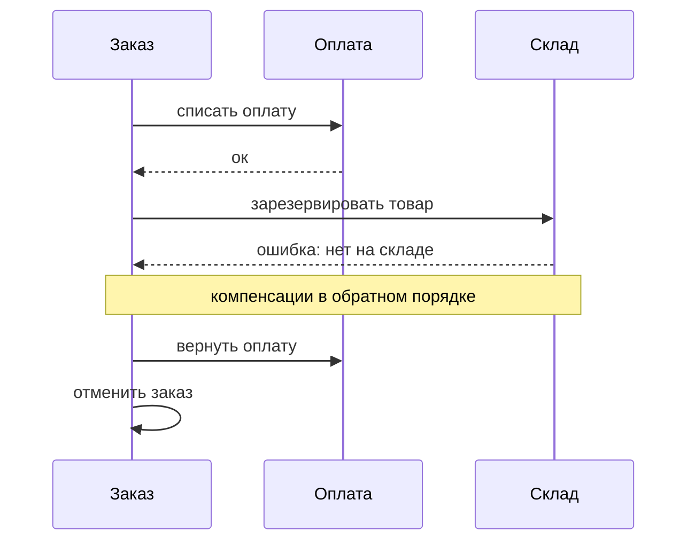

# Глава 17. Проектирование систем: масштабирование, надёжность, компромиссы

**Цели главы:** научиться рассуждать о системах целиком: оценивать нагрузку, находить узкие места, выбирать между согласованностью и доступностью, проектировать для сбоев; реализовать базовые механизмы надёжности (token bucket, circuit breaker).

⏱ ~2 недели · предыдущая: [Глава 16](16-linux-cicd-deploy.md) · следующая: [Глава 18 (итоговый проект)](18-capstone.md)

> Главная книга по теме — *«Designing Data-Intensive Applications»* (Martin Kleppmann). Эта глава — карта; читайте DDIA параллельно (главы 1–3, 5–7 — приоритетно).

---

## 17.1. Мышление: требования, оценки, компромиссы

В проектировании **нет правильных ответов — есть компромиссы**. Любое решение что-то улучшает и что-то ухудшает: скорость vs согласованность, простота vs гибкость, цена vs надёжность.

**Порядок работы над любой системой:**

1. **Функциональные требования** — что система делает (сократить ссылку, перейти по ней, статистика кликов).
2. **Нефункциональные** — масштаб (пользователи, RPS, объём данных), латентность (p95), доступность (99,9%?), надёжность данных (можно ли потерять?), согласованность, стоимость.
3. **Оценка нагрузки** (*back-of-the-envelope*) — порядки величин, чтобы понять, **нужна ли вообще сложность**.
4. **API и модель данных.**
5. **Верхнеуровневая схема** → **глубокие места** (узкие места, сбои) → **компромиссы** и что будете делать при росте.

### Порядки величин (запомните шкалу)

| Операция | Примерное время |
|---|---|
| Обращение к памяти (RAM) | ~100 нс |
| Чтение с SSD (случайное) | ~100 мкс |
| Круг по сети внутри одного дата-центра | ~0,5 мс |
| Запрос к хорошо настроенной БД по индексу | 1–5 мс |
| Диск HDD, поиск | ~10 мс |
| Круг между континентами | 100–150 мс |

Следствия: память быстрее диска в тысячи раз; сеть — главный «налог» (десять последовательных вызовов сервисов = десять раундов); кэш в памяти спасает.

Полезные округления: в сутках ≈ **10⁵** секунд (86 400); в месяце ≈ **2,6·10⁶**; `RPS = запросов_в_день / 86 400`; пик ≈ в 2–10 раз выше среднего.

### Пример оценки: сократитель ссылок (URL shortener)

Допущения: 100 млн новых ссылок в месяц, чтений в 100 раз больше, хранение 5 лет, запись ~500 байт.

| Что | Расчёт | Результат |
|---|---|---|
| Запись | 100 000 000 / 2 592 000 с | ≈ **39 запросов/с** |
| Чтение (×100) | 39 × 100 | ≈ **3,9 тыс/с** в среднем; пик ×10 ≈ **39 тыс/с** |
| Записей за 5 лет | 100 млн × 12 × 5 | **6 млрд** |
| Объём | 6·10⁹ × 500 Б | ≈ **3 ТБ** |
| Длина кода (base62) | 62⁶ ≈ 5,7·10¹⁰, 62⁷ ≈ 3,5·10¹² | 6 символов хватит с запасом ≈ 9×; берём **7** — с запасом |

Выводы: запись смехотворна для одной БД; **чтения** (≈ 39 тыс/с в пик) — кэшируем (горячие ссылки в Redis, ответ из памяти); 3 ТБ — это уже не «одна маленькая БД», но и не космос; шардирование понадобится не сразу. Вот так оценка **убирает ненужную сложность**.

## 17.2. Масштабирование



| Подход | Суть | Предел |
|---|---|---|
| **Вертикальное** | мощнее машина | дорого и ограничено; но **очень недооценено** — современный сервер вытягивает многое |
| **Горизонтальное** | больше машин за балансировщиком | почти неограничено, но требует **stateless** |

**Stateless-сервисы.** Любой экземпляр может обработать любой запрос, потому что состояния в процессе нет: сессии — в Redis/БД, файлы — в объектном хранилище, очереди — вне процесса. Это условие горизонтального масштабирования и безболезненных рестартов (глава 16).

**Где обычно «упирается» система (по порядку):**

1. **Запросы к БД** (N+1, нет индексов) → исправить запросы и индексы (глава 7). 90% проблем.
2. **Пул соединений** БД / `max_connections` → пул, PgBouncer (глава 8).
3. **Чтения** → кэш (глава 13), **read replicas** (реплики для чтения).
4. **Тяжёлая работа в запросе** → очереди и воркеры (глава 13).
5. **Запись одной БД** → вертикальный рост, пакетная запись, партиционирование, и только потом **шардирование**.
6. Статика и медиа → **CDN**.

### Масштабирование БД

- **Реплики чтения:** primary принимает запись, реплики — чтение. Цена: **лаг репликации** — только что записанное может быть не видно на реплике. Решение «прочитай свою запись»: после записи пользователь некоторое время читает с primary.
- **Партиционирование** (внутри одной БД): большая таблица разбита по диапазону/хешу (например, по месяцу) — быстрее запросы и удаление старых данных (`DROP PARTITION`).
- **Шардирование** (по нескольким БД): данные делятся по **ключу шарда** (`user_id`). Плюс — рост записи и объёма; минус — **сложность**: запросы через шарды, транзакции между шардами, перебалансировка, «горячие» ключи. Откладывайте до последнего.
- **Consistent hashing** — способ раскладывать ключи по узлам так, чтобы при добавлении/удалении узла переезжала лишь малая доля ключей (узлы и ключи — на «кольце» хешей; для ровности используют виртуальные узлы). Применяется в кэшах и шардированных хранилищах.

## 17.3. Согласованность и теорема CAP

В распределённой системе **сетевые разрывы неизбежны** (Partition). **CAP:** при разрыве вы выбираете между **согласованностью** (Consistency: все видят одни данные — можно отказать в ответе) и **доступностью** (Availability: всегда отвечаем, возможно устаревшим). Более полная модель **PACELC**: даже без разрывов — компромисс между латентностью и согласованностью.

| Модель | Гарантия | Где встретите |
|---|---|---|
| **Сильная** (linearizable) | как будто одна копия данных | одиночная БД, `SELECT … FOR UPDATE`, etcd |
| **Eventual** (в конечном счёте) | реплики сойдутся, но не сразу | реплики, кэши, Redis-репликация, DNS |
| **Read-your-writes** | вы видите свои записи | реплики с «липкостью» к primary |
| **Monotonic reads** | не откатываетесь назад во времени | |

**Практика:** внутри одной транзакции БД вы получаете сильную согласованность. Каждый кэш, реплика, очередь и микросервис добавляет «eventual»-кусок: проектируйте UX и API с его учётом (оптимистичное обновление UI на фронтенде — того же рода идея).

## 17.4. Надёжность: сбои — норма

**Всё, что может сломаться, сломается:** сеть теряет пакеты, зависимости тормозят, диски заполняются, деплой ошибается. Задача — чтобы сбой одной части **не превращался в каскад**.

| Механизм | Что делает |
|---|---|
| **Таймауты** везде | никогда не ждать вечно: HTTP-клиент, БД, очередь (`context`, главы 5–8) |
| **Ретраи** | только для **идемпотентных** операций; backoff + jitter; ограниченное число попыток |
| **Идемпотентность** | повтор безопасен (ключ идемпотентности, глава 6) |
| **Circuit breaker** | если зависимость «лежит», перестать её дёргать — не добивать и не копить ожидание |
| **Bulkhead** (переборки) | отдельные пулы/лимиты на разные зависимости, чтобы одна не съела все ресурсы |
| **Rate limiting / load shedding** | отбрасывать лишнее, сохраняя работоспособность для остальных (`429`/`503`) |
| **Backpressure** | сообщать производителю «медленнее» (ограниченные очереди и каналы) |
| **Graceful degradation** | отдать урезанный ответ (без рекомендаций), а не ошибку |
| **Избыточность и failover** | несколько экземпляров, реплики БД, зоны доступности |
| **Бэкапы и RTO/RPO** | RPO — сколько данных можно потерять; RTO — как быстро восстановиться |

> **Шторм ретраев (retry storm).** Сервис замедлился → клиенты таймаутятся и **повторяют сразу** → нагрузка растёт ещё сильнее → он падает окончательно. Лечение: экспоненциальная задержка **с jitter**, лимит попыток, circuit breaker, и ретраи **только на одном уровне** стека (иначе они перемножаются: 3 ретрая на каждом из 3 уровней = 27 вызовов).

### Алгоритмы ограничения частоты

| Алгоритм | Идея | Особенности |
|---|---|---|
| Fixed window | счётчик за окно | просто, но «двойной» всплеск на стыке окон |
| Sliding window | учёт запросов за последние N секунд | точнее, дороже |
| **Token bucket** | ведро с токенами пополняется с постоянной скоростью; запрос забирает токен | **допускает всплеск до размера ведра**, затем держит среднюю скорость; самый распространённый |
| Leaky bucket | очередь, вытекающая с постоянной скоростью | сглаживает трафик |

### Реализация: token bucket и circuit breaker с управляемым временем



Оба механизма принимают **функцию времени** — как в главе 12: тесты (и этот пример) «перематывают» часы без `Sleep`.

```go
package main

import (
	"errors"
	"fmt"
	"sync"
	"time"
)

type Clock func() time.Time

// ---------------- Token bucket ----------------

type TokenBucket struct {
	mu       sync.Mutex
	capacity float64 // размер ведра = максимальный всплеск
	rate     float64 // токенов в секунду
	tokens   float64
	last     time.Time
	now      Clock
}

func NewTokenBucket(capacity, ratePerSec float64, now Clock) *TokenBucket {
	return &TokenBucket{capacity: capacity, rate: ratePerSec, tokens: capacity, last: now(), now: now}
}

func (b *TokenBucket) Allow() bool {
	b.mu.Lock()
	defer b.mu.Unlock()
	t := b.now()
	b.tokens = min(b.capacity, b.tokens+t.Sub(b.last).Seconds()*b.rate) // «долить» накопленное
	b.last = t
	if b.tokens >= 1 {
		b.tokens--
		return true
	}
	return false
}

// ---------------- Circuit breaker ----------------

type State int

const (
	Closed   State = iota // всё хорошо, вызовы идут
	Open                  // зависимость «лежит», вызовы отклоняются сразу
	HalfOpen              // пробный вызов: если успешен — закрываемся, иначе снова открываемся
)

func (s State) String() string { return [...]string{"closed", "open", "half-open"}[s] }

var ErrOpen = errors.New("circuit breaker is open")

type Breaker struct {
	mu        sync.Mutex
	state     State
	failures  int
	threshold int           // подряд идущих ошибок до размыкания
	cooldown  time.Duration // сколько ждать перед пробой
	openedAt  time.Time
	now       Clock
}

func NewBreaker(threshold int, cooldown time.Duration, now Clock) *Breaker {
	return &Breaker{threshold: threshold, cooldown: cooldown, now: now}
}

func (b *Breaker) State() State {
	b.mu.Lock()
	defer b.mu.Unlock()
	return b.state
}

func (b *Breaker) Do(fn func() error) error {
	if err := b.before(); err != nil {
		return err // быстрый отказ без обращения к зависимости
	}
	err := fn()
	b.after(err)
	return err
}

func (b *Breaker) before() error {
	b.mu.Lock()
	defer b.mu.Unlock()
	switch b.state {
	case Open:
		if b.now().Sub(b.openedAt) < b.cooldown {
			return ErrOpen
		}
		b.state = HalfOpen // кулдаун прошёл: пропускаем ОДИН пробный вызов
	case HalfOpen:
		return ErrOpen // проба уже идёт — остальные ждут её результата
	}
	return nil
}

func (b *Breaker) after(err error) {
	b.mu.Lock()
	defer b.mu.Unlock()
	if err == nil {
		b.failures = 0
		b.state = Closed
		return
	}
	b.failures++
	if b.state == HalfOpen || b.failures >= b.threshold {
		b.state = Open
		b.openedAt = b.now()
	}
}

func main() {
	now := time.Date(2026, 1, 1, 0, 0, 0, 0, time.UTC)
	clock := func() time.Time { return now }

	// --- token bucket: всплеск 3, затем 1 запрос/с ---
	tb := NewTokenBucket(3, 1, clock)
	fmt.Print("всплеск из 5 запросов: ")
	for i := 0; i < 5; i++ {
		fmt.Print(tb.Allow(), " ")
	}
	now = now.Add(2 * time.Second) // «прошло 2 секунды»
	fmt.Println("\nчерез 2 с:", tb.Allow(), tb.Allow(), tb.Allow())

	// --- circuit breaker: 3 ошибки → open; через кулдаун — проба ---
	br := NewBreaker(3, 10*time.Second, clock)
	fail := func() error { return errors.New("upstream down") }
	ok := func() error { return nil }

	for i := 1; i <= 5; i++ {
		err := br.Do(fail)
		fmt.Printf("вызов %d: err=%q state=%s\n", i, err, br.State())
	}
	now = now.Add(11 * time.Second)
	fmt.Println("после кулдауна, успешная проба:", br.Do(ok), br.State())
}
```

Реальный вывод:

```
всплеск из 5 запросов: true true true false false 
через 2 с: true true false
вызов 1: err="upstream down" state=closed
вызов 2: err="upstream down" state=closed
вызов 3: err="upstream down" state=open
вызов 4: err="circuit breaker is open" state=open
вызов 5: err="circuit breaker is open" state=open
после кулдауна, успешная проба: <nil> closed
```

Видно главное: после трёх сбоев вызовы 4 и 5 **даже не доходят до зависимости** (быстрый отказ вместо ожидания таймаута), а после паузы пробный вызов возвращает систему в нормальный режим.

<!-- viz:TokenBucketViz -->

<!-- viz:BreakerViz -->

## 17.5. Данные и транзакции в распределённой системе



- **Распределённых ACID-транзакций «бесплатно» нет.** 2PC (двухфазный коммит) существует, но хрупок и медлен; в микросервисах от него обычно уходят.
- **Сага:** длинная операция = последовательность локальных транзакций, у каждой — **компенсирующее действие** на случай сбоя дальше.

```
Заказ создан → Оплата списана → Склад зарезервирован → Доставка назначена
   сбой на «Склад» → компенсации: вернуть оплату → отменить заказ
```

  Бывают **оркестрируемые** (один координатор ведёт шаги) и **хореографические** (сервисы реагируют на события друг друга). Компенсации сами должны быть идемпотентными и повторяемыми.
- **Transactional outbox** (глава 13) — надёжная публикация событий; **идемпотентные потребители** — безопасная повторная доставка.
- **Идентификаторы:** автоинкремент (просто, но раскрывает объём, плохо шардируется); **UUID** (v4 случайный → плохая локальность индекса; **v7** упорядочен по времени — лучше для B-tree); *snowflake*-ID (время + узел + счётчик).
- **Время.** Не доверяйте системным часам разных машин: они расходятся. Для порядка событий — монотонные счётчики БД, номера версий, логические часы; `time.Now()` — для человека и сроков, не для арбитража «кто первый».

## 17.6. Монолит и микросервисы

| | Монолит (модульный) | Микросервисы |
|---|---|---|
| Развёртывание | одно | много независимых |
| Согласованность | транзакции БД | саги, eventual |
| Отладка | один процесс, один стек | распределённая трассировка обязательна (глава 15) |
| Команды | одна/несколько | независимые команды, независимые релизы |
| Накладные расходы | мало | сетевые вызовы, версионирование API, деплой ×N, мониторинг ×N |

**Правило:** микросервисы решают **организационные** проблемы (много команд) и очень специфичные **масштабные** (разные профили нагрузки). Они **создают** технические проблемы. Начинайте с **модульного монолита**, границы модулей делайте как будущие границы сервисов, выделяйте — когда боль реальна. Антипаттерн: «распределённый монолит» (сервисы, которые нельзя выкатить независимо) и общая БД на несколько сервисов.

Сопутствующие понятия: **API Gateway** (единая входная точка, авторизация, лимиты), **BFF** (бэкенд под конкретный фронтенд), **service discovery** (как сервисы находят друг друга — DNS/Kubernetes Service), **service mesh** (sidecar-прокси для сетевых функций — тяжёлая вещь, нужна редко).

## 17.7. Координация и консенсус — кратко

Когда нескольким узлам нужно **договориться** (кто лидер, какой порядок записей), используют алгоритмы консенсуса (**Raft**, Paxos). На практике вы **не пишете их**, а берёте готовое: etcd/ZooKeeper/Consul, встроенные в БД и Kubernetes. Для «только один экземпляр делает X» чаще хватает **блокировки в вашей БД** (`SELECT … FOR UPDATE`, advisory lock) или аренды (lease) в Kubernetes.

## 17.8. Типовые задачи проектирования

Шаблон ответа для любой:

```
1. Требования (функциональные + нефункциональные) и допущения
2. Оценка: RPS, объём, пропускная способность
3. API (эндпоинты, ключевые поля)
4. Модель данных и выбор хранилища (почему)
5. Верхнеуровневая схема (блоки и стрелки)
6. Глубокие места: узкое место, сбои, согласованность, безопасность
7. Масштабирование: что сломается при ×10 и ×100, что будете делать
8. Компромиссы и что осознанно не сделали
```

Классика для тренировки: **сократитель ссылок**, **ограничитель частоты**, **чат**, **лента новостей**, **сервис уведомлений**, **загрузка и раздача файлов**, **поиск с автодополнением**, **распределённый ID-генератор**.

---

## Задачи

1. 🟡 **Оценки на бумаге.** Для каждой системы — RPS (средний и пик), объём данных за год, нужна ли шардированность, что кэшировать: (а) лента на 10 млн активных пользователей; (б) сервис аналитики кликов на 1 млрд событий в сутки; (в) чат на 1 млн одновременных соединений. Запишите допущения.
2. 🔴 **Полный дизайн: сократитель ссылок.** По шаблону 17.8: API, схема БД (`links(code, url, created_at, expires_at, user_id)`), генерация кодов без коллизий (счётчик + base62 vs хеш vs случайный; сравните), кэш чтений, обработка `301` против `302` (и почему аналитика), аналитика кликов (асинхронно через очередь), защита от абьюза, масштабирование ×100. Нарисуйте схему (Mermaid/draw.io).
3. 🔴 **Ещё два дизайна.** Выберите из: ограничитель частоты как отдельный сервис, сервис уведомлений (email/push/SMS с повторами и приоритетами), лента новостей (fan-out on write vs on read). Каждый — по шаблону; попросите коллегу/друга/модель найти слабые места и ответьте на критику.
4. 🟡 **Token bucket и breaker — доведите до продакшена.** Возьмите код из 17.4: напишите table-driven тесты на управляемых часах (граничные случаи: ёмкость, медленное пополнение, `HalfOpen` с проваленной пробой, параллельные вызовы `-race`). Подключите `TokenBucket` как HTTP-middleware (по IP, `429` + `Retry-After`), а `Breaker` — вокруг исходящего HTTP-клиента к «ненадёжному» сервису.
5. 🟡 **Эксперимент: шторм ретраев.** Сервер-имитация (`httptest`) тормозит/падает в течение 5 с. 100 клиентов: (а) ретраят сразу, без пауз; (б) backoff + jitter; (в) backoff + jitter + circuit breaker. Для каждого измерьте суммарное число запросов к серверу и время восстановления. Постройте таблицу и сделайте вывод.
6. 🟡 **Хаос-эксперимент.** В Compose-стеке остановите контейнер БД под нагрузкой (`docker compose stop db`). Что происходит: с запросами, `readyz`, логами, метриками? Сколько времени сервис восстанавливается после старта БД? Добавьте таймауты и деградацию (`503` с понятным сообщением, а не зависание) и повторите. Результаты — в `chaos-report.md`.
7. 🔴 **Сага.** Заказ → оплата → резерв склада → доставка (три «сервиса» в одном процессе с интерфейсами). Реализуйте оркестрируемую сагу с компенсациями; смоделируйте сбой на каждом шаге и повторную доставку сообщений; тестами докажите инвариант «никогда не остаётся списанная оплата без заказа и зарезервированный склад без оплаты».
8. 🔴 **Consistent hashing.** Реализуйте кольцо с виртуальными узлами (`AddNode`, `RemoveNode`, `Get(key)`). Измерьте: равномерность распределения 1 млн ключей по 5 узлам при 1/50/200 виртуальных узлах; долю переехавших ключей при добавлении шестого узла (ожидание ≈ 1/6) — и сравните с наивным `hash(key) % N`.
9. 🟡 **«Прочитай свою запись».** Смоделируйте primary + реплику с задержкой 200 мс (две in-memory структуры). Покажите баг (пользователь не видит только что созданную задачу), затем исправьте: после записи читать с primary N секунд (или по версии). Оцените цену решения.
10. 🟡 **Что сломается при ×10?** Для вашего итогового проекта (глава 18) составьте таблицу: компонент → при каком RPS/объёме станет узким местом → как поймёте (метрика) → что сделаете. Это основа раздела «Масштабирование» в вашем дизайн-документе.

## Самопроверка

- Как оценить RPS и объём «на салфетке»? Какие порядки величин нужно помнить?
- Что такое stateless-сервис и почему он обязателен для горизонтального масштабирования?
- Что даёт кэш, реплика, шардирование — и какие проблемы приносят?
- Объясните CAP и PACELC своими словами. Приведите пример eventual consistency в вашем проекте.
- Что такое шторм ретраев? Как его избежать?
- Как работает token bucket? Чем он отличается от fixed window?
- Какие у circuit breaker состояния и переходы?
- Что такое сага и компенсация? Почему нет «дешёвого» распределённого коммита?
- Когда монолит лучше микросервисов? Что такое «распределённый монолит»?
- Зачем нужен consistent hashing?

➡️ Дальше: [Глава 18. Итоговый проект «Tasker»](18-capstone.md)
