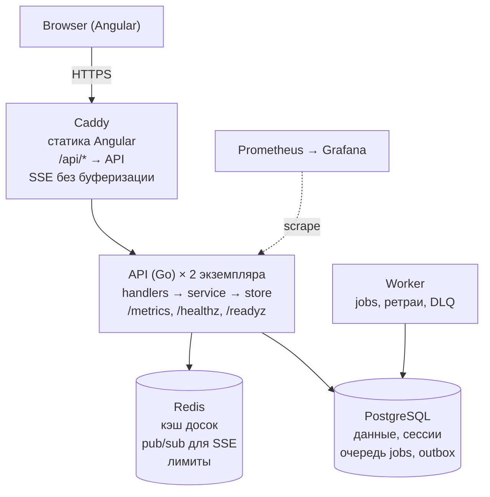
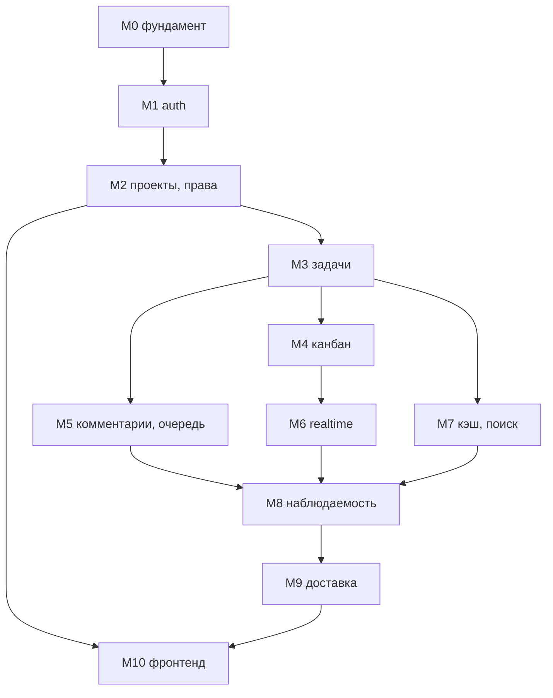

# Глава 18. Итоговый проект «Tasker» и что дальше

**Цель:** собрать всё изученное в одном настоящем продукте — командном трекере задач (канбан-доска) с **Go-бэкендом и вашим Angular-фронтендом**, задеплоенном на сервер с HTTPS, тестами, мониторингом и CI/CD. Это ваше портфолио и главный экзамен.

⏱ 3–4 недели · предыдущая: [Глава 17](17-system-design.md) · дальше — ваша карьера 🚀

---

## 18.1. Продукт

**Tasker** — «мини-Trello»: пользователи объединяются в проекты, ведут задачи на доске (`todo → doing → done`), комментируют, получают уведомления, видят изменения коллег **в реальном времени**.

**Пользовательские истории (must-have):**

1. Я регистрируюсь, вхожу и выхожу; мои данные защищены.
2. Я создаю проект и приглашаю участников по email.
3. Я создаю задачи, назначаю исполнителя, срок, метки.
4. Я перетаскиваю задачу между колонками; порядок внутри колонки сохраняется.
5. Я фильтрую и ищу задачи (статус, исполнитель, текст).
6. Я комментирую задачи.
7. Коллеги видят мои изменения без перезагрузки страницы.
8. Исполнитель получает уведомление (email-имитация), если его назначили.
9. Чужие проекты и задачи мне **не видны и недоступны** (проверено тестами).

## 18.2. Архитектура



Worker может быть тем же бинарником с другой командой запуска (`tasker worker`).

## 18.3. Модель данных (отправная точка)

```
users(id, email UNIQUE(lower), name, password_hash, created_at)
sessions(token_hash PK, user_id → users, expires_at)

projects(id, owner_id → users, name, created_at)
project_members(project_id → projects, user_id → users, role[owner|member|viewer], PK(project_id,user_id))

tasks(id, project_id → projects, title, description, status[todo|doing|done],
      position numeric, assignee_id → users NULL, due_date NULL,
      version int, created_at, updated_at, deleted_at NULL)
labels(id, project_id, name, color)          task_labels(task_id, label_id, PK(task_id,label_id))
comments(id, task_id, author_id, body, created_at)

jobs(id, kind, payload jsonb, status, attempts, run_at, ...)       -- очередь (глава 13)
outbox(id, topic, payload jsonb, created_at, published_at NULL)    -- опционально
processed_messages(message_id PK)                                   -- идемпотентность потребителей
```

Индексы продумайте под запросы: `tasks (project_id, status, position)`, `tasks (assignee_id) WHERE deleted_at IS NULL`, `project_members (user_id)`, GIN по `tsvector` для поиска. Ограничения БД — обязательны (`CHECK`, `FOREIGN KEY`, `UNIQUE`).

**Порядок на доске.** Вам нужно вставлять карточку «между двумя соседями» без пересчёта всех. Варианты: **дробные позиции** (`position = (prev + next) / 2`, периодически ребалансировать), «разреженные» целые (шаг 1000), строковые ключи LexoRank/fractional indexing. Выберите, обоснуйте в ADR, покройте тестом конкурентных перемещений.

## 18.4. API (контракт — в OpenAPI до кода)

| Группа | Методы |
|---|---|
| Auth | `POST /auth/register`, `POST /auth/login`, `POST /auth/logout`, `GET /me` |
| Проекты | `GET /projects`, `POST /projects`, `GET/PATCH/DELETE /projects/{id}`, `POST /projects/{id}/members`, `DELETE /projects/{id}/members/{userId}` |
| Задачи | `GET /projects/{id}/tasks?status=&assignee=&q=&limit=&cursor=`, `POST /projects/{id}/tasks`, `GET/PATCH/DELETE /tasks/{id}`, `POST /tasks/{id}/move` (`status`, `before_id`/`after_id`) |
| Комментарии | `GET /tasks/{id}/comments`, `POST /tasks/{id}/comments` |
| Realtime | `GET /projects/{id}/events` (SSE) |
| Служебные | `GET /healthz`, `GET /readyz`, `GET /version`, `GET /openapi.yaml`, `GET /docs`; `/metrics` — на служебном порту |

Единый формат ошибок (Problem Details), идемпотентность `POST` через `Idempotency-Key`, `ETag`/`If-Match` для `PATCH`, ограничение размера тела, лимиты запросов на вход.

## 18.5. Этапы (milestones)



Каждый этап заканчивается **работающим вертикальным срезом**: миграция → код → тесты → OpenAPI → (если нужно) UI. Мёржите в `main` через PR с зелёным CI — даже если вы один.

| # | Этап | Что сделать | Опора |
|---|---|---|---|
| **M0** | Фундамент | репозиторий, модуль, структура `cmd/internal`, конфиг из окружения (fail fast), `slog`, `Makefile`, Docker Compose с Postgres, CI: `vet` + `lint` + `test` | гл. 4, 9, 11, 16 |
| **M1** | Аутентификация | регистрация/вход/выход/`/me`, bcrypt, сессии в Postgres (cookie `HttpOnly; Secure; SameSite`), CSRF-защита, лимит попыток входа, тесты (включая одинаковые ответы на неверный email/пароль) | гл. 8, 10 |
| **M2** | Проекты и права | CRUD проектов, участники и роли, **проверка членства на каждом запросе на уровне SQL**, набор IDOR-тестов (пользователь B → проект A → 404) | гл. 10, 11 |
| **M3** | Задачи | CRUD, фильтры, **keyset-пагинация**, `version`+`ETag`/`If-Match` (`412` при конфликте), валидация, мягкое удаление | гл. 6, 7, 8 |
| **M4** | Канбан | `move` с позиционированием в **транзакции**; тест: 50 одновременных перемещений не ломают порядок и не теряют карточки | гл. 7, 8, 5 |
| **M5** | Комментарии и уведомления | комментарии; назначение исполнителя создаёт `job` **в той же транзакции**; воркер (`SKIP LOCKED`) «шлёт письмо» с ретраями, backoff, DLQ, **идемпотентно** | гл. 13 |
| **M6** | Realtime | SSE по проекту; события доставляются через Redis Pub/Sub, поэтому работают **при двух экземплярах API**; нет утечек горутин при обрыве | гл. 5, 13 |
| **M7** | Кэш и поиск | кэш доски в Redis (cache-aside + `singleflight` + инвалидация); полнотекстовый поиск Postgres (`tsvector` + GIN) | гл. 7, 13 |
| **M8** | Наблюдаемость | метрики RED + бизнес-метрики, `/healthz`/`/readyz`, `request_id` в логах, дашборд Grafana, нагрузочный тест k6 с отчётом (p95/p99, точка перелома) | гл. 15 |
| **M9** | Доставка | multi-stage Docker, Compose для прода, Caddy + **HTTPS на настоящем сервере**, CD по тегу, откат, **бэкап + проверенное восстановление**, `RUNBOOK.md` | гл. 9, 16 |
| **M10** | Фронтенд | Angular: вход, список проектов, доска с drag-and-drop (CDK), фильтры, SSE-обновления, обработка ошибок и `401`; **типы из `openapi.yaml`** | гл. 6, 10, 14 |

## 18.6. Нефункциональные требования (критерии зрелости)

| Область | Требование |
|---|---|
| Производительность | `GET /projects/{id}/tasks` — **p95 < 100 мс** при 200 RPS на 2 vCPU и 100 000 задач (докажите отчётом k6); пул БД подобран измерением |
| Надёжность | деплой **без потерянных запросов** (graceful shutdown + readiness); падение Redis не роняет API (деградация) |
| Безопасность | нет IDOR (тесты), пароли — bcrypt/argon2id, секреты не в репозитории, `govulncheck` чист, заголовки безопасности, лимиты на входы |
| Данные | миграции обратимы и применяются с нуля в CI; ограничения целостности в БД; индексы подтверждены `EXPLAIN` |
| Качество | покрытие сервисного слоя ≥ 70% осмысленными тестами; интеграционные тесты репозиториев; тесты проходят с `-race` |
| Наблюдаемость | структурные логи, метрики, дашборд, хотя бы один осмысленный алерт |
| Контракт | **100% эндпоинтов описаны в OpenAPI**, спецификация проверяется в CI (контрактные тесты) |
| Документация | README (запуск за 3 команды), ADR (≥ 5), схема архитектуры, runbook |

## 18.7. Чек-лист «готов к продакшену»

- [ ] `docker compose up` на чистой машине поднимает весь стек; `.env.example` есть, секретов в Git нет
- [ ] Все таймауты заданы (HTTP-сервер, клиент, БД, Redis); все запросы принимают `context`
- [ ] Graceful shutdown; `readyz` реально проверяет зависимости
- [ ] Каждый маршрут проверяет **владельца/членство**; есть тесты на чужие данные
- [ ] Повторная доставка job и повторный `POST` безвредны (идемпотентность)
- [ ] Метрики имеют низкую кардинальность (нет `user_id`/сырых путей в метках)
- [ ] pprof и `/metrics` недоступны снаружи
- [ ] Бэкап есть, **восстановление проверено**, RTO/RPO записаны
- [ ] Откат на предыдущую версию выполнен вручную хотя бы раз и занимает минуты
- [ ] CI блокирует слияние красного кода; зависимости обновляются
- [ ] Логи не содержат паролей, токенов, персональных данных
- [ ] Нагрузочный отчёт приложен; известны первое и второе узкие места

## 18.8. Что сдавать (даже если вы один)

1. Репозиторий с историей осмысленных коммитов и PR по этапам.
2. `README.md`: что это, архитектура, как запустить, как тестировать, ссылки на задеплоенный стенд.
3. `docs/`: `openapi.yaml`, ADR, схема архитектуры, модель данных, `RUNBOOK.md`, отчёт о нагрузочном тестировании, отчёт о хаос-эксперименте (глава 17).
4. Работающий стенд по HTTPS и дашборд.
5. Короткое **ретро**: что получилось, что было сложнее всего, какие три решения вы бы приняли иначе, что сломается при ×10 нагрузки.

## 18.9. Усложнения (на выбор)

- Вход через GitHub/Google (OIDC, PKCE, BFF — глава 10).
- Вложения: загрузка файлов в S3/MinIO через pre-signed URL.
- Внутренний сервис уведомлений на **gRPC** (глава 14) вместо вызова по очереди.
- Мультиарендность: организации, изоляция данных (row-level security в Postgres).
- Журнал активности (audit log) и «отмена» через event sourcing-подход.
- WebSocket-присутствие («кто сейчас на доске»).
- Деплой в Kubernetes (`kind` → управляемый кластер), HPA.
- Трейсинг OpenTelemetry сквозь API → БД → worker.
- Rate limiting в Redis со скользящим окном и метриками.
- Шардирование/партиционирование `comments` по времени.

## 18.10. Рубрика самооценки

| Уровень | Критерии |
|---|---|
| 🥉 **Бронза** | M0–M4 работают, тесты зелёные, деплой на сервер, README |
| 🥈 **Серебро** | + M5–M8: очередь, realtime, кэш, метрики, дашборд, нагрузочный отчёт, нет IDOR |
| 🥇 **Золото** | + M9–M10: CI/CD, HTTPS, бэкап с проверенным восстановлением, откат, фронтенд с типами из OpenAPI, 2 экземпляра API, хаос-эксперимент и ретро |

---

## 18.11. Что дальше

### Углубление в Go

- **Рантайм:** планировщик (G-M-P), сборщик мусора, escape analysis, модель памяти. Материалы: блог go.dev, доклады Go team, «Go Memory Model».
- **Читайте стандартную библиотеку:** `net/http`, `sync`, `context`, `database/sql` — лучшие образцы идиоматичного Go.
- **Рефлексия, `unsafe`, `cgo`** — по необходимости, осторожно.
- **Книги:** «100 Go Mistakes» (Harsanyi), «Concurrency in Go» (Cox-Buday), «Learning Go» (Bodner), «Let's Go Further» (Edwards).

### Углубление в бэкенд

- **«Designing Data-Intensive Applications»** — прочесть целиком.
- PostgreSQL изнутри: планировщик, MVCC, WAL, репликация (книга «PostgreSQL Internals», документация).
- Распределённые системы: Raft, события и CQRS, паттерны Saga/Outbox, Kafka.
- Безопасность: OWASP ASVS, практика на PortSwigger Web Security Academy.
- Kubernetes и облако: сертификация CKA/CKAD — по желанию; Terraform.

### Практика и опыт

- Участвуйте в open source: начните с документации и `good first issue` в проектах экосистемы (`chi`, `pgx`, `sqlc`, `prometheus/client_golang`, `go-redis`).
- Пишите **design docs** и ADR; делайте **код-ревью** чужого кода — это ускоряет рост сильнее всего.
- Деплойте и **эксплуатируйте** свои проекты месяцами: дежурство за собственным сервисом многому учит.
- Ведите блог/заметки: объяснить — значит понять.

### Подготовка к собеседованию на Go-бэкенд

| Блок | Что должны уметь объяснить и показать |
|---|---|
| **Go** | слайсы и мапы (внутреннее устройство, `len`/`cap`, алиасинг), интерфейсы и ловушка `nil`-интерфейса, ошибки (`Is`/`As`/`%w`), `defer`, горутины/каналы/`select`/`context`/`sync`, гонки и `-race`, GC и escape analysis, дженерики, тестирование |
| **Конкурентность (практика)** | воркер-пул, pipeline, graceful shutdown, ограничитель частоты, найти утечку горутин в коде |
| **БД** | индексы, `EXPLAIN`, транзакции и уровни изоляции, N+1, блокировки, миграции без простоя, запрос с оконной функцией |
| **Сеть и HTTP** | жизненный цикл запроса, TLS, CORS, кэширование, идемпотентность, коды статусов |
| **Архитектура и system design** | слои и DI, кэш/очередь/репликация, CAP, retries/circuit breaker, saga/outbox, оценка нагрузки |
| **Практика** | спроектировать REST API, написать SQL, отревьюить фрагмент кода с багами, разобрать «упал прод» по метрикам |
| **Ваш проект** | вы должны **обосновать каждое решение** в Tasker и сказать, что сломается при ×10 |

Типичные «живые» задания: LRU-кэш (вы делали), rate limiter, worker pool, обход/обработка потока данных, парсер, concurrent-safe структура, дебаг гонки.

---

## Финальная самопроверка

- Можете ли вы за 5 минут нарисовать архитектуру Tasker и проследить запрос от клика до записи в БД и обратно, называя все слои, ошибки, таймауты и метрики по пути?
- Что произойдёт, если во время деплоя упадёт Redis? БД? Один из двух экземпляров API?
- Как вы докажете, что пользователь B не получит данные пользователя A?
- Как восстановите данные, если таблицу удалили час назад?
- Сколько запросов в секунду выдержит система и что станет узким местом первым?

Если на все пять вопросов у вас есть **уверенный и подтверждённый ответ** — вы бэкенд-разработчик. Добро пожаловать. 🎉

📎 Под рукой: [cheatsheet.md](cheatsheet.md) · [README](README.md)
